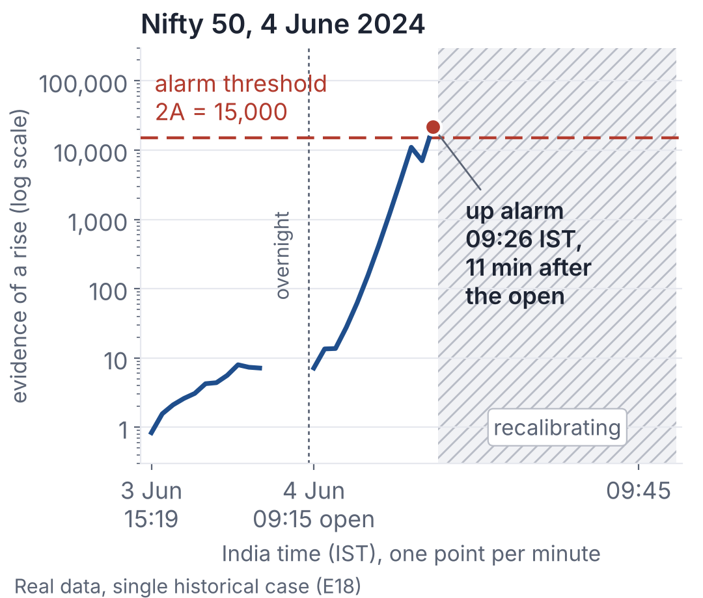
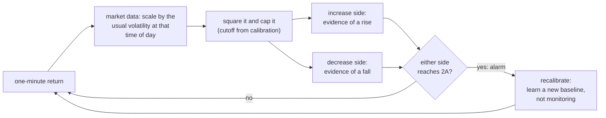

# Anytime-Valid Volatility Monitor

[](https://github.com/ShockXR/Anytime-Valid-Volatility-Monitor/actions/workflows/tests.yml)

[](LICENSE)


**Can a monitor tell when volatility has shifted while a stream of one-minute returns is still arriving?**

Sudeep R. Bapat's work on quarticity ([Bapat 2026, *International Review of Economics and Finance*](https://doi.org/10.1016/j.iref.2026.105482)) uses a robust threshold to limit the influence of price jumps. This prototype takes that clipping idea into a different task. It squares each one-minute return and caps it at a cutoff set during calibration, so a single extreme return can contribute only so much. Two e-detectors, the framework of Shin, Ramdas and Rinaldo (2024), then accumulate evidence as each return arrives that the average of this capped quantity has shifted up or down. The experiments ask how quickly an alarm can fire for a specified false-alarm budget, and what happens when the monitor has to learn its baseline from data.

The estimator is Bapat's and the detection framework is Shin, Ramdas and Rinaldo's; the combination, implementation, calibration comparisons and market replays are this project's. Research prototype by Shreyan Thanki, November 2026, built with extensive AI assistance ([how](#how-this-was-built)).

<p align="center"><a href="docs/figures/nifty_2024-06-04_alarm.png"></a></p>

**On 4 June 2024 the monitor raised an up alarm at 09:26 IST, 11 minutes after the Nifty open, then paused to recalibrate.** Real data, single historical case (experiment E18), default plug-in baseline, which the guarantee below does not cover. The evidence must reach 2A = 15,000 to raise an alarm. The 11 minutes are time since the open; the minute at which volatility itself changed cannot be observed. A [two-panel version](docs/figures/nifty_2024-06-04_alarm_detail.png) adds each minute's capped return. Inspect the run in the executed [notebook](notebooks/demo.ipynb), or download [docs/demo/replay.html](docs/demo/replay.html) and open it in a browser for a minute-by-minute replay.

<details>
<summary><b>How the monitor works, in one diagram</b></summary>



</details>

## What the experiments show

**1. A false-alarm guarantee, and exactly what it covers** [theory]. Suppose the baseline is known and, at every monitored minute, the expected capped squared return given the past equals that baseline. Then the chance of any false alarm in the first m monitored steps after a fresh start is at most m/A. With m one 390-minute day and A = 7,800, that is 5%. The default monitor instead estimates its baseline from a calibration window (the plug-in baseline), which can exceed that bound and has no corresponding general guarantee. Daily restarts and a confidence-sequence baseline each carry their own bound and conditions. Proofs: [docs/math.md](docs/math.md) (sections 5 and 6) and [docs/theory_per_period.md](docs/theory_per_period.md).

**2. Where jumps break classical detectors, the capped monitor stays inside its budget** [synthetic]. Experiment E4, returns with rare jumps: baseline estimated from 2,000 calibration steps, A = 7,800, one 390-step day, 300 paths. With no change, the monitor's increase side alarmed falsely on 2.3% of paths, against 70.7% for a Gaussian likelihood-ratio e-detector and 70.3% for Page's CUSUM calibrated on normal returns. When the standard deviation rose by half at step 500, the monitor's median delay was 36 steps. The Gaussian detector's 20 steps mean little, since 74% to 78% of its paths had already alarmed falsely. Full tables: [docs/experiment_report.md](docs/experiment_report.md#e4-detecting-changes-false-alarms-and-delay).

**3. On real markets an alarm summarises a burst that is under way; it is not a forecast** [real]. Over 27 asset-years of crypto and Nifty data, 91.4% of up alarms were followed by an hour above the calibrated level, against 74.6% of control minutes with an equally volatile previous hour; matching on the last 10 minutes as well (a later check) narrows the gap to 83.5% ([W1](reports/round4/W1/REPORT.md)). On fresh 2026 data the alarms did not improve a HAR forecast that already sees the last hour, for BTC, ETH or the Nifty 50. The contribution is the guarantee, not prediction.

A question for Prof. Bapat: **which calibration assumption would you relax first for one-minute market data?**

## See it run

**Cost to keep in mind:** after an alarm the default monitor pauses to learn a new baseline and does not watch: 750 minutes (two sessions) in the Nifty replay, 1,000 steps in the simulation below.

Browse the executed [notebooks/demo.ipynb](notebooks/demo.ipynb), or run locally (Python 3.10 or newer):

```bash
python -m venv .venv && source .venv/bin/activate   # Windows: .venv\Scripts\activate
pip install -e ".[dev]"
python -m avmonitor simulate --ratio 2
```

The simulated stream has rare jumps throughout; its standard deviation doubles at step 3000 and falls back at step 6000. You should see:

```text
[SYNTHETIC] sd x2.0 at step 3000, back to 1 at step 6000, jumps with prob 0.003 per step
alarm level A = 7800: at most 5% chance of a false alarm per 390 steps under the null
robust e-detector: [(3010, 'up'), (6098, 'down'), (8287, 'down')]
Gaussian LR      : [(1000, 'up'), (2564, 'up'), (3581, 'up'), (4779, 'up'), (6036, 'down'), (7570, 'up'), (8823, 'up')]
```

The robust monitor flags the rise after 10 steps and the fall after 98, then raises one false down alarm. The Gaussian monitor shares the threshold A, which is valid only for normal returns, and alarms seven times, twice before anything changed. The second line restates the known-baseline bound of finding 1.

## Validation and reproducibility

```bash
# software tests, no data needed
python -m pytest -q
# check every number in this README against a committed result
python scripts/trace_numbers.py --target README.md
# data hashes, tests and experiment reruns
python scripts/reproduce.py
```

The tests run on every push (GitHub Actions). Raw market data are not committed: `python scripts/download_data.py` fetches them from public sources and records their hashes ([data/README.md](data/README.md)).

**Further reading**

* The pitch as answers to ten questions: [PITCH_BAPAT.md](PITCH_BAPAT.md)
* Every experiment, with tables and caveats: [docs/experiment_report.md](docs/experiment_report.md)
* The replication of the paper's estimator tables, with questions: [docs/estimator_issues.md](docs/estimator_issues.md)
* Definitions, proofs and later-day statements: [docs/math.md](docs/math.md), [docs/theory_per_period.md](docs/theory_per_period.md) and the other `docs/theory_*.md` notes
* The fourth round of backtests: [reports/round4/ROUND4_SUMMARY.md](reports/round4/ROUND4_SUMMARY.md)
* What the results do not show: [docs/limitations.md](docs/limitations.md)
* The previous, fuller README: [README_FULL.md](README_FULL.md)

## How this was built

Shreyan Thanki directed the project. The code, experiments, proofs and write-ups were produced with extensive AI assistance (Claude, by Anthropic). The reviews in `docs/review/` were written by separate AI agents asked to act as sceptical referees, not by human experts, and **no statistician has yet checked the proofs**. The code is released under the MIT license.

## References

- Bapat, S. R. (2026). A jump and noise robust kernel based estimator of quarticity for high frequency data. *International Review of Economics and Finance*, 109, 105482. [doi:10.1016/j.iref.2026.105482](https://doi.org/10.1016/j.iref.2026.105482)
- Shin, J., Ramdas, A. and Rinaldo, A. (2024). E-detectors: a nonparametric framework for sequential change detection. *New England Journal of Statistics in Data Science*, 2(2), 229 to 260. [doi:10.51387/23-NEJSDS51](https://doi.org/10.51387/23-NEJSDS51)
- Page, E. S. (1954). Continuous inspection schemes. *Biometrika*, 41(1/2), 100 to 115.

The full, verified list is in [docs/literature_review.md](docs/literature_review.md).
