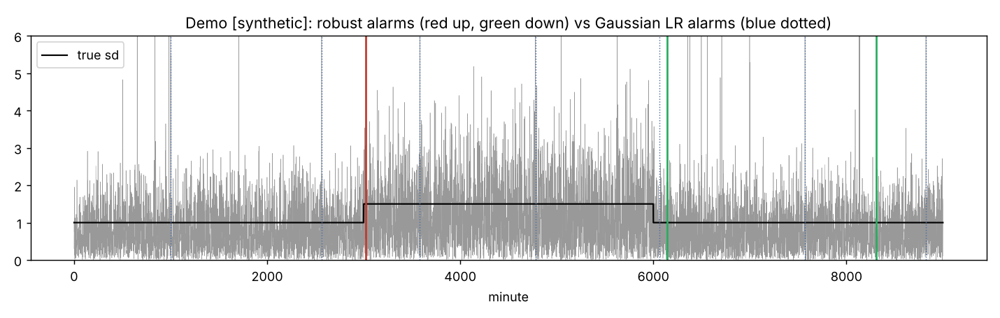

# Anytime-Valid Volatility Monitor

**An online alarm for changes in volatility, built on the jump-robust clipping idea in Bapat (2026, *International Review of Economics and Finance*), with a proved limit on false alarms that holds however long it runs and however often it is checked.**

Research prototype by Shreyan Thanki, November 2026. Every result carries a label: **[PUBLISHED]** from the paper, **[SYNTHETIC]** from our simulations, **[REAL]** from our runs on market data. The work was built with extensive AI assistance; [How this was built](#how-this-was-built) says exactly how.

## The idea in one paragraph

Bapat (2026) estimates integrated quarticity (the quantity behind confidence intervals for realized volatility) robustly: each one-minute return is clipped at c times its median absolute deviation (MAD), so a few jumps or outliers cannot dominate. This project takes the clipping idea online. A monitor clips each new squared return using past data only and feeds it to two betting **e-detectors** (Shin, Ramdas and Rinaldo 2024), one watching for rises and one for falls. Each keeps a running "wealth" from bets against "volatility has not changed" and raises an alarm when that wealth reaches a threshold A. If nothing has changed, the bets cannot make money except by luck, and a classical inequality caps how often luck pays off. That is what gives a false-alarm limit that holds in finite samples, with no model for the returns, even though the monitor is checked every minute.

## What this prototype demonstrates

1. **The paper's tables reproduce from the printed formulas** [PUBLISHED vs SYNTHETIC], and once both kernels are put on the same scale, the robust kernel beats the plain kernel in most simulation cells. Two points are worth discussing with the author: the printed kernel estimators are not on the integrated-quarticity scale, and clipping at c times MAD leaves a bias that does not shrink with more data. Both have simple fixes.
2. **The false-alarm guarantee holds where classical detectors break** [SYNTHETIC]. With jumps or fat tails, Gaussian likelihood-ratio and CUSUM detectors raise a false alarm within a day on 70% to 97% of paths. The robust monitor stays at 0.3% to 2.3% against its 5% bound, and catches a 50% rise in volatility in a median of 36 to 49 one-minute steps.
3. **The guarantee does not cost speed where it matters** [SYNTHETIC]. Held to the same false-alarm rate, the monitor is as fast as classical rules on normal returns (37 to 44 steps against 38 to 43 to catch a doubling of variance) and much faster on fat-tailed returns (74 to 91 against 203 to 750).
4. **Clipping also gives new theory.** A classical result (a one-sided form of Bahadur and Savage 1956) says no model-free test can detect a fall in the variance itself. The clipped variance is bounded, so a fall in it can be detected, and it keeps a direct volatility meaning. Clipping also sets a speed limit: at c = 3 and A = 7,800, no valid deterministic rule can flag even a total collapse of volatility before step 45, and the e-detectors need 58 [proof and SYNTHETIC].
5. **On real markets the guarantee survives, and alarms mean "volatility is now well above normal".** On five cryptocurrencies and the Nifty 50 the proved monitors kept their bounds on shuffled calm days, and up alarms flag volatility that is genuinely above normal. They do not improve a strong volatility forecast, so the contribution is the guarantee, not prediction [REAL].



*[SYNTHETIC] One-minute returns with rare jumps (grey); the true volatility (black) rises by half at minute 3,000 and falls back at minute 6,000. The robust monitor (solid lines: red up, green down) flags both changes and raises one false down alarm later, which its budget of 5% a day allows. The Gaussian rule (dotted blue), which is fooled by jumps, fires seven times. Rerun with `python experiments/demo.py`.*

## Results at a glance

| Question | What we found | Label | Details |
| --- | --- | --- | --- |
| Do the paper's tables reproduce? | Yes, with unnormalised kernel weights and the raw MAD. On a common scale the robust kernel beats the plain kernel in most cells. | PUBLISHED vs SYNTHETIC | [estimator_issues.md](docs/estimator_issues.md) |
| Is the false-alarm limit real? | 0.3% to 2.3% against a 5% bound under jumps and fat tails, where classical detectors reach 70% to 97%. A fresh check on new random seeds (8 return laws, 3,000 paths each) gave at most 1.7% a day. | SYNTHETIC | [math.md](docs/math.md), [fresh-seed check](reports/MASTER_BACKTEST_REPORT.md) |
| How fast is it? | Doubling of variance: 37 to 44 steps (classical 38 to 43) on normal returns, 74 to 91 (classical 203 to 750) on Student t returns, at the same false-alarm rate. | SYNTHETIC | [round 4, R2](reports/round4/ROUND4_SUMMARY.md) |
| Does the guarantee survive real data? | On streams built by shuffling the one-minute returns of calm real days, the proved monitors stayed within their bounds in all 252 settings tested (pre-registered). | REAL | [experiment report](docs/experiment_report.md) |
| What does a real alarm mean? | On five coins, alarms are followed by volatility on the flagged side of EWMA and HAR forecasts 71% to 83% of the time, against about 50% at random times. Against control minutes whose last hour was just as volatile, 91.4% of up alarms were followed by an hour above the calibrated level, against 74.6% of controls; down alarms add almost nothing. | REAL | [round 4, W1](reports/round4/W1/REPORT.md) |
| Does it react to scheduled news? | Around the 16 FOMC statements of 2024 and 2025, a pre-registered rerun with the proved monitor flagged 8 of 16 on BTC against 10.9% of matched control windows (Holm p 0.0003), though it was designed after the first result was known. On fresh 2026 releases the confirmation test failed (2 of 16 against 5.9%, p 0.25), so this is exploratory. | REAL | [E22](docs/report_parts/E22.md), [E23](docs/report_parts/E23.md) |
| Is it reproducible? | All 139 fixed data files match their recorded hashes, and 465 of 465 result files are identical after reruns. | REAL | [round 4 summary](reports/round4/ROUND4_SUMMARY.md) |

## What it does not show

* **That the monitor predicts.** On fresh 2026 data, adding its alarms to a HAR forecast that already sees the last hour did not improve that forecast for BTC, ETH or the Nifty 50.
* **That the FOMC result is established.** It failed its pre-registered confirmation on fresh releases. Two forward tests are registered instead: a fixed-date test on BTC FOMC and CPI releases from 25 October 2026 to 1 June 2027, and an anytime-valid version whose first release enters on 26 November 2026.
* **A 5% bound on every day.** The proof covers the first day after each calibration; on later days only a long-run average of 0.05 false alarms a day is proved, unless the monitor restarts every day.
* **The best default setting.** The default is very conservative (0 false alarms in 20,000 simulated calm days) and so 3.1 to 6.4 times slower than it could be. A faster setting held up on real calm days, but it was chosen after seeing results, so the default is unchanged until it is tested on fresh data.
* **Continuous watching.** After an alarm the default monitor recalibrates and is blind 64% to 72% of the time on crypto and about half the time on the Nifty 50. A rank-based variant removes the blind period, at the cost of more alarms.
* **A human-checked proof.** The proofs were written and reviewed by AI agents and have not been checked by a statistician.

## Where this could go

These are proposals to discuss with Prof. Bapat, not finished work.

* **A short paper on the monitor** (a draft is in [paper/](paper/)): the bounded-statistic argument, the delay theory and the speed limit for falls, the confidence-sequence baseline, and the crypto and Nifty applications.
* **An estimation follow-up on the quarticity estimator:** a version with a local scale that stays consistent when volatility moves within the day ([alternatives/robust_iq_estimator/](alternatives/robust_iq_estimator/)), which needs a central limit theorem.
* **A bridge to sequential estimation:** purely sequential, fixed-accuracy estimation of the volatility level from clipped squared returns, with the robust kernel estimator as the variance plug-in.

There are also a few questions about how the printed tables were computed (whether the kernel weights are normalised, whether the MAD is scaled, the volatility used in the simulations, the RMSE definition), asked to learn rather than to correct. Each is listed with its evidence in [docs/estimator_issues.md](docs/estimator_issues.md) and in section 10 of [PITCH_BAPAT.md](PITCH_BAPAT.md), the one-page version of this pitch.

## See it in five minutes

Python 3.10 or newer.

```bash
python -m venv .venv
source .venv/bin/activate        # Windows: .venv\Scripts\activate
pip install -e ".[dev]"
python -m pytest -q                       # the full test suite, no data needed
python -m avmonitor simulate --ratio 2    # synthetic stream, volatility doubles at step 3000
python experiments/demo.py                # the figure above
```

[docs/demo/replay.html](docs/demo/replay.html) is a self-contained page that replays two real days minute by minute: the Nifty 50 on 4 June 2024 and BTC on 10 October 2025. [notebooks/demo.ipynb](notebooks/demo.ipynb) is an executed walk-through.

Minimal use from Python:

```python
import numpy as np
from avmonitor.monitor import VolatilityMonitor

rng = np.random.default_rng(0)
r = np.concatenate([rng.standard_normal(3000), 2 * rng.standard_normal(1000)])  # sd doubles at step 3000
mon = VolatilityMonitor(threshold=7800, cal_len=1000, null_band=0.25)          # A = 390 / 0.05; plug-in baseline (approximate, very conservative and slow: reports/round4/R2)
for e in mon.run(r):
    print(e.index, e.direction)
```

Real data (Binance coins, Bitstamp BTC, Nifty 50) and every experiment: see [README_FULL.md](README_FULL.md#reproduce-the-experiments).

## Read more

| If you want | Read |
| --- | --- |
| The pitch as answers to ten questions | [PITCH_BAPAT.md](PITCH_BAPAT.md) |
| Every result in detail, the method table and the experiment list | [README_FULL.md](README_FULL.md) |
| Every number, experiment by experiment | [docs/experiment_report.md](docs/experiment_report.md) |
| The paper in plain words | [docs/paper_review.md](docs/paper_review.md) |
| Checks of the estimator, with evidence | [docs/estimator_issues.md](docs/estimator_issues.md) |
| Proofs | [docs/math.md](docs/math.md) and the `docs/theory_*.md` notes |
| What the results do not show | [docs/limitations.md](docs/limitations.md) |
| The fourth round of backtests | [reports/round4/ROUND4_SUMMARY.md](reports/round4/ROUND4_SUMMARY.md) |
| The research plan, scores and risks | [RESEARCH_STRATEGY_BAPAT.md](RESEARCH_STRATEGY_BAPAT.md) |

## What is in the repository

* **A Python package, `avmonitor`:** the paper's estimators as printed and normalised, online MAD clipping, betting e-detectors, the streaming monitor, a confidence-sequence baseline, monitors with no blind period, a panel version with false discovery control, published change-point methods as benchmarks, data loaders and a command line.
* **25 experiments** (E1 to E25) and three theory work streams in [experiments/](experiments/), each writing to [results/](results/).
* **Proofs and theory notes** in [docs/](docs/), a short paper draft in [paper/](paper/), and eight alternative directions in [alternatives/](alternatives/).

## How this was built

Shreyan Thanki directed the project. The code, experiments, proofs and write-ups were produced with extensive AI assistance (Claude, by Anthropic). Every review and referee report in `docs/review/` was written by a separate AI agent asked to act as a sceptical referee, not by a human expert, so "independent" there means "not the agent that wrote the files".

* **Plans come before results.** "Pre-registered" means the plan was committed to git before the data it tests were read; there is no external registry.
* **Every printed number is traced.** `python scripts/trace_numbers.py --target README.md` checks that each number in this file appears in a committed result or report; the pitch and the short paper are checked the same way.
* **Everything reruns.** `python scripts/reproduce.py` checks the data hashes, runs the tests and reruns the experiments against `results/MANIFEST.csv`. The test suite also runs on every push through GitHub Actions.

## Data and license

Raw data are not committed: `python scripts/download_data.py` fetches the Binance, Bitstamp, Nifty 50 and India VIX files from public mirrors and NSE's archive, and records a SHA-256 hash of each ([data/README.md](data/README.md)). The paper does not name its crypto data source, so our five-coin data may differ from the paper's. The code is released under the MIT license ([LICENSE](LICENSE)).

## Key references

The full, verified list is in [docs/literature_review.md](docs/literature_review.md).

- Bapat, S. R. (2026). A jump and noise robust kernel based estimator of quarticity for high frequency data. *International Review of Economics and Finance*, 109, 105482. doi:10.1016/j.iref.2026.105482
- Shin, J., Ramdas, A. and Rinaldo, A. (2024). E-detectors: a nonparametric framework for sequential change detection. *New England Journal of Statistics in Data Science*, 2(2), 229 to 260. doi:10.51387/23-NEJSDS51
- Mancini, C. (2009). Non-parametric threshold estimation for models with stochastic diffusion coefficient and jumps. *Scandinavian Journal of Statistics*, 36, 270 to 296.
- Bahadur, R. R. and Savage, L. J. (1956). The nonexistence of certain statistical procedures in nonparametric problems. *Annals of Mathematical Statistics*, 27(4), 1115 to 1122.
- Waudby-Smith, I. and Ramdas, A. (2024). Estimating means of bounded random variables by betting. *Journal of the Royal Statistical Society Series B*, 86(1), 1 to 27.
- Page, E. S. (1954). Continuous inspection schemes. *Biometrika*, 41(1/2), 100 to 115.

## Author

Shreyan Thanki ([@ShockXR](https://github.com/ShockXR))
