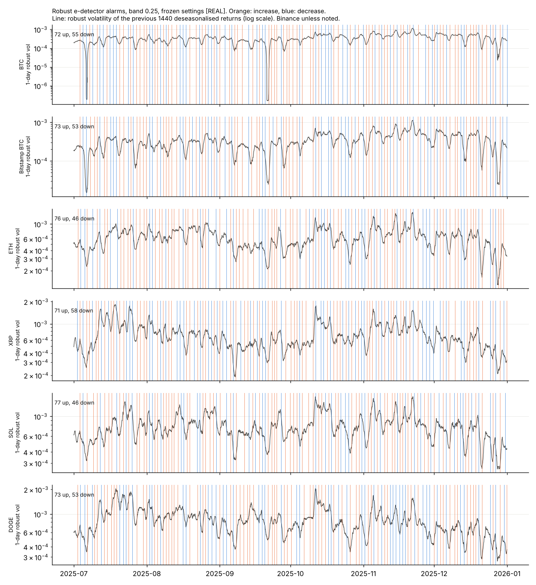
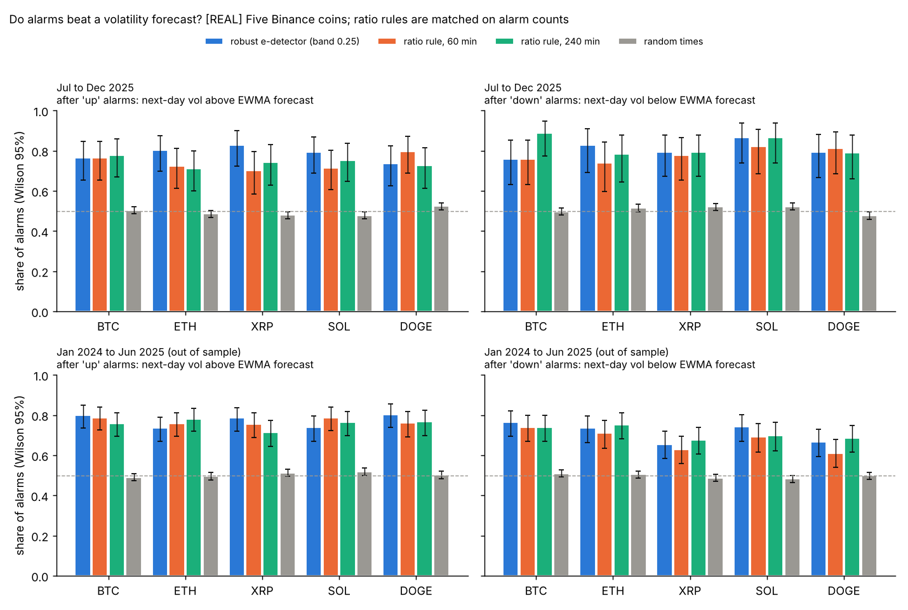

## E6. Five coins: the paper's real-data tables, and the monitor across coins, venues and years

**Data [REAL].** Binance spot one-minute bars (klines) for BTCUSDT, ETHUSDT, XRPUSDT, SOLUSDT and DOGEUSDT, read with `avmonitor.data.load_binance` from a public mirror of Binance's kline files (source and hashes in `data/MANIFEST.csv`). The mirror has no missing minutes and no duplicates from January 2024 to December 2025, so 1 July to 31 December 2025 gives 264,959 one-minute log returns per coin. For the cross-venue check, the Bitstamp BTC/USD file of E5. Published numbers [PUBLISHED] are in `experiments/paper_tables.py` (`TABLE5_ALL`, `TABLE6_ALL`). Bapat (2026) does not name the exchange behind Tables 5 and 6, so this section only says whether a hypothesis is consistent or inconsistent with the published numbers. Scripts: `experiments/e06a_five_coins_tables.py` (Q6a to Q6c, about 10 seconds) and `experiments/e06b_five_coins_monitor.py` (Q6d, Q6e, about 5 minutes on 2 cores). Iteration notes, including failed attempts: `docs/iterations/E6.md`.

### Q6a. Table 5 for all five coins: what matches, and why the rest does not

**Method.** The summary statistics of Table 5 on Binance, side by side with the published rows (`results/e06a_table5.csv`). Then five falsifiable hypotheses for the mismatches, each with what it predicts (`results/e06a_hypotheses.csv`, `e06a_mean_log_change.csv`, `e06a_window_offsets.csv`, `e06a_window_length.csv`, `e06a_extremes.csv`).

| Coin | Source | Min | Q1 | Mean | Q3 | Max | Zero returns |
|---|---|---|---|---|---|---|---|
| BTC | Binance [REAL] | -0.0438 | -2.22 × 10⁻⁴ | -7.57 × 10⁻⁷ | 2.23 × 10⁻⁴ | 0.0226 | 4.3% |
| | paper [PUBLISHED] | -0.0298 | -2.21 × 10⁻⁴ | -7.73 × 10⁻⁷ | 2.22 × 10⁻⁴ | 0.0314 | |
| ETH | Binance | -0.0375 | -3.97 × 10⁻⁴ | **+6.75 × 10⁻⁷** | 4.00 × 10⁻⁴ | 0.0452 | 1.0% |
| | paper | -0.0455 | -3.59 × 10⁻⁴ | **-6.70 × 10⁻⁷** | 3.63 × 10⁻⁴ | 0.0274 | |
| XRP | Binance | -0.2482 | -4.36 × 10⁻⁴ | -7.32 × 10⁻⁷ | 4.40 × 10⁻⁴ | 0.1660 | 3.0% |
| | paper | -0.1240 | -4.30 × 10⁻⁴ | -7.51 × 10⁻⁷ | 4.32 × 10⁻⁴ | 0.1085 | |
| SOL | Binance | -0.0295 | -4.95 × 10⁻⁴ | -8.20 × 10⁻⁷ | 5.00 × 10⁻⁴ | 0.0375 | 3.8% |
| | paper | -0.0367 | -3.64 × 10⁻⁴ | -8.20 × 10⁻⁷ | 3.71 × 10⁻⁴ | 0.0331 | |
| DOGE | Binance | -0.2693 | -5.34 × 10⁻⁴ | -1.29 × 10⁻⁶ | 5.35 × 10⁻⁴ | 0.1737 | 3.2% |
| | paper | -0.0788 | **0** | -1.31 × 10⁻⁶ | **0** | 0.0944 | |

The median is 0 everywhere. **What matches:** the quartiles of BTC (within 0.4%) and XRP (within 1.7%), and the means of BTC, XRP, SOL and DOGE (within 2.5%; SOL within 0.1%). **What does not:** the ETH and SOL quartiles (Binance 10% and 35% wider), the ETH sign, the DOGE quartiles, and every extreme.

| Hypothesis | What it predicts | What the data says | Verdict |
|---|---|---|---|
| H1. DOGE closes rounded to 4 decimals | Q1 = Q3 = 0, other coins unchanged | Rounding Binance DOGE to 4 decimals gives 27.4% zero returns and Q1, Q3 = ∓5.8 × 10⁻⁴. A grid of 0.0002 USD gives 45%. Q1 = Q3 = 0 needs at least half the returns to be zero, which first happens at a grid of 0.00025 USD (51.6% zeros); 3 decimals gives 84.5%. The 4-decimal rule leaves the other four coins unchanged. | **4 decimals: inconsistent.** A grid of 0.00025 USD or coarser (for example 3 decimals): consistent with Q1 = Q3 = 0. |
| H2. DOGE price refreshed in only some minutes (a sparse venue) | Q1 = Q3 = 0 | Keeping the last price in all but a random 50%, 40% or 30% of minutes gives 51% to 71% zeros and Q1 = Q3 = 0, but makes the extremes larger (minimum -0.39 to -0.61) and RQ 3.7 to 20 times larger. | Consistent with Q1 = Q3 = 0; does not explain the smaller published extremes. |
| Check on H1 and H2 | | **Any data with Q1 = Q3 = 0 has MAD = 0**, so τ = 3 × MAD = 0, every return is clipped to 0 and the printed robust kernel is exactly 0 (true in every variant above). The paper prints 2.00 × 10⁻¹² for DOGE, the same number as for XRP. | The DOGE rows of Tables 5 and 6 cannot both come from one series with the printed formulas. A question for the author. |
| H3. The ETH sign is a slip | The mean is fixed by the first and last close: mean = log(last / first) / n | Binance ETH: 2,484.82 USDT on 1 July 00:00, 2,971.64 on 31 December 23:59, a log change of +0.1789. The published mean implies -0.1775: same size within 0.8% (the other coins agree within 0.1% to 2.5%), opposite sign. A typed minus sign, or returns computed on rows sorted newest first, would both do this. Reversed order also swaps the extremes: predicted minimum -0.0452 (published -0.0455, a match) and maximum 0.0375 (published 0.0274, no match). | **Consistent** with a sign or ordering slip. A different period or venue cannot turn a 19% rise into a 19% fall. |
| H4. A different calendar window (time zone) | One offset fits all five means | No offset of 0 to 30 hours fits within print precision. UTC is among the best (worst coin 2.5% off); India time (UTC+5:30) 5.4%; UTC+8 17.6%. | Inconsistent with a shifted window; consistent with UTC. |
| H4b. About 2,000 fewer returns (from Q6b) | Same first and last price, n about 262,950 | Means then match within 1.7% for all five (ETH sign flipped), better than the complete half year (2.5%). Ending the window early (30 December 14:30) or starting it late (2 July 09:29) instead gives errors of 15% and 17%. | Consistent with a venue that has about 0.75% missing minutes; inconsistent with a shorter window. |
| H5. The extremes come from one crash and from venue microstructure | | All ten Binance extremes fall within 21:15 to 21:45 UTC on 10 October 2025. Without 21:00 to 23:00 that day, the Binance extremes are much smaller (BTC -0.0173 and 0.0127, XRP -0.0354 and 0.0225) than the published ones, which lie between the two. Multi-minute returns (as a gap would create) at the crash make the BTC minimum larger (-0.040 to -0.096 for 2 to 10 minutes), not smaller as the paper's -0.0298 would need. | Consistent with a venue where the 10 October crash was shallower than on Binance; gaps alone cannot explain the BTC minimum. |

**Reading.** Binance reproduces the bulk of the BTC and XRP distributions and the means of four coins, so the paper's data is close to Binance-like prices over the same UTC half year, but it is not the Binance series: the extremes, the ETH and SOL quartiles and the DOGE zeros differ. The DOGE quartiles need a price grid of about 0.00025 USD or coarser (or a price that stays unchanged in more than half of all minutes), which matches the paper's own remark about "price discreteness".

### Q6b. Table 6 for all five coins: formulas, Kernel / RQ, MAD and the "RMSE" column

**Method.** As in E5a, every printed formula and plausible alternative is computed per coin and divided by the published value (`results/e06b_table6_formulas.csv`). A formula that matches the paper's code should give a similar ratio for every coin; the spread of the log ratio over BTC, ETH, XRP and SOL measures this. Each formula is also computed with 21:00 to 23:00 UTC on 10 October removed, to separate the crash from the bulk. A power scan finds the total power of |r| that best explains the cross-coin pattern of BPQ and TPQ (`e06b_power_scan.csv`).

| Estimator | Formula | BTC | ETH | XRP | SOL | DOGE |
|---|---|---|---|---|---|---|
| RQ | (1/3) Σ r⁴ (no n) | 1.63 | 1.02 | 7.05 | 0.58 | 34.7 |
| RQ | same, crash removed | 0.20 | 0.27 | 0.011 | 0.32 | 0.11 |
| RQ | (n/3) Σ r⁴ (eq. 3) | 4.3 × 10⁵ | 2.7 × 10⁵ | 1.9 × 10⁶ | 1.5 × 10⁵ | 9.2 × 10⁶ |
| BPQ | eq. (4) as printed | 7 × 10⁻⁵ | 2 × 10⁻⁴ | 0.066 | 2 × 10⁻⁴ | 0.090 |
| BPQ | (1/3) μ₁⁻² Σ \|rᵢ\|\|rᵢ₋₁\| (a third of bipower variation) | **0.99** | **0.97** | 1.21 | 1.07 | 1.97 |
| TPQ | eq. (5) as printed, p = 1/2 | 3.07 | 3.34 | 3.12 | 4.14 | 8.11 |
| TPQ | (1/3) × eq. (5), p = 1/2 | **1.02** | 1.11 | **1.04** | 1.38 | 2.70 |
| TPQ | standard p = 4/3 | 5 × 10⁻⁷ | 7 × 10⁻⁷ | 9 × 10⁻⁴ | 2 × 10⁻⁶ | 2 × 10⁻³ |
| MinRQ | ADS constant, no n | 4.62 | 3.10 | 23.7 | 3.39 | 230 |
| MedRQ | ADS constant, no n | 3.93 | 1.41 | 9.66 | 1.61 | 68.9 |
| MedRQ | same, crash removed | 0.98 | 0.44 | 0.007 | 0.62 | 0.22 |
| Kernel | eq. (7) as printed | 1.62 | 1.02 | 6.98 | 0.57 | 34.5 |
| Robust kernel | eqs. (11), (16), raw MAD | **0.97** | 1.26 | **1.03** | 2.70 | 2.23 |
| Robust kernel | eqs. (11), (16), scaled MAD | 2.51 | 3.11 | 2.53 | 6.25 | 5.34 |

Ratios are Binance / published. Bold marks the close matches of the formulas that fit across coins; the ratios near 1 for the ETH RQ and Kernel are coincidences of the crash (finding 1).

**Findings.**

1. **RQ, MinRQ, MedRQ and Kernel are driven by the crash.** The printed RQ without the factor n is the right magnitude (as in E5), but the ratio swings from 0.58 to 35 across coins because a few crash minutes dominate Σ r⁴. With the crash removed the ratios fall to 0.01 to 0.32: the paper's numbers sit between Binance with and without the crash, as H5 predicts. MinRQ and MedRQ protect against isolated jumps only; a cluster of large consecutive returns (as on 10 October) passes through them.
2. **Kernel / RQ = W(30) / (n - 30) for every coin.** On Binance the ratio is 3.986 × 10⁻⁵ for all five coins, equal to W(30) / (n - 30) with W(30) = 10.560 (sum of the Gaussian kernel weights) and n = 264,959, as derived in `docs/estimator_issues.md`. The published ratios are 4.00 to 4.03 × 10⁻⁵ (`results/e06b_kernel_rq_ratio.csv`), 0.4% to 1.0% higher. Allowing for rounding of the printed numbers, all five coins are consistent with one sample length n between **262,854 and 263,052**, about 2,000 returns fewer than a complete UTC half year. Hypothesis H4b above follows from this.
3. **BPQ and TPQ are not quarticities.** The cross-coin pattern of the published BPQ is best explained by a total power of 2 in |r| (spread of log ratio 0.10, against 3.4 for power 4), and TPQ by a power of 1.25 to 1.5. The printed eq. (4) and the standard TPQ (p = 4/3) are off by factors of 10⁻⁷ to 10⁻¹. One third of bipower variation and one third of eq. (5) with p = 1/2 reproduce BTC within 1% and 2%; the same "1/3" appears in the published RQ. For BTC, the coin whose quartiles match best, this is a strong hint about the code; it remains an inference.
4. **The raw MAD fits the robust kernel.** The robust kernel depends on the data mostly through τ⁴, so it can be adjusted to the paper's own quartiles: multiply by (published half interquartile range / Binance half interquartile range)⁴ (`results/e06b_robust_mad.csv`). After this adjustment the raw-MAD ratios are 0.95 (BTC), 0.85 (ETH), 0.96 (XRP) and 0.81 (SOL), against 2.48, 2.08, 2.37 and 1.86 for the scaled MAD. Removing the crash changes nothing, as expected for a truncated estimator. This confirms E1 and E5a on four more coins: the paper's code very likely uses the raw MAD.
5. **The "RMSE" column** (`results/e06b_rmse_definitions.csv`). With θ = 2.2 × 10⁻⁶ the assumed true quarticity:

| Definition | Reproduces | Does not reproduce |
|---|---|---|
| D1: \|Q - θ\| for the single published estimate Q (rounding of Q allowed for) | 29 of 35 entries | Robust kernel for BTC, ETH, XRP and DOGE (printed 2.12 × 10⁻⁶, D1 gives 2.20 × 10⁻⁶); MedRQ for BTC (printed 2.22 × 10⁻⁶, D1 gives 2.08 × 10⁻⁶); BPQ for BTC (0.0263 against 0.0262, last digit) |
| D2, D3: root mean square error over daily estimates, or over the local estimates Q_t | none of the 2.12 entries | Any average of squared errors is at least \|mean estimate - θ\|. With estimates of 10⁻¹³ to 10⁻¹², it cannot be below 2.2 × 10⁻⁶; printing 2.12 × 10⁻⁶ would need a mean estimate of 8 × 10⁻⁸, which is 10⁵ times the printed one. On Binance both come out at 2.2 × 10⁻⁶. |
| D4: \|Q - κ₄ θ\| with κ₄ = 0.9638, the share of the fourth moment of a normal variable kept by clipping at 3 standard deviations | **all four 2.12 × 10⁻⁶ entries** (0.9638 × 2.2 × 10⁻⁶ = 2.1204 × 10⁻⁶) | SOL's robust kernel (2.20 × 10⁻⁶) follows D1 instead |

One definition, comparing the robust kernel with the truncated target κ₄ θ, reproduces 2.12 × 10⁻⁶ exactly. It is a numerical coincidence check, not proof: it uses the scaled-MAD cut-off of 3 standard deviations although the estimate itself fits the raw MAD, and SOL does not follow it. These are questions for the author, not corrections.

**Questions for the author from Q6a and Q6b.** (i) Which venue and pair, and are minutes missing (the Kernel / RQ ratios point to about 262,950 returns)? (ii) Is the ETH mean's sign a typo, or were ETH returns computed newest first? (iii) How were DOGE prices stored (a grid of 0.00025 USD or coarser reproduces Q1 = Q3 = 0), and how can the DOGE robust kernel be 2.00 × 10⁻¹² if the MAD is 0? (iv) Are BPQ and TPQ in Table 6 one third of bipower variation and of eq. (5) with p = 1/2? (v) How was the robust kernel's RMSE computed?

### Q6c. Daily IQ on a common scale, per coin

**Method.** As in E5b: for each UTC day with at least 1,400 returns (184 days per coin), integrated quarticity with T = 1 day for every estimator in `avmonitor.robust` (`results/e06c_daily_iq.csv`, `e06c_summary.csv`). MedRQ is the reference. Separately, the share of the fourth moment Σ r⁴ that survives clipping at 3 MADs, with a one-day MAD or one MAD for the whole six months (as in the paper), on raw returns and on returns divided by the intraday profile (`e06c_truncation_share.csv`).

| Median daily IQ / MedRQ [REAL] | BTC | ETH | XRP | SOL | DOGE |
|---|---|---|---|---|---|
| RQ | 1.26 | 1.52 | 1.33 | 1.27 | 1.32 |
| Kernel (normalised, h = 30) | 1.26 | 1.50 | 1.33 | 1.29 | 1.33 |
| MinRQ | 1.03 | 1.06 | 1.05 | 1.05 | 1.05 |
| TPQ (p = 4/3) | 0.99 | 1.02 | 1.01 | 1.04 | 1.03 |
| QPQ | 0.93 | 0.93 | 0.96 | 0.98 | 0.96 |
| TRQ (Mancini type) | 0.63 | 0.66 | 0.74 | 0.71 | 0.66 |
| Robust kernel, scaled MAD, corrected for Gaussian clipping | 0.35 | 0.43 | 0.47 | 0.49 | 0.44 |
| Robust kernel, scaled MAD | 0.33 | 0.41 | 0.45 | 0.48 | 0.42 |
| Robust kernel, raw MAD (as in the paper) | 0.15 | 0.19 | 0.21 | 0.23 | 0.20 |
| Median daily MedRQ | 2.2 × 10⁻⁷ | 2.1 × 10⁻⁶ | 2.6 × 10⁻⁶ | 3.0 × 10⁻⁶ | 5.0 × 10⁻⁶ |

| Fourth moment kept after clipping at 3 MADs [REAL] | Gaussian theory | BTC | ETH | XRP | SOL | DOGE |
|---|---|---|---|---|---|---|
| raw MAD, one day, raw returns | 70.5% | 10.8% | 9.6% | 15.0% | 17.1% | 13.5% |
| scaled MAD, one day, raw returns | 96.4% | 24.2% | 21.2% | 31.9% | 34.6% | 28.7% |
| scaled MAD, one day, deseasonalised | 96.4% | 26.7% | 26.0% | 33.3% | 37.2% | 34.0% |
| raw MAD, six months (as in the paper) | 70.5% | 0.23% | 0.69% | 0.00% | 1.84% | 0.00% |
| Returns clipped, scaled MAD, one day | 0.27% | 3.9% | 3.4% | 2.7% | 2.6% | 2.9% |

**Reading.** The ranking is the same for all five coins: RQ and the plain kernel highest (they include jumps), then the jump-robust group MinRQ, TPQ, MedRQ and QPQ within about 7% of each other, then TRQ, then the MAD-truncated estimators. Relative to the jump-robust group, clipping at 3 scaled MADs removes 52% to 67% of the quarticity, and at 3 raw MADs (the paper's convention) 77% to 85%. Even within one day, 10 to 15 times more returns are clipped than for normal data, and deseasonalising barely helps (1 to 5 percentage points), so the cause is fat tails within the day, not intraday seasonality. With one MAD over six months, as in Table 6, the robust kernel keeps under 2% of the fourth moment, and for XRP and DOGE essentially none. The paper's assumed true quarticity (2.2 × 10⁻⁶) is of the order of the daily IQ of ETH, XRP and SOL, but it is not on the scale of any printed Table 6 estimate.

### Q6d. The streaming monitor on five coins, out of sample, and across venues

**Settings, frozen from E5.** A = 28,800 per side (at most a 5% chance of any false alarm per day under the null), c = 3, 1,440-minute calibration, bands 0, 0.25 and 0.5, returns divided by the predictable intraday profile (`intraday_scale`, 20-day lookback, using only days before). The Gaussian likelihood ratio monitor (band 0) is the benchmark. Periods: 1 July to 31 December 2025, and **out of sample** 21 January 2024 to 30 June 2025 (527 days; the first 20 days of January 2024 only warm up the intraday profile). Nothing was changed after seeing either period. Gaps: missing minutes would be NaN rows, so no return spans a gap; the monitor skips NaN returns and drops them from calibration windows; post-alarm volatilities need at least 1,000 finite returns out of 1,440. The mirror had no gaps, so this rule never fired.

**Validation.** As in E5c: robust volatility (scaled median |u|) of the 1,440 minutes after an alarm, divided by the baseline of the calibration window. New here: Wilson 95% intervals, and a **matched-delay control**: random times whose baseline window ended as long before as each alarm's did (5 random times per alarm). The E5 control (next day against previous day at 3,000 random times) gives 45% to 54% (`results/e06d_monitor_summary.csv`).

| Robust e-detector, band 0.25 [REAL] | Period | Alarms per day | Up / down | Up alarms followed by higher vol (Wilson 95%) | Matched control | Down alarms followed by lower vol | Matched control |
|---|---|---|---|---|---|---|---|
| BTC | Jul to Dec 2025 | 0.69 | 72 / 55 | 79% (68 to 87) | 51% | 85% (73 to 92) | 51% |
| ETH | | 0.66 | 76 / 46 | 79% (69 to 87) | 54% | 89% (77 to 95) | 50% |
| XRP | | 0.70 | 71 / 58 | 84% (74 to 91) | 48% | 90% (79 to 95) | 46% |
| SOL | | 0.67 | 77 / 46 | 79% (69 to 87) | 52% | 93% (82 to 98) | 51% |
| DOGE | | 0.68 | 73 / 53 | 76% (65 to 85) | 55% | 85% (73 to 92) | 51% |
| Bitstamp BTC | | 0.68 | 73 / 53 | 81% (70 to 88) | 50% | 90% (79 to 96) | 49% |
| BTC | Jan 2024 to Jun 2025, out of sample | 0.70 | 198 / 173 | 81% (75 to 86) | 49% | 83% (76 to 88) | 51% |
| ETH | | 0.70 | 208 / 162 | 75% (69 to 81) | 47% | 83% (77 to 88) | 50% |
| XRP | | 0.71 | 187 / 188 | 77% (71 to 83) | 50% | 84% (78 to 88) | 54% |
| SOL | | 0.66 | 187 / 162 | 75% (68 to 81) | 47% | 88% (82 to 92) | 52% |
| DOGE | | 0.68 | 173 / 185 | 81% (74 to 86) | 46% | 85% (80 to 90) | 54% |

Pooled over the five Binance coins (`results/e06d_pooled.csv`):

| Detector | Period | Alarms per day | Up: share higher (95%) | Down: share lower (95%) | Median post / baseline, up |
|---|---|---|---|---|---|
| Robust, band 0 | Jul to Dec 2025 | 0.83 to 0.84 | 79% (74 to 83) | 73% (68 to 77) | 1.16 to 1.30 |
| Robust, band 0.25 | | 0.66 to 0.70 | 80% (75 to 83) | 88% (84 to 92) | 1.18 to 1.34 |
| Robust, band 0.5 | | 0.47 to 0.51 | 79% (74 to 84) | 97% (93 to 99) | 1.22 to 1.48 |
| Gaussian LR | | 0.89 to 0.92 | 67% (63 to 71) | 80% (74 to 84) | 1.06 to 1.12 |
| Robust, band 0 | out of sample | 0.83 to 0.86 | 74% (71 to 77) | 75% (73 to 77) | 1.12 to 1.23 |
| Robust, band 0.25 | | 0.66 to 0.71 | 78% (75 to 80) | 85% (82 to 87) | 1.22 to 1.29 |
| Robust, band 0.5 | | 0.46 to 0.54 | 81% (78 to 83) | 97% (95 to 98) | 1.24 to 1.39 |
| Gaussian LR | | 0.90 to 0.92 | 64% (61 to 66) | 81% (79 to 84) | 1.07 to 1.13 |

**Cross-venue consistency** (`results/e06d_cross_venue.csv`). Binance BTCUSDT and Bitstamp BTC/USD, July to December 2025, same frozen settings. Share of one venue's alarms with a same-direction alarm on the other venue within 60 minutes; the null comes from 1,000 random circular shifts of the other venue's alarm times.

| Detector | Binance alarms matched on Bitstamp | Bitstamp alarms matched on Binance | Shift null | p |
|---|---|---|---|---|
| Robust, band 0 | 52% of 153 | 51% of 156 | 3.6% | 0.002 |
| Robust, band 0.25 | **72% of 127** | **73% of 126** | 2.9% | 0.001 |
| Robust, band 0.5 | 71% of 91 | 71% of 91 | 2.1% | 0.001 |
| Gaussian LR | 60% of 169 | 59% of 170 | 4.7% | 0.001 |

Across coins (`results/e06d_cross_coin.csv`), 25% to 30% of ETH, XRP, SOL and DOGE alarms (band 0.25) fall within 60 minutes of a same-direction BTC alarm in July to December 2025, and 18% to 27% out of sample, against about 3% for shifted times.

**Reading.**
* **The E5 result generalises.** On all five coins, in both periods, about 75% to 84% of increase alarms and 83% to 93% of decrease alarms (band 0.25) are followed by a day of volatility in the flagged direction, against about 50% for random times with the same delay structure. Out of sample the shares drop by only 1 to 4 points. The alarm rate is remarkably stable: 0.66 to 0.71 per day for every coin and both periods.
* The Bitstamp run reproduces E5 (73 up and 53 down alarms against 73 and 52; 81% and 90% against 81% and 90%); the small difference comes from a longer warm-up of the intraday profile and from passing gaps as missing instead of zero.
* **Alarms are mostly about the market, not the venue.** With band 0.25, almost three quarters of BTC alarms appear on both venues within an hour, in the same direction. The rest are venue-specific. Coins share about a quarter of their alarms with BTC, so most alarms are coin-specific.
* The Gaussian benchmark again raises far more increase alarms (583 against 369 in 2025), and they are weaker (67% against 80%).
* **Microstructure caveat.** On quiet weekends Binance BTCUSDT often sits between two adjacent prices one tick (0.01 USDT) apart, so the robust volatility of a whole day can fall to 10⁻⁷ to 10⁻⁶ (`results/figures/e06_alarm_timelines.png`, July and September). Leaving such a state is flagged as an increase. Bitstamp does not show this as strongly.

### Q6e. Does an alarm carry information beyond a volatility forecast?

**Why.** Volatility clusters, so any detector that reacts to a burst looks somewhat predictive against "previous day" or "calibration baseline" comparisons. The stronger question: after an alarm, does next-day volatility move away from what a reasonable forecast, made at the same moment with the same information, predicts?

**Method.** At each alarm time t, two forecasts of the robust volatility of the next 1,440 minutes, both using data up to t only. (i) **EWMA**: exponentially weighted mean of |u| with a half-life of 1,440 minutes, times a factor that converts it to the robust-volatility scale (median ratio over the previous 30 days). (ii) **HAR**: a regression of log next-day robust volatility on the logs of the 1-day, 5-day and 22-day average robust volatility, refitted every day on hourly samples whose outcome was already known (history from January 2024). Hit: realised above the forecast after an "up" alarm, below it after a "down" alarm. Reference: the same rates at 3,000 random times per coin. **Rate-matched competitor:** a non-sequential rule that alarms when the robust volatility of the last S minutes (S = 60 or 240) divided by that of the 1,440 minutes before them rises above k_up or falls below k_down, with a 1,440-minute dead time after each alarm (as the monitor recalibrates). The thresholds were chosen on the same data to give the same numbers of up and down alarms as the e-detector; this hindsight favours the competitor. Files: `results/e06e_forecast_hits.csv` (per coin), `e06e_pooled.csv` (pooled), `e06e_competitor.csv`, figure `results/figures/e06_hit_rates.png`.

Pooled over the five Binance coins; band 0.25 unless stated; p is a two-proportion test against the e-detector:

| Rule [REAL] | Period | Forecast | Up: above forecast (95%) | Down: below forecast (95%) |
|---|---|---|---|---|
| Random times | Jul to Dec 2025 | EWMA | 49% | 51% |
| Robust e-detector | | EWMA | **79% (74 to 82)**, n = 367 | **81% (75 to 85)**, n = 256 |
| Ratio rule, 60 min | | EWMA | 74%, p = 0.15 | 78%, p = 0.51 |
| Ratio rule, 240 min | | EWMA | 74%, p = 0.17 | 82%, p = 0.60 |
| Robust e-detector | | HAR | 81% (76 to 84) | 78% (73 to 83) |
| Random times | | HAR | 52% | 48% |
| Random times | Out of sample | EWMA | 50% | 50% |
| Robust e-detector | | EWMA | **77% (74 to 80)**, n = 951 | **71% (68 to 74)**, n = 870 |
| Ratio rule, 60 min | | EWMA | 77%, p = 0.91 | 67%, p = 0.09 |
| Ratio rule, 240 min | | EWMA | 76%, p = 0.45 | 71%, p = 0.99 |
| Robust e-detector | | HAR | 77% (74 to 79) | 73% (70 to 76) |
| Random times | | HAR | 49% | 51% |
| Robust e-detector, band 0.5 | Out of sample | EWMA | 83% (80 to 85) | 84% (80 to 87) |
| Ratio rule, 60 min, matched to band 0.5 | | EWMA | 79%, p = 0.053 | 73%, p < 0.001 |
| Ratio rule, 240 min, matched to band 0.5 | | EWMA | 79%, p = 0.033 | 80%, p = 0.16 |
| Gaussian LR (against robust band 0: 75% up) | Jul to Dec 2025 | EWMA | 61%, p < 0.001 | 72%, p = 0.37 |
| Gaussian LR (against robust band 0: 72% up) | Out of sample | EWMA | 65%, p < 0.001 | 73%, p = 0.009 (GLR better) |

**Reading.**
* **Yes, alarms carry information beyond both forecasts.** After an increase alarm, next-day volatility is above a forecast made at the same moment 77% to 81% of the time, against 49% to 52% at random times, for every coin and both periods (each coin p < 0.001). After a decrease alarm it is below the forecast 71% to 81% of the time. Both forecasts lag a level shift, and the alarm marks the shift.
* **A simple ratio rule matched on alarm counts does about as well.** At band 0.25 the differences are 0 to 5 points and not significant. With the strictest band (0.5), out of sample and with the EWMA forecast, the e-detector is better by about 4 points for increases (p = 0.03 to 0.05) and by 10 points for decreases against the 60-minute rule (p < 0.001); with the HAR forecast the differences are smaller and not significant. The two rules flag partly different events: 45% to 65% of the e-detector alarms have a same-direction ratio-rule alarm within 6 hours, and when both fire the e-detector is earlier (median 5 minutes before the 60-minute rule and 30 to 50 minutes before the 240-minute rule).
* **What the e-detector adds is the guarantee, not extra precision.** The ratio rule needed its thresholds tuned with hindsight on the data it is scored on, and it has no false alarm control. The e-detector's settings were fixed beforehand, and its false alarm bound holds whenever the null holds. The Gaussian benchmark's increase alarms are clearly less informative (7 to 14 points lower).
* **This validates usefulness only.** It says nothing about the false alarm guarantee, which concerns periods where volatility does not change, and which E4, E8 and E9 test on simulated data.

**Caveats.** Alarms within a coin are separated by at least a day, but alarms across coins are correlated (Q6d), and the next-day windows of random times overlap, so pooled intervals and p-values are optimistic. The HAR forecast is biased for BTC in July to December 2025 (realised above the forecast at 63% of random times on both venues); the comparison with random times takes this into account, and the EWMA forecast, which is unbiased at random times (48% to 52%), gives the same conclusions. The Binance data is a third-party mirror of Binance's public files. "Volatility" here is a robust median-based measure of deseasonalised returns, not a quantity a trader can trade directly.
