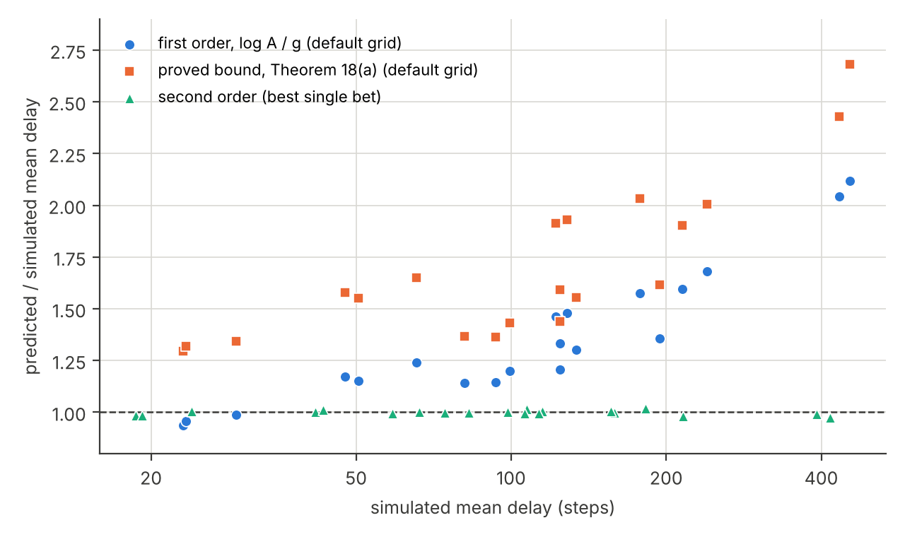

## Abstract

We study online detection of volatility changes in one-minute returns with jumps and fat tails, by a monitor that may be checked at every step. Each return is clipped at a multiple of a robust scale from past data, and two Shiryaev-Roberts betting e-detectors, for increases and decreases, monitor the clipped squared return. With a known baseline the average run length to a false alarm is at least $A$ and the probability of a false alarm within $m$ steps is at most $m/A$, for every return law and dependence that keep the conditional mean of the clipped squared return on the null side; a small drift of that mean inflates the bound by a closed-form factor. No nontrivial e-process exists for the null that the variance has not fallen, so a decrease detector needs a bounded statistic, whose clipping level limits the speed of any valid rule. A baseline from a confidence sequence gives $\delta + m/A$ when the conditional truncated variance varies within a tolerance fixed in advance. We bound the delay and split its cost of robustness into three factors. Simulations and data on five cryptocurrencies and FOMC statements show what the guarantee buys and what it does not.

**Keywords.** Sequential change detection; e-processes; testing by betting; high-frequency volatility; truncation; jumps; anytime validity.

## 1 Introduction

Volatility in high-frequency markets moves between regimes: calm, stressed, calm again. Risk limits, position sizes and model refits should react when it moves. We ask for an online monitor that reads a stream of one-minute returns, raises an alarm when volatility shifts up or down, and has a proved limit on false alarms that holds however often it is checked. Two obstacles make this hard.

**Jumps and fat tails.** A few extreme returns dominate sums of squared returns, and a detector built on a Gaussian likelihood reads a single jump as strong evidence of higher volatility. Jump-robust estimators address this for a fixed sample: bipower variation (Barndorff-Nielsen and Shephard 2004), threshold estimators (Mancini 2009), nearest-neighbour truncation (Andersen, Dobrev and Schaumburg 2012), and the kernel quarticity estimator of Bapat (2026), which clips every return at $c$ times its median absolute deviation (MAD) so that no single return has unbounded influence.

**Repeated looks.** A fixed-sample test applied at every minute eventually rejects by chance: in our simulations a 60-step $z$-test of the variance, repeated at every step, raised a false alarm within one 390-step day on 71% of Gaussian paths. Classical change detection (Page 1954; Shiryaev 1963; Roberts 1966; Lorden 1971; Pollak 1985) controls the run length to a false alarm but needs the pre-change law. E-detectors (Shin, Ramdas and Rinaldo 2024) give the same control for composite, nonparametric nulls, using e-processes built by betting (Shafer 2021; Ramdas, Grünwald, Vovk and Shafer 2023; Waudby-Smith and Ramdas 2024).
<!-- provenance: E4 -->

Robust estimators solve the first problem and not the second; betting e-detectors solve the second, but they need a statistic whose conditional mean has a meaning under the null and, for the direction "volatility went down", a bounded one. Clipping supplies such a statistic. The tools we combine are known, and we say where each comes from. Our contributions are three.

1. **A robust anytime-valid monitor, and what it can and cannot detect.** We monitor the clipped squared return with a predictable truncation level, under nulls that restrict only its conditional mean, and give the run-length and finite-horizon guarantees with exact conditions, their reading over many days, and a closed-form bound when the null holds only up to a small drift. We show that no nontrivial e-process exists for the null "the variance has not fallen", so a decrease detector needs a bounded statistic, and that the clipping level then sets a speed limit for decreases that binds every rule with the guarantee, not only e-detectors.
2. **An estimated baseline with a clean null.** We prove that the common plug-in baseline is bounded only through the drift its estimation error induces and keeps its nominal level only when the horizon is short compared with the square root of the calibration length, and that a baseline from a confidence sequence gives $\delta + m/A$ when the conditional truncated variance varies by less than a factor $1 + b$ across calibration and monitoring, a condition that does not depend on the algorithm.
3. **Evidence, including negative results.** A delay theory that splits the cost of robustness into a truncation, a nonparametric and a grid loss, with a delay floor for every valid rule that the e-detectors meet within a factor of about 2; simulations against parametric and robust competitors; and real-data studies in which the monitor is about as precise as a simple rule tuned with hindsight and adds little to a forecast that already sees the last hour, so that its value lies in the proof and in settings fixed in advance.

**Related work.** Retrospective tests for volatility breaks include the cumulative sums of squares of Inclán and Tiao (1994) and the nonparametric high-frequency test of Bibinger, Jirak and Vetter (2017). Econometric monitoring with a training sample, with asymptotic control of the probability of any false alarm, goes back to Chu, Stinchcombe and White (1996); it covers GARCH parameters (Berkes, Gombay, Horváth and Kokoszka 2004; Horváth, Trapani and Wang 2025), the unconditional variance of conditionally heteroskedastic series (Horváth, Kokoszka and Zhang 2006) and general parameters (Dette and Gösmann 2020). Our guarantee is non-asymptotic and needs no model for the returns, at the price of a null on a conditional mean; Section 4 is the anytime-valid counterpart of their training-sample problem. Robust change detection censors likelihood ratios (Huber 1965), uses least favourable laws (Unnikrishnan, Veeravalli and Meyn 2009), bounded losses (Fearnhead and Rigaill 2019) or robust divergences in Bayesian online change-point detection (Adams and MacKay 2007; Knoblauch, Jewson and Damoulas 2018); clipping the statistic is the betting analogue of Huber's censoring. Among e-value methods, Shekhar and Ramdas (2024) reduce change detection to sequential estimation, which is close to our confidence-sequence baseline; Vovk et al. (2021) build conformal change detectors; Dandapanthula and Ramdas (2025) treat many streams; Wang and Ramdas (2023) and Mineiro (2022) give confidence sequences under heavy tails, the constructive side of the asymmetry of Section 3.3; and Clerico (2025) shows that coin betting is optimal for bounded means, the setting of our Lemma 18. E-values have been applied to risk backtesting (Wang, Wang and Ziegel 2026) and to high-volatility days (Choe and Ramdas 2024). On criteria other than the run length, Lai (1998) introduced a window-limited false alarm probability and Mei (2008) showed that the run length can be uninformative; Tartakovsky, Nikiforov and Basseville (2014) is the standard reference. Andersen, Todorov and Zhou (2025) monitor high-frequency prices in real time for a different target, local no-arbitrage violations. Our search, made in November 2026 and not exhaustive, found no method that combines jump-robust high-frequency volatility measures with anytime-valid change detection.

**Organisation.** Section 2 sets up the statistic and the nulls, Section 3 proves the guarantees, Section 4 treats an estimated baseline and Section 5 the detection delay; Sections 6 and 7 report simulations and an application, and Section 8 discusses limitations. The supplement holds the proofs, further details, the experiment settings and a map from every table and figure to its script and result file. A companion note (`paper/extensions.md`) treats a running truncation level, restarts, panels of assets, several sampling frequencies and an adversarial search over null streams.

## 2 Model, statistic and nulls

**Returns and information.** Let $r_t$ be the one-minute log return ending at minute $t$. Monitoring starts after a calibration window $r_{-n+1}, \dots, r_0$, and $\mathcal{F}_t$ is the information up to time $t$: the returns and, when returns can be missing, the indicators of which were observed. A quantity is *predictable* if its value used at time $t$ is $\mathcal{F}_{t-1}$-measurable. Everything the monitor uses (truncation level, baseline, bets, intraday profile) must be predictable.

**The statistic.** Bapat (2026) clips returns at $c = 3$ times the MAD of the whole sample before forming a kernel estimate of local quarticity. We keep the clipping and change three things. First, we use the scaled MAD about zero, $\hat s = 1.4826\,\mathrm{median}_i \lvert r_i\rvert$ (the median of one-minute returns is 0 in all our data sets), so that with Gaussian returns the cut-off $\tau = c\,\hat s$ sits at $c$ standard deviations; with the raw MAD it sits at $0.6745\,c$. Second, $\hat s$ and $\tau$ are computed from the calibration window, so $\tau$ is $\mathcal{F}_0$-measurable. Third, we monitor
$$
X_t = \min(r_t^2, \tau^2) \in [0, \tau^2],
$$
the summand of truncated realised variance, rather than a fourth power. The same detectors applied to $\min(r_t^4, \tau^4)$ are valid too; for pure variance changes they were 1% to 28% faster for increases and 1.8 to 2.6 times slower for decreases. When more than half of a calibration window's returns are exactly zero, $\hat s = 0$; the monitor then extends the window, up to twice its length, and if that does not help it uses the scaled median of the nonzero absolute returns. The rule uses past data only, so $\tau$ stays predictable and positive.
<!-- provenance: E3 E6 E7 ALT1 -->

**Truncated moments.** For $Z \sim N(0,1)$ with density $\varphi$ and distribution function $\Phi$, and a cut-off $a > 0$, let
$$
\kappa_2(a) = \mathbb{E}[\min(Z^2, a^2)] = 2\Phi(a) - 1 - 2a\varphi(a) + 2a^2(1 - \Phi(a)).
$$
For $c = 3$ and the scaled MAD ($a = 3$), 0.27% of Gaussian returns are clipped and $\kappa_2 = 0.995$; with the raw MAD ($a = 2.023$), 4.3% are clipped and $\kappa_2 = 0.925$. For Gaussian returns with standard deviation $\sigma_0$ the mean of $X_t$ is $\kappa_2(c)\sigma_0^2$, and $\tau^2$ divided by it is $c^2/\kappa_2(c)$, which equals 9.045 for $c = 3$.
<!-- provenance: E2 -->

**Intraday seasonality and missing returns.** Before monitoring, each return is divided by a predictable intraday profile: for crypto, the median of $\lvert r\rvert$ at the same minute of the day over the previous 20 days, smoothed across neighbouring minutes (Andersen and Bollerslev 1997; Boudt, Croux and Laurent 2011). The profile is treated as known; errors in it violate the null, and no experiment isolates them. A missing return is skipped, so the statistic does not move at that step, and so is the first return after a gap, which spans the gap; zeros in place of missing returns would look like evidence of lower volatility. Validity then needs an assumption: given the past, whether $r_t$ is observed carries no information about its size, so that the null below also holds given that $r_t$ is observed. The assumption is not innocuous, since exchange outages tend to coincide with volatile periods. Under it the horizons $m$ below count every monitored step, with or without a return.
<!-- provenance: E6 E7 -->

**Nulls.** Let $\mu_t = \mathbb{E}[X_t \mid \mathcal{F}_{t-1}]$ be the conditional truncated variance and $m_0 > 0$ a baseline. For a band $b \in [0, 1)$ fixed in advance, the nulls are
$$
H_0^{\uparrow}:\ \mu_t \le (1+b)\,m_0 \ \text{ for all } t \ge 1, \qquad H_0^{\downarrow}:\ \mu_t \ge (1-b)\,m_0 \ \text{ for all } t \ge 1.
$$
They restrict one conditional moment and allow any return law, any jumps and any dependence that keeps that moment on the null side at every step. Persistent volatility clustering and price-level microstructure noise both move it, even when the unconditional variance is constant (Section 6.4).

**Lemma 1 (volatility meaning).** Suppose $r_t = \sigma_t \varepsilon_t$, where $\sigma_t > 0$ is $\mathcal{F}_{t-1}$-measurable and $\varepsilon_t$ is independent of $\mathcal{F}_{t-1}$ with a law $G$ that does not depend on $t$. Let $\tau$ be $\mathcal{F}_0$-measurable and $g_\tau(s) = \mathbb{E}_G[\min(s^2\varepsilon^2, \tau^2)]$. Then $\mu_t = g_\tau(\sigma_t)$, and $g_\tau$ is nondecreasing on $(0, \infty)$; it is strictly increasing on every interval of values $s$ with $G(0 < \lvert\varepsilon\rvert < \tau/s) > 0$. Hence, with $m_0 = g_\tau(\sigma_0)$ and $b = 0$, $H_0^{\uparrow}$ holds whenever $\sigma_t \le \sigma_0$ for all $t$, and $H_0^{\downarrow}$ whenever $\sigma_t \ge \sigma_0$ for all $t$.

The proof is in Supplement S1.5. Only the size of the change in $\mu_t$ for a given change in $\sigma_t$ depends on $G$. Three caveats follow. A change in tail shape at fixed $\sigma_t$ also moves $\mu_t$: with $c = 3$, a switch from Gaussian to Student $t$ innovations at the same variance lowers $\mu_t$ and is seen as a decrease. With a contemporaneous leverage effect, $\mu_t$ need not be monotone in $\sigma_t$. And returns of prices rounded to a fixed tick are not of the form $\sigma_t\varepsilon_t$ with a fixed $G$, so for the tick laws of our simulations the null is a statement about $\mu_t$ only.
<!-- provenance: ALT1 -->

## 3 Validity

### 3.1 Betting e-detectors and the false alarm guarantees

Write $m^{\uparrow} = (1+b)m_0$, $m^{\downarrow} = (1-b)m_0$ and $B = \tau^2/m^{\downarrow} > 1$, and let $Y_t = X_t/m^{\uparrow}$ on the increase side and $Y_t = X_t/m^{\downarrow} \in [0, B]$ on the decrease side. With a predictable bet $\lambda_t$ define the betting factors
$$
f_t^{\uparrow} = 1 + \lambda_t (Y_t - 1), \ \ \lambda_t \in [0, 1), \qquad f_t^{\downarrow} = 1 + \lambda_t (1 - Y_t), \ \ \lambda_t \in \big[0, 1/(B-1)\big).
$$
Both are positive, since $Y_t \ge 0$ and, on the decrease side, $Y_t \le B$. Under the corresponding null, $\mathbb{E}[f_t \mid \mathcal{F}_{t-1}] \le 1$, so for every start time $j$ the wealth $L_t^{(j)} = \prod_{s=j}^{t} f_s$ (with $L_{j-1}^{(j)} = 1$) is a nonnegative supermartingale with initial value 1, a *test supermartingale*.

**Definition (Shiryaev-Roberts e-detector).** Fix bets $\lambda_1, \dots, \lambda_K$ in the admissible range and weights $w_k > 0$ with $\sum_k w_k = 1$. For each $k$ let $M_t^{(k)} = f_t^{(k)}(M_{t-1}^{(k)} + 1)$ with $M_0^{(k)} = 0$, so that $M_t^{(k)} = \sum_{j=1}^{t} \prod_{s=j}^{t} f_s^{(k)}$ is the total wealth of bettors who start at every time $j \le t$. Let $M_t = \sum_k w_k M_t^{(k)}$ and raise an alarm at $T_A = \inf\lbrace t \ge 1 : M_t \ge A \rbrace$.

The default grids, used throughout, are $\lambda \in \lbrace 0.02, 0.05, 0.1, 0.2, 0.35, 0.5 \rbrace$ for increases and $\lambda/\lambda_{\max} \in \lbrace 0.1, 0.25, 0.5, 0.75, 0.95 \rbrace$ with $\lambda_{\max} = 1/(B-1)$ for decreases, with equal weights. An update costs $O(K)$ operations.
<!-- provenance: E9 -->

**Lemma 2.** Under the null, $\mathbb{E}[M_t \mid \mathcal{F}_{t-1}] \le M_{t-1} + 1$ for every $t \ge 1$, so $M_t - t$ is a supermartingale. The same holds for any predictable bets and for any average of such statistics with fixed weights.

*Proof.* $\mathbb{E}[M_t^{(k)} \mid \mathcal{F}_{t-1}] = \mathbb{E}[f_t^{(k)} \mid \mathcal{F}_{t-1}](M_{t-1}^{(k)} + 1) \le M_{t-1}^{(k)} + 1$; average over $k$. $\square$

**Theorem 3 (average run length).** Under the null, $\mathbb{E}[T_A] \ge A$ for every $A > 0$.

Theorem 3 is the run-length guarantee of e-detectors (Shin, Ramdas and Rinaldo 2024); Supplement S1.5 gives the proof with its conditions explicit. A practitioner usually needs a statement for a finite horizon.

**Theorem 4 (false alarm within a horizon).** Under the null, $\mathbb{P}(T_A \le m) \le m/A$ for every integer $m \ge 1$.

*Proof.* For $0 \le t \le m$ let $S_t = M_t + (m - t)$. By Lemma 2, $S$ is a nonnegative supermartingale on $\lbrace 0, \dots, m \rbrace$ with $S_0 = m$. Ville's inequality gives $\mathbb{P}(\max_{t \le m} S_t \ge A) \le m/A$, and $M_t \ge A$ implies $S_t \ge A$. $\square$

The argument is elementary and not new, but its reading over many days needs care. With $A = 7800$ for a 390-step trading day, or $A = 28{,}800$ for a 1440-minute crypto day, Theorem 4 bounds by 5% the probability of a false alarm within the first day after (re)calibration, not on a given later day: the statistic carries up to $(d-1)m$ in expectation into day $d$ (Lemma 2), and Ville's inequality bounds an alarm on day $d$ only by $dm/A$. For a null stream inside the class (each $Y_t = 1$ for $d - 1$ days, then i.i.d. clipped Gaussian returns with the same conditional mean) the probability of a false alarm on day 5 is 11.5%, and on day 10 it is 28.0%. Even for i.i.d. Gaussian returns, Table 3 implies a probability of a false alarm on a given day, given none before, of 1.1% on day 1, about 3.1% on days 2 to 5, 4.2% on days 6 to 10 and 4.6% on days 11 to 20. Over long runs the right statement is an expected count (Corollary 6); a probability for a window of fixed length is the window-limited criterion of Lai (1998), and Mei (2008) shows why the run length alone can mislead. The CUSUM-type statistic $C_t = f_t \max(C_{t-1}, 1)$ satisfies $C_t \le M_t$ and inherits both guarantees.
<!-- provenance: E9 -->

<!-- SLOT: TH6 per-period guarantees (M2): a construction with a proved bound per period, e.g. restarting the statistic at each period boundary, and its cost -->

**Proposition 5 (two-sided monitoring).** Under the two-sided null $(1-b)m_0 \le \mu_t \le (1+b)m_0$ for all $t$, the average $\bar M_t = (M_t^{\uparrow} + M_t^{\downarrow})/2$ of the two side statistics satisfies Lemma 2. Hence the rule that alarms at the first $t$ with $\bar M_t \ge A$, and the rule that alarms at the first $t$ with $\max(M_t^{\uparrow}, M_t^{\downarrow}) \ge 2A$, both satisfy Theorems 3 and 4.

Proposition 5 follows from Lemma 2 (Supplement S1.5). The average rule is never later than the maximum rule. All our experiments use the maximum rule, which names the direction of an alarm by the side that crossed; the gain from the average is small, because the side that is not moving carries little wealth.

**Corollary 6 (restarts after alarms).** Suppose the monitor recalibrates after every alarm, with a truncation level $\tau_q$ and baseline $m_0^{(q)}$ for segment $q$ that are known at the start of the segment, and that the two-sided null holds in every segment relative to its own baseline. Let $N_m$ be the number of alarms within the first $m$ monitored steps (calibration steps are not counted). Then $\mathbb{E}[N_m] \le m/A$.

The proof is in Supplement S1.1. With $b = 0$ the hypothesis asks that each segment's baseline equal the true conditional mean of its statistic, which no estimated baseline achieves; Corollary 16 covers a baseline from a confidence sequence. With the true baseline and $A = 300$ the restarted monitor raised 26.5 alarms per 10,000 monitored steps against the bound of 33.3; with the confidence-sequence baseline and $A = 36{,}000$ it raised 0.000 (Gaussian) and 0.001 (Student $t_3$) false alarms per 1440-step day in 30-day streams, against a bound of 0.041. Corollary 6 itself was not checked at an operating level.
<!-- provenance: E4 E14 -->

### 3.2 A small drift of the conditional mean

The guarantees need the null at every step. The next result says what is left when it holds only up to a drift. Write $\lambda_k^{\uparrow}$ ($w_k^{\uparrow}$) for the increase bets (weights) and $\lambda_l^{\downarrow}$ ($w_l^{\downarrow}$) for the decrease bets, and for $x \ge 0$ and an integer $m \ge 1$ let
$$
\Upsilon_m(x) = \frac{(1 + x)\big((1 + x)^m - 1\big)}{m x}, \qquad \Upsilon_m(0) = 1,
$$
the average of $(1+x)^j$ over $j = 1, \dots, m$.

**Theorem 7 (drift of the conditional mean).** Suppose that $\mu_t \le (1 + \xi^{\uparrow})\,m^{\uparrow}$ and $\mu_t \ge (1 - \xi^{\downarrow})\,m^{\downarrow}$ for all $t$, with constants $\xi^{\uparrow}, \xi^{\downarrow} \ge 0$ known at time 0. Then for the two-sided rule of Proposition 5 with the maximum and every $m \ge 1$,
$$
\mathbb{P}(T_A \le m) \le \min\Big\lbrace 1,\ \frac{m}{A}\,\Gamma_m(\xi^{\uparrow}, \xi^{\downarrow}) \Big\rbrace, \qquad
\Gamma_m(\xi^{\uparrow}, \xi^{\downarrow}) = \frac12\Big[\sum_k w_k^{\uparrow}\,\Upsilon_m(\lambda_k^{\uparrow}\xi^{\uparrow}) + \sum_l w_l^{\downarrow}\,\Upsilon_m(\lambda_l^{\downarrow}\xi^{\downarrow})\Big].
$$
With $\xi^{\uparrow} = \xi^{\downarrow} = 0$ this is Theorem 4.

The proof is in Supplement S1.2. For the default detector with $c = 3$, $b = 0$ and $A = 7800$, the inflation factor $\Gamma_m$ is close to 1 while the drift times the horizon is small: at one day a drift of 0.1% on both sides gives 5.14% instead of 5%, 0.5% gives 5.80% and 1% gives 7.06%. Then it compounds: the one-day 5% bound doubles at a drift of 1.63% and reaches 1 at about 3.7% upward, and over five days a drift of 0.5% exhausts it. The bound is attained by a deterministic stream where it reaches 1; below that, the strongest stream found reaches 0.33 to 0.63 of it in one day. A drift that alternates costs far less, but only a pathwise bound shows it, and that bound is proved only when the drift does not respond to the data, or else in a looser threshold form (Supplement S1.3). No bound of the form $C\,m/A$ in terms of the mean drift alone exists. Theorem 7 gives a concrete scale for "the null holds approximately": the conditional mean must stay within a few tenths of a percent of the baseline over a day, or a band $b$ must absorb the drift.
<!-- provenance: TH4 -->

### 3.3 Why a decrease detector needs a bounded statistic

**Proposition 8.** Let $\mathcal{N}_\infty$ be the set of all probability laws on $[0, \infty)$ with mean at least 1. If $E: [0, \infty) \to [0, \infty]$ is measurable and $\mathbb{E}_P[E(Y)] \le 1$ for every $P \in \mathcal{N}_\infty$, then $E(y) \le 1$ for every $y \ge 0$.

**Corollary 9 (no e-process for "the variance has not fallen").** Let $\mathcal{P}^{\downarrow}$ be the set of laws of real sequences $(r_t)_{t \ge 1}$ with $\mathbb{E}[r_t^2 \mid r_1, \dots, r_{t-1}] \ge m_0$ for every $t$. If $W_t = W_t(r_1, \dots, r_t) \ge 0$ satisfies $\mathbb{E}_P[W_t] \le 1$ for every $P \in \mathcal{P}^{\downarrow}$ and every fixed $t$, then $W_t \le 1$ for every $t$ and every path. Consequently a Shiryaev-Roberts statistic built from such processes started at each time satisfies $M_t \le t$ on every path, and cannot alarm before time $A$, whatever the data.

The proof (Supplement S1.4) builds, for any path, a law in $\mathcal{P}^{\downarrow}$ that follows the path with probability close to 1; Proposition 8 is proved in Supplement S1.5. This one-sided relative of the result of Bahadur and Savage (1956) is not new; the asymmetry is what matters. The increase null "mean at most 1" on $[0, \infty)$ admits nontrivial e-variables such as $E(y) = y$, so an increase detector works on raw squared returns, but a fall in the variance itself cannot be detected by any nonparametric e-test. For a statistic with values in $[0, B]$ the null "mean at least 1" admits the bets $1 + \lambda(1 - y)$ with $\lambda \in [0, 1/(B-1)]$, and up to domination these are the only e-variables (Lemma 18). Truncation is one way to obtain a bounded functional with a volatility meaning (Lemma 1); exceedance indicators, ranks or any bounded increasing transform of $r_t^2$ would also do. The price is a speed limit: one step can multiply the wealth of a decrease bet by at most $B/(B-1)$ (Corollary 20). For increases, clipping is not needed for validity, but it bounds the effect of one jump on the wealth: $f_t^{\uparrow} \le 1 + \lambda(B-1)$.

**Every valid rule.** The e-detectors are one way to obtain the guarantee of Theorem 4; the next result bounds every rule that has it. Let $\pi(y)$ be the largest probability that a law on $[0, B]$ in the null can put on the value $y$: $\pi(y) = (B-1)/(B-y)$ for $y < 1$ and $\pi(y) = 1$ otherwise under the decrease null (conditional mean at least 1), $\pi(y) = 1/y$ for $y > 1$ and $\pi(y) = 1$ otherwise under the increase null (at most 1), and the product of the two under the two-sided null (equal to 1). For a path $y = (y_1, y_2, \dots)$ of $Y_t = X_t/m_0$ let $W_n(y) = \prod_{s \le n} 1/\pi(y_s)$.

**Theorem 10 (pathwise floor).** Let $T$ be a stopping rule with $\mathbb{P}(T \le n) \le n/A$ for every $n$ and every law of $(Y_t)$ on $[0, B]$ in one of the three nulls. (a) If $T$ is deterministic, it stops at step $n$ on the path $y$ only if $W_n(y) \ge A/n$. (b) If $T$ is randomised independently of the data, $\mathbb{P}(T \le n \mid y) \le (n/A)\,W_n(y)$. (c) For every path $y$ and every $n$ with $W_n(y) \ge A/n$, some deterministic rule with the same guarantee stops at $n$ on $y$.

**Corollary 11.** (a) For the decrease null on $[0, \infty)$, that is without truncation, no deterministic rule valid at levels $n/A$ alarms before step $A$, on any path. (b) On a complete collapse, $y_s = 0$ for every $s$, every rule valid at levels $n/A$ for the decrease or the two-sided null needs at least $\min\lbrace n : n \log(B/(B-1)) \ge \log(A/n)\rbrace$ steps: 45 at $c = 3$ and $A = 7800$.

The proof (Supplement S1.6) places at each step the two-point null law that gives $y_s$ its largest probability. Under this product law, which is in the null, the path has probability $1/W_n(y)$, so a rule that stops there spends at least that much of its budget $n/A$. The same laws can be placed on the returns, so the floor also binds rules that see $r_t$ rather than $Y_t$. Part (a) of the corollary extends Corollary 9 from e-processes to every procedure. We found no statement of Theorem 10 in this form and claim no priority for an elementary argument; Clerico (2025) shows a related optimality of betting for a bounded mean. Section 5.1 compares the floor with the e-detectors.
<!-- provenance: TH5 -->

## 4 Estimated baseline

The guarantees above assume that the baseline $m_0$ and the level $\tau$ are fixed in advance, or at least that the null holds with whatever values the monitor uses. In practice both are estimated from a calibration window.

### 4.1 The plug-in baseline

The *plug-in* baseline is the mean of $X$ over the window, with $\tau$ from the same window. Its effect is measurable. With 390 calibration steps, the one-day false alarm rate of the increase side was 4.58%, 4.68% and 5.10% for Gaussian, Student $t_3$ and jump returns, against 1.75%, 1.73% and 1.62% with the true baseline (4000 paths, Monte Carlo standard error 0.34 points). The excess grows with the horizon, because a baseline that is slightly too low gives the log wealth a positive drift that the bets eventually find: with i.i.d. returns the five-day rate was 41% to 44%, where a known baseline guarantees at most 25%, and in 30-day streams with recalibration after every alarm the plug-in raised 0.094 (Gaussian) and 0.084 (Student $t_3$) false alarms per 1440-step day against a nominal 0.05.
<!-- provenance: E4 E10 E14 E16 -->

Theorem 7 explains this. Given the window $W$, the plug-in's error is a drift that stays fixed during monitoring: if the conditional mean of $X_t$ after calibration stays at a level fixed by the window, for example $\mathbb{E}_F[\min(r^2, \hat\tau^2)]$ for i.i.d. returns with law $F$, then the increase side sees the drift $\xi^{\uparrow}(W) = (\mu^\ast(W)/\hat m - 1)^+$ and the decrease side $\xi^{\downarrow}(W) = (1 - \mu^\ast(W)/\hat m)^+$, both known at time 0.

**Corollary 12 (plug-in baseline).** Under this condition, $\mathbb{P}(T_A \le m) \le \mathbb{E}_W\big[\min\lbrace 1, (m/A)\,\Gamma_m(\xi^{\uparrow}(W), \xi^{\downarrow}(W))\rbrace\big]$, where $\Gamma_m$ uses the decrease bets of the window.

The proof applies Theorem 7 conditionally on the window (Supplement S1.2). The plug-in baseline's error is a persistent drift whose proved bound (42% for one day with 390 calibration steps) is within a factor of 1.3 of the worst stream found by the adversarial search. The one-day bound falls to 7.3% at 11,520 calibration steps and 6.0% at 23,040, so the plug-in has no guarantee of the form $C\,m/A$ at practical calibration lengths, but it does have a computable one.
<!-- provenance: TH4 -->

**When $n$, $m$ and $A$ grow together.** Assume that the calibration returns are i.i.d. with a law $F$ that has no atom at 0, and let $\mathcal{C}(W)$ be the class of monitored streams whose conditional truncated mean at the window's level, $\mathbb{E}[\min(r_t^2, \hat\tau^2) \mid \mathcal{F}_{t-1}]$, equals its value under $F$; i.i.d. returns from $F$ are one such stream. Write $\bar\Phi$ for the standard normal upper tail and $\widehat{\mathrm{se}}$ for the standard error of $\hat m$.

**Theorem 13 (the plug-in as $n$, $m$ and $A$ grow).** Let $n \to \infty$, with $m = m_n$ and $A = A_n \ge m$. (a) If $m/\sqrt n \to 0$, then for every stream in $\mathcal{C}(W)$, $\mathbb{P}(T \le m) \le (m/A)\big(1 + C\,(m+1)/\sqrt n\,(1 + o(1))\big)$ uniformly in $A$, with $C = 0.037$ for Gaussian returns and $0.047$ for Student $t_3$ returns at $c = 3$, and $C = 2.52$ for every $F$. (b) If $m/\sqrt n \to \infty$, $m/\log A \to \infty$ and $m/A \to 0$, some stream in $\mathcal{C}(W)$ makes $\mathbb{P}(T \le m)/(m/A) \to \infty$. (c) Baselines moved apart to $\hat m \pm z\,\widehat{\mathrm{se}}$ give $\mathbb{P}(T \le m) \le m/A + 2\bar\Phi(z) + o(1)$ uniformly in $m$ and $A$, and some stream attains the excess $2\bar\Phi(z)$ when $m/(\sqrt n \log A) \to \infty$; so $z = \Phi^{-1}(1 - \delta/2)$ restores $m/A + \delta$.

The proof (Supplement S2) bounds the drift of the plug-in by $\hat B$ times the Kolmogorov distance between the window and $F$, applies the central limit theorem to it and feeds it into Corollary 12; the stream of (b) holds the conditional mean fixed and then bets boldly on the two values $0$ and $\hat B$. The boundary $m \asymp \sqrt n$ does not depend on $A$: a one-day horizon of 390 minutes falls below $\sqrt n$ only for windows of more than 152,100 returns (390 trading days of minute data), and is short compared with it only for much longer ones. At one day after a 390-step Gaussian window, the largest false alarm probability over $\mathcal{C}(W)$ lies between 33.8% and 42.4% (nominal 5%), while i.i.d. returns gave at most 5.14% in simulation. For i.i.d. monitored returns a heuristic suggests the scale $\log A/\sqrt n$ instead of $m/\sqrt n$; we have not proved it. The confidence-sequence baseline of Section 4.2 achieves (c) without asymptotics, at an effective $z$ of 3.8 to 5.7 against 2.576 for $\delta = 0.01$.
<!-- provenance: TH5 -->

### 4.2 A baseline from a confidence sequence

A confidence sequence restores a distribution-free proof. The construction uses a sample split, which is needed because a $\tau$ computed from the whole window makes each $X_i$ in the window depend on later returns.

**Construction.** The first $n_\tau$ returns of the calibration window fix $\tau = c\,\hat s$ (the default uses 25% of the window; we did not vary this share). For the later returns, indexed $i = 1, 2, \dots$, let $\chi_i = \min(r_i^2, \tau^2)/\tau^2 \in [0, 1]$ and $\eta_i = \mathbb{E}[\chi_i \mid \mathcal{F}_{i-1}] = \mu_i/\tau^2$. Choose predictably a centre $\hat z_{i-1} \in (0, 1)$ and bets $\lambda_i^{\uparrow}, \lambda_i^{\downarrow} > 0$ with $\lambda_i^{\uparrow}(1 - \hat z_{i-1}) \le \ell_0$ and $\lambda_i^{\downarrow}\hat z_{i-1} \le \ell_0$ for a fixed $\ell_0 \in (0, 1)$. With $\psi_a(\lambda) = (-\log(1 - \lambda a) - \lambda a)/a^2$, $e_i = (\chi_i - \hat z_{i-1})^2$, $\psi_i^{\uparrow} = \psi_{1-\hat z_{i-1}}(\lambda_i^{\uparrow})$, $\psi_i^{\downarrow} = \psi_{\hat z_{i-1}}(\lambda_i^{\downarrow})$ and error levels $\delta_u, \delta_l \in (0, 1)$, put
$$
U_t = \frac{\sum_{i \le t} \lambda_i^{\uparrow} \chi_i + \log(1/\delta_u) + \sum_{i \le t} \psi_i^{\uparrow} e_i}{\sum_{i \le t} \lambda_i^{\uparrow}}, \qquad
L_t = \frac{\sum_{i \le t} \lambda_i^{\downarrow} \chi_i - \log(1/\delta_l) - \sum_{i \le t} \psi_i^{\downarrow} e_i}{\sum_{i \le t} \lambda_i^{\downarrow}}.
$$
They bound the bet-weighted averages $\bar\eta_t^{\uparrow} = \sum_{i \le t}\lambda_i^{\uparrow}\eta_i / \sum_{i \le t}\lambda_i^{\uparrow}$ and $\bar\eta_t^{\downarrow}$ (the same with $\lambda^{\downarrow}$) at all times at once: $\mathbb{P}(\exists t: \bar\eta_t^{\uparrow} \ge U_t) \le \delta_u$ and $\mathbb{P}(\exists t: \bar\eta_t^{\downarrow} \le L_t) \le \delta_l$, with no assumption on dependence or on how $\eta_i$ varies (Lemma S7). With $1 - \hat z = \hat z = 1$ these are the predictable plug-in empirical Bernstein bounds of Waudby-Smith and Ramdas (2024); the one-sided ranges let the lower bound use bets up to $\ell_0/\hat z$, which matters because $\hat z \approx 0.11$ for a clipped squared Gaussian return.

**Monitoring rule.** Calibration ends at a stopping time $T_0 > n_\tau$, a fixed length or a rule that stops when the relative width of the bounds falls below a target. Set $m^{\uparrow} = (1+b)\,\tau^2 \min(U_{T_0}, 1)$ and $m^{\downarrow} = (1-b)\,\tau^2 \max(L_{T_0}, 0)$, run the two statistics of Section 3.1 from $T_0$ with these baselines and with bets fixed at $T_0$ (the decrease side is switched off when $m^{\downarrow} = 0$ or $\tau^2/m^{\downarrow} \le 1$), and alarm at the first $t > T_0$ with $\max(M_t^{\uparrow}, M_t^{\downarrow}) \ge 2A$.

**Theorem 14 (guarantee with an estimated baseline).** Let $\delta = \delta_u + \delta_l$ and assume the tolerance condition
$$
\sup_{t > T_0} \mu_t \le (1+b) \min_{n_\tau < i \le T_0} \mu_i \quad\text{and}\quad \inf_{t > T_0} \mu_t \ge (1-b) \max_{n_\tau < i \le T_0} \mu_i,
$$
with nothing assumed about the calibration window beyond $0 \le X \le \tau^2$. Then

1. for every integer $m \ge 1$, $\mathbb{P}(\text{an alarm at one of } T_0 + 1, \dots, T_0 + m) \le \delta + m/A$, and $\le \delta + (1-\delta)\,m/A$ when $m < A$;
2. if $T_0 < \infty$ almost surely, the expected number of monitored steps before the first alarm is at least $(1-\delta)A$;
3. one side alone at level $A$ satisfies the bound with $\delta_u$ (increase) or $\delta_l$ (decrease) in place of $\delta$, under its half of the condition.

The proof (Supplement S2) uses two facts. Because the coverage of the bounds is uniform in time, they hold at the random time $T_0$ with probability at least $1 - \delta$; and on that event the tolerance condition puts every later $\mu_t$ on the null side of the baselines, since a weighted average lies between the smallest and the largest of its terms, so Ville's inequality applies after $T_0$.

The proof uses the condition only through the bet-weighted forms $\mu_t \le (1+b)\tau^2\bar\eta^{\uparrow}_{T_0}$ and $\mu_t \ge (1-b)\tau^2\bar\eta^{\downarrow}_{T_0}$, which are weaker but depend on the bets the algorithm chose. The tolerance condition says plainly what the guarantee needs: the conditional truncated variance must vary by less than a factor $1 + b$ across calibration and monitoring. With $b = 0$ it rules out any volatility clustering, so the confidence sequence protects against estimation error, not against a moving conditional mean.

<!-- SLOT: TH6 Theorem 14 restated with an algorithm-free tolerance hypothesis (M4); the statement above already uses the tolerance condition, TH6 may sharpen or replace it -->

**Corollary 15 (a constant conditional law).** If from step $n_\tau + 1$ until the change the conditional law of $r_t$ given $\mathcal{F}_{t-1}$ is one fixed law (for example i.i.d. returns with jumps and fat tails), then $\mu_t$ is constant, the tolerance condition holds with $b = 0$, and with no change $\mathbb{P}(\text{false alarm within } m \text{ monitored steps}) \le \delta + m/A$ with the baseline estimated from the data.

**Corollary 16 (recalibration after every alarm).** If every segment has its own split, bounds and error budget $\delta$, and the tolerance condition holds in every segment relative to its own calibration, then the number $N_m$ of alarms within the first $m$ monitored steps satisfies $\mathbb{E}[N_m] \le (\delta + m/A)/(1-\delta)$. With $\delta = 0$ this is Corollary 6.

**Choosing $A$ and $\delta$.** For a target $\alpha$ for the first day of $m$ steps, choose $\delta < \alpha$ and $A = m/(\alpha - \delta)$; with $\delta = 0.01$ and $\alpha = 5\%$, $A = 9750$ for a 390-step day and $A = 36{,}000$ for a 1440-minute day. Since the delay grows like $\log A$, the larger $A$ costs little ($\log 9750/\log 7800 \approx 1.025$); the real cost is the width of the bounds (Section 6.3). Shekhar and Ramdas (2024) combine a confidence sequence for the pre-change parameter with a detector in a similar way; our construction adds the one-sided ranges, the sample split for the truncation level and the explicit tolerance condition.
<!-- provenance: E8 -->

## 5 Detection delay

This section asks how fast the detector reacts to a real change, what robustness costs in speed, and what limits the speed of decrease detection. Proofs are in Supplement S3.

### 5.1 Growth rate, information and speed limits

**Post-change model.** From a change time $\nu$ on, $Y_\nu, Y_{\nu+1}, \dots$ are i.i.d. with law $Q$ and, given $\tau$ and the baseline (through which $Y$ is defined), independent of $\mathcal{F}_{\nu-1}$. Write $V = Y - 1$ on the increase side and $V = 1 - Y$ on the decrease side; $V$ takes values in $[v_{\mathrm{lo}}, v_{\mathrm{hi}}]$, equal to $[-1, B-1]$ or $[1-B, 1]$, and the admissible bets are $\lambda \in [0, \lambda_{\max})$ with $\lambda_{\max} = 1/\lvert v_{\mathrm{lo}}\rvert$. A change means $\mathbb{E}_Q[V] > 0$. The worst-case delay of a stopping rule $T$ is Lorden's (1971)
$$
\mathrm{WADD}(T) = \sup_{\nu \ge 1}\ \operatorname{ess\,sup}\ \mathbb{E}_\nu\big[(T - \nu + 1)^+ \mid \mathcal{F}_{\nu-1}\big].
$$
The *growth rate* of a bet is $g(\lambda) = \mathbb{E}_Q[\log(1 + \lambda V)]$. It is strictly concave with $g(0) = 0$ and $g'(0) = \mathbb{E}_Q[V] > 0$, so it has a unique maximiser $\lambda^\ast(Q)$ in $[0, \lambda_{\max}]$. Let $\mathcal{N}_B = \lbrace P \text{ on } [0, B] : \mathbb{E}_P[V] \le 0 \rbrace$ be the nonparametric null class of one step, and $\mathrm{KL}_{\inf}(Q) = \inf_{P \in \mathcal{N}_B} \mathrm{KL}(Q \,\Vert\, P)$.

**Lemma 17 (growth is bounded by information).** If $E \ge 0$ and $\mathbb{E}_P[E(Y)] \le 1$ for a law $P$, then $\mathbb{E}_Q[\log E(Y)] \le \mathrm{KL}(Q \,\Vert\, P)$.

**Lemma 18 (the best nonparametric growth).** Let $B < \infty$. (a) Every e-variable for the whole class $\mathcal{N}_B$ is dominated by a bet: there is $\lambda \in [0, \lambda_{\max}]$ with $E(y) \le 1 + \lambda v(y)$ for all $y$. (b) If $0 < \lambda^\ast < \lambda_{\max}$, then $\max_\lambda g(\lambda) = g(\lambda^\ast) = \mathrm{KL}_{\inf}(Q)$, and the infimum is attained by $P^\ast(dy) = Q(dy)/(1 + \lambda^\ast v(y))$.

Part (b) is the dual form, for a bounded statistic, of the information number of Honda and Takemura (2010), and $P^\ast$ is the reverse information projection of $Q$ onto the null (Grünwald, de Heide and Koolen 2024; Larsson, Ramdas and Ruf 2024). For decreases the maximiser is interior only barely. For the falls of Table 1 below, $\lambda^\ast/\lambda_{\max}$ = 0.9917, 0.99987 and $1 - 2.4\times 10^{-8}$ at standard deviation ratios 0.8, 0.67 and 0.5, because $Q$ puts mass $1.8\times10^{-4}$, $7.5\times10^{-6}$ and $2.0\times10^{-9}$ at $Y = B$. So for decreases the relevant bets lie at or just below $\lambda_{\max}$, and the constants of the asymptotic theory below, built on an interior $\lambda^\ast$, are large. This is a light-tail effect: writing $\lambda^\ast = \lambda_{\max}(1 - \varepsilon^\ast)$, the optimum solves $\varepsilon^\ast = q_B/h(\varepsilon^\ast)$, where $q_B = Q(Y = B)$ is the probability that a post-change return reaches the truncation level and $h$ depends on the rest of the law (Proposition S9). For Student $t_3$ returns $\lambda^\ast/\lambda_{\max}$ is 0.93 to 0.55, and a bet at $\varepsilon = 10^{-6}$ is up to 53% slower than the optimum.
<!-- provenance: E11 TH5 -->

Since every bet is an e-variable for the true pre-change law $P_0$ when $P_0 \in \mathcal{N}_B$, and since $X$ and $Y$ are functions of $r$, Lemmas 17 and 18 and the data processing inequality give:

**Corollary 19 (information ladder).** With $g_{\mathrm{grid}} = \max_k g(\lambda_k)$,
$$
\mathrm{KL}(Q_r \,\Vert\, P_{0,r}) \ \ge\ \mathrm{KL}(Q_X \,\Vert\, P_{0,X}) \ \ge\ \mathrm{KL}_{\inf}(Q) \ \ge\ g_{\mathrm{grid}}.
$$
The three ratios between neighbouring terms are the *truncation loss*, the *nonparametric loss* (the price of a null that restricts only the mean of $Y$) and the *grid loss*. Their product is the first-order delay ratio of the robust detector against the likelihood-ratio detector that knows both laws.

**Corollary 20 (speed limits).** Every bet satisfies $f_\lambda \le 1 + \lambda_{\max} v_{\mathrm{hi}}$, so every e-variable for $\mathcal{N}_B$ satisfies $\log E \le \log B$ on the increase side and $\log E \le \log(B/(B-1))$ on the decrease side, and $\mathrm{KL}_{\inf}(Q)$ obeys the same bounds however large the change. For the detector the statement is deterministic: $M_n \le \sum_k w_k \sum_{j=1}^{n} F_k^{\,n-j+1}$ with $F_k = 1 + \lambda_k v_{\mathrm{hi}}$, so $T_A$ is never smaller than the first $n$ at which this sum reaches $A$.

With $c = 3$ and Gaussian returns, $\log(B/(B-1)) = 0.117$ nats per step. On a complete collapse of volatility (all returns zero), a single bet just below $\lambda_{\max}$ gives $M_n \le B(F^n - 1)$ with $F = B/(B-1)$, so no Shiryaev-Roberts e-detector whose bets are valid over the whole null can alarm before $n = \log(1 + A/B)/\log(B/(B-1))$: 57.7 steps at $A = 7800$ and 63.6 at $2A$. The default grid needs 73 steps (79 at $2A$), and 36, 122 and 180 at $c = 2, 4$ and 5. Every valid rule needs 45 steps at $c = 3$ (Corollary 11), and 23, 73 and 106 at $c = 2, 4$ and 5. The difference between 45 and 58 steps is the factor $n/B$ in the level: a valid rule may spend its whole budget $n/A$ on one path, while an e-detector must spread $\mathbb{E} M_n \le n$ over all paths. The bound $B$ that makes a decrease detectable also caps the evidence one step can provide.
<!-- provenance: E11 TH5 -->

**A delay floor for every valid rule.** For a change at the first step with post-change law $Q$, let $N_A = \min\lbrace n : W_n \ge A/n\rbrace$, with $W_n$ of Theorem 10 evaluated on the data.

**Theorem 21 (delay floor).** Let $T$ be valid at levels $n/A$ for one of the three nulls. (a) If $T$ is deterministic, $T \ge N_A$ almost surely under $Q$, so $\mathrm{WADD}(T) \ge \mathbb{E}_Q[N_A]$. (b) For every null law $P^\circ$ with respect to which $Q$, restricted to the first $n$ steps, is absolutely continuous, $Q(T \le n) \le \beta_n$, the largest $Q$-probability of rejection of a test of $P^\circ$ at level $n/A$ that rejects only where $N_A \le n$; hence $\mathrm{WADD}(T) \ge 1 + \sum_{n \ge 1}(1 - \beta_n)$.

Both parts follow from Theorem 10 and the Neyman-Pearson lemma, since Lorden's supremum includes the change at the first step (Supplement S3). We take $P^\circ = P^\ast$ of Lemma 18, which has mean exactly 1, and evaluate $\beta_n$ by importance sampling, so the bounds below are Monte Carlo estimates, not certified values. Over 18 post-change laws (Gaussian, Student $t_3$ and jumps, standard deviation ratios 0.5 to 2, $A = 7800$), the default grid took 1.69 to 2.16 times the bound and the growth-optimal single bet 1.34 to 1.76 times, and no alarm on 180,000 paths came before the pathwise floor. As $A$ grows the gap closes slowly (at $A = 10^8$ the best single bet is 1.22 to 1.40 times the bound), and the floor alone grows like $\log A/\gamma_Q$ with $\gamma_Q = \mathbb{E}_Q\log(1/\pi(Y)) \ge \mathrm{KL}_{\inf}(Q)$ (Proposition S8). So the slowness of decrease detection comes mostly from the problem, through $B$, and partly from the detector.
<!-- provenance: TH5 -->

### 5.2 Delay bounds and first-order optimality

**Theorem 22 (non-asymptotic delay bound).** Under the post-change model, for one side of the Shiryaev-Roberts mixture, or of its CUSUM-type version, at level $A$:

(a) for every change time $\nu$ and every pre-change history,
$$
\mathbb{E}\big[(T_A - \nu + 1)^+ \mid \mathcal{F}_{\nu-1}\big] \ \le\ \min_{k:\, g_k > 0}\ \frac{\log(A/w_k) + o_k}{g_k},
$$
where $g_k = g(\lambda_k)$, $\Lambda_k = \log(1 + \lambda_k V)$ with $V$ drawn from $Q$, and $o_k = \min\big(\sup \Lambda_k,\ \mathbb{E}[(\Lambda_k^+)^2]/\mathbb{E}[\Lambda_k]\big)$ bounds the mean overshoot; for the two-sided monitor, whose sides alarm at $2A$, replace $\log(A/w_k)$ by $\log(2A/w_k)$;

(b) $\mathrm{WADD}(T_A) = \mathbb{E}_Q[T_A^0]$, where $T_A^0$ is the alarm time of the detector started from $M_0 = 0$ on i.i.d. data from $Q$: the worst case is a change at the first monitored step.

Part (a) combines Wald's identity with Lorden's (1970) bound on the overshoot, for one bet; Shin, Ramdas and Rinaldo (2024) give such bounds for mixtures of exponential e-detectors. It pays the full $\log(1/w_k)$ for not knowing the right bet and ignores the other bets and start times; in simulations of one side at level $A$ it is 1.3 to 2.7 times the mean delay. Part (b) means that simulations with the change at the first monitored step measure the worst-case delay.
<!-- provenance: E11 -->

**Theorem 23 (first-order asymptotics).** Fix $Q$ with $\mathbb{E}_Q[V] > 0$ and an interior maximiser $0 < \lambda^\ast < \lambda_{\max}$, and treat $\tau$ and the baseline as fixed (condition on $\mathcal{F}_0$). As $A \to \infty$: (a) every stopping rule whose average run length is at least $A$ under every i.i.d. return law in the null has $\mathrm{WADD}_Q(T) \ge (\log A/\mathrm{KL}_{\inf}(Q))(1 + o(1))$, where the worst-case delay is evaluated with the pre-change law $P^\ast$ of Lemma 18, not with the true pre-change law; (b) a fixed grid with $g_{\mathrm{grid}} > 0$ has $\mathrm{WADD}(T_A)/(\log A/\mathrm{KL}_{\inf}) \to \mathrm{KL}_{\inf}/g_{\mathrm{grid}} \ge 1$; (c) $K_A = 1 + \lceil (b' - a)\sqrt{\log A}\,\rceil$ equally spaced bets on an interval $[a, b'] \ni \lambda^\ast$ with $b' < \lambda_{\max}$ give $\mathrm{WADD}(T_A) \le (\log A + \tfrac12 \log\log A + O(1))/\mathrm{KL}_{\inf}$; (d) a mixture over bets with a density bounded below near $\lambda^\ast$ gives $\mathrm{WADD}(T_A) \le (\log A + \log\log A + O(1))/\mathrm{KL}_{\inf}$.

Ram and Ramdas (2026) prove a universal lower bound of the form (a) for composite pre- and post-change classes and show that it is attained for bounded means; Theorem 23 is an instance of their result with explicit constants for linear bets, and we claim no priority. By (a) and (c) a refined grid is first-order optimal among all rules that control the run length over the nonparametric null. A fixed grid is not, but its ratio $\mathrm{KL}_{\inf}/g_{\mathrm{grid}}$ is 1.00 to 1.08 for the default grid in our cases. For decreases the constant behind the $O(1)$ in (c) grows without bound as $\lambda^\ast$ approaches $\lambda_{\max}$, so (c) says little there.
<!-- provenance: E11 -->

### 5.3 Practical alarm levels and the price of robustness

The first-order formula $\log A/g$ is a poor guide at $A = 7800$: it overstates the delay of small changes by up to 112%. A second-order approximation from nonlinear renewal theory, $(\log A + \gamma_{\mathrm{ov}} - \zeta)/g$, with $\gamma_{\mathrm{ov}}$ the mean overshoot and $\zeta \approx \log(1/g) + \gamma_E$ a memory term of the Shiryaev-Roberts statistic ($\gamma_E$ is Euler's constant), was within 3% of the simulated mean delay of a single bet in all 20 cases of Table S2; it is heuristic, since we did not check its regularity conditions (Supplement S4). The default grid costs 9% to 26% against the best single bet.
<!-- provenance: E11 -->

Table 1 splits the first-order delay ratio against the Gaussian likelihood-ratio detector into the three factors of Corollary 19, for clean Gaussian data and $c = 3$.

| sd ratio | 1.25 | 1.5 | 2 | 0.8 | 0.67 | 0.5 |
|---|---|---|---|---|---|---|
| truncation loss | 1.03 | 1.08 | 1.27 | 1.00 | 1.00 | 1.00 |
| nonparametric loss | 1.10 | 1.23 | 1.48 | 1.25 | 2.00 | 3.61 |
| grid loss | 1.02 | 1.02 | 1.04 | 1.02 | 1.05 | 1.05 |
| predicted penalty $\mathrm{KL}/g_{\mathrm{grid}}$ | 1.16 | 1.37 | 1.95 | 1.27 | 2.09 | 3.79 |
| simulated penalty against the Gaussian LR mixture | 1.14 | 1.35 | 1.73 | 1.48 | 2.19 | 3.45 |

*Table 1. The price of robustness on clean Gaussian data, $c = 3$; simulated data. Penalties are ratios of mean delays with the change at the first step, 3000 paths with common random numbers.* <!-- provenance: E11 Q11b -->

The information ratio agrees with the 10% to 70% delay penalty of Table 4 below to within about 15%. The largest factor is the nonparametric loss, not truncation; for decreases it is the speed limit of Corollary 20, since $\mathrm{KL}_{\inf}$ cannot exceed 0.117 nats per step while the Gaussian information grows with the size of the change. The robust detector keeps 53% to 88% of the asymptotic speed of the Gaussian likelihood-ratio detector for increases and 28% to 80% for decreases, and under Student $t_3$ returns 94% to 98% of the speed of the correctly specified detector for increases. In exchange its guarantee covers every return law.

**The truncation constant.** For increases on clean data $c = 3$ costs 3% to 12% of delay against no truncation, and it keeps a burst of jumps from looking like a volatility increase (a burst moves the detector 3.5% as much as a real 25% increase, against 39% without truncation). A separate decrease clip $c_{\downarrow} = 2$, valid with a known or a confidence-sequence baseline, cut median decrease delays by 13% to 51% in simulations with the plug-in baseline, but was 12% slower for a 20% fall at a price tick of 0.5 standard deviations (Supplement S5).
<!-- provenance: E11 -->

### 5.4 Clustering and forecast-relative monitoring

Under persistent volatility clustering $\mu_t$ wanders even when the unconditional variance is constant, so the nulls are false and the raw monitor alarms on most days (Section 6.4). A natural fix is to monitor $r_t/\hat\sigma_t$ with a predictable volatility forecast $\hat\sigma_t^2$. For a GARCH(1,1) forecast (Bollerslev 1986) frozen at its pre-break parameters $(\omega, \alpha, \beta)$, a break that multiplies the intercept by $\theta$ leaves the post-break ratio of the mean squared return to the mean forecast below $(1-\beta)/\alpha$ for every $\theta$ (Proposition S10): at persistence $\alpha + \beta = 0.99$ with $\alpha = 0.05$, a doubling of the long-run variance gives 1.091, and no break gives more than 1.2. The mean of the ratio, which the monitor sees, is not covered (2.20 against 2.0 at persistence 0.95 and $\theta = 1000$). A persistent volatility model explains a level shift as its own slow wandering, the mirror image of the finding that unmodelled shifts make fitted GARCH models look nearly integrated (Diebold 1986; Lamoureux and Lastrapes 1990; Mikosch and Starica 2004); by Lai's (1998) bound any detector needs about 1.9 days for a doubling at persistence 0.99 (Supplement S6).
<!-- provenance: E10 -->

## 6 Simulations

All results in this section are from simulated data; Supplement S8 lists the settings. Unless stated otherwise the monitor uses $c = 3$ with the scaled MAD, the default grids and $A = 7800$, so that with a known baseline Theorem 4 bounds by 5% the probability of a false alarm within one 390-step day. "Jumps" adds to Gaussian returns, with probability 0.005 per step, an independent normal jump whose standard deviation is 8 times the diffusive one (10 times in the runs with the true baseline). Student $t_\nu$ returns are scaled to unit variance. "Price ticks" are Gaussian returns rounded to multiples of half a standard deviation (about 20% zero returns).
<!-- provenance: E4 E9 -->

### 6.1 Validity

Table 2 compares the robust monitor with an e-detector on raw squared returns, a Shiryaev-Roberts mixture of Gaussian likelihood ratios (standard deviation ratios 1.25, 1.5 and 2), Page's (1954) CUSUM on $r_t^2$ with its threshold calibrated by simulation to a run length of about 7800 on Gaussian data, and a $z$-test of the variance over the last 60 steps at level 0.05, repeated at every step. The baseline of every method is estimated from 2000 calibration steps drawn from the same law as the monitored data, so jumps and fat tails are part of "normal".

| Detector | Gaussian | jumps | Student $t_5$ | price noise | slow SV |
|---|---|---|---|---|---|
| Robust e-detector, increase | 1.7% | 2.3% | 0.7% | 3.7% | 26.3% |
| Robust e-detector, decrease | 0.7% | 0.7% | 0.3% | 0.3% | 27.0% |
| E-detector on raw $r_t^2$, increase | 1.7% | 2.3% | 1.3% | 3.0% | 26.3% |
| Gaussian likelihood-ratio e-detector, increase | 2.7% | **70.7%** | **96.3%** | 6.3% | 29.0% |
| Page CUSUM, calibrated on Gaussian data | 5.0% | **70.3%** | **97.3%** | 9.7% | 32.3% |
| Repeated 60-step $z$-test | **70.7%** | **90.0%** | **100%** | **78.0%** | **95.0%** |

*Table 2. Simulated data. Share of paths with a false alarm within one 390-step day, no change, plug-in baselines from 2000 steps, 300 paths per cell (Monte Carlo standard error about 0.8 points at 2% and 1.3 points at 5%). "Price noise" adds i.i.d. noise with standard deviation 0.5 per-step return standard deviations to log prices; "slow SV" is a log-normal stochastic volatility with log-sd 0.15 and half-life 390 steps.* <!-- provenance: E4 Q4a -->

In the three columns where the null holds, all e-detectors stayed below 5%, including the increase detector on raw squared returns, as Section 3.3 predicts. Calibrated on Gaussian data, the Gaussian likelihood-ratio and CUSUM detectors raised false alarms on 70% to 97% of days under jumps or fat tails, and the repeated $z$-test failed everywhere; this says little about betting as such, and Section 6.2 adds robust competitors. In the last two columns the null is false: price noise makes the conditional mean of $r_t^2$ depend on the previous return, and slow stochastic volatility moves it.

Table 3 and Figure 1 use the true baseline, to which the theorems apply.

| Horizon $m$ (steps) | bound $m/A$ | Gaussian | Student $t_3$ | jumps | price ticks |
|---|---|---|---|---|---|
| 98 | 1.3% | 0.00% | 0.18% | 0.12% | 0.05% |
| 390 | 5.0% | 1.1% | 1.4% | 1.3% | 1.4% |
| 1950 | 25% | 12.8% | 14.3% | 13.2% | 13.7% |
| 3900 | 50% | 29.6% | 30.6% | 29.7% | 31.2% |
| 7800 | 100% | 55.9% | 55.9% | 56.4% | 56.9% |

*Table 3. Simulated data. False alarm rate within $m$ steps with the true baseline, two-sided rule, $A = 7800$, 4000 paths per law; Student $t_3$ has an infinite fourth moment. 95% intervals at one day are about $\pm 0.3$ points.* <!-- provenance: E9 Q9a -->

The bound holds for every law, and the four laws give almost the same rates, which is what a nonparametric guarantee should look like once the statistic is bounded. Against these laws it is conservative by a factor of about 4 at one day and about 2 at $m = A$. Most of the slack is expected wealth stranded on paths that never alarm, and for a single bet of 0.5 the bound is nearly sharp: a law found by dynamic programming over the whole nonparametric null reaches 95% of it (Supplement S5).
<!-- provenance: E9 E11 -->

**An adversarial search.** The worst null stream found, which watches the detector's own state, alarmed within one day on 2.62% of paths (95% interval 2.50% to 2.75%) against the bound of 5%, and within five days on 18.1% against 25%; outside the class each failure matched the broken condition (clustering, a plug-in baseline, coarse price ticks). The companion note gives the details.
<!-- provenance: E16 -->

### 6.2 Delay against parametric and robust competitors

Table 4 reports median delays after a change 500 steps into monitoring, with the designs of Table 2.

| Detector | Gaussian | jumps | Student $t_5$ |
|---|---|---|---|
| *Increases, sd ratio 1.25, 1.5, 2* | | | |
| Robust e-detector (default grid) | 87, 35, 17 ($\le$ 4.3%) | 102, 36, 18 ($\le$ 4%) | 122, 49, 22 (3%) |
| Robust e-detector, CUSUM type | 154, 51, 23 ($\le$ 1%) | 171, 52, 23 ($\le$ 0.3%) | 215, 72, 32 ($\le$ 0.3%) |
| E-detector on raw $r_t^2$ | 84, 33, 15 ($\le$ 4.3%) | 246, 60, 23 ($\le$ 5.3%) | 134, 51, 21 ($\le$ 4%) |
| Gaussian likelihood-ratio e-detector | 78, 26, 10 ($\le$ 5.3%) | 61, 20, 9 (**74 to 78%**) | 46, 10, 7 (**96 to 98%**) |
| Page CUSUM | 64, 24, 10 (6 to 10%) | 54, 20, 11 (**74 to 79%**) | 50, 9, 6 (**97 to 99%**) |
| *Decreases, sd ratio 0.5, 0.67, 0.8* | | | |
| Robust e-detector (default grid) | 71, 92, 147 ($\le$ 2%) | 72, 98, 160 (1%) | 68, 96, 168 ($\le$ 3%) |
| Gaussian likelihood-ratio e-detector | 23, 46, 104 (6 to 9%) | 23, 49, 121 (3 to 7%) | 29, 81, 282 ($\le$ 2%) |

*Table 4. Simulated data. Median delay in steps after a change at step 500 of monitoring; in brackets, the share of paths with a false alarm during the 500 steps before the change, with plug-in baselines from 2000 steps. These shares cover 500 steps, not a day: with a known baseline Theorem 4 would bound them by $500/7800 = 6.4\%$ per side. 300 paths per cell. The decrease detector on raw $r_t^2$ does not exist (Section 3.3).* <!-- provenance: E4 Q4b -->

On clean Gaussian data the parametric detectors are faster, and the robust detector pays 10% to 70% extra delay for increases, close to what Table 1 predicts. With jumps or fat tails the parametric detectors alarm before the change on 74% to 99% of paths, so their delays have no meaning. Truncation matters for increases under jumps: at sd ratio 1.25 the median delay is 102 steps with truncation and 246 without. For decreases the Gaussian likelihood-ratio detector was faster, with false alarm rates before the change of 3% to 9% over 500 steps, at or somewhat above the 6.4% that Theorem 4 gives with a known baseline; this rests on normality, and real one-minute returns contain many exact zeros (5.7% of Bitstamp BTC/USD minutes), which a Gaussian likelihood reads as evidence of low volatility.
<!-- provenance: E4 E5 -->

**Bayesian online change-point detection and a two-window scan.** We also compared Bayesian online change-point detection (BOCPD; Adams and MacKay 2007) with a Gaussian model in each regime, on raw and on clipped returns, and a two-window variance-ratio scan (inspired by Bibinger, Jirak and Vetter 2017) that compares the realised variance of the $k$ returns before and after each candidate time, dropping returns above 4 times a local bipower scale; the scan is our own construction, not their published test. Online, with thresholds matched to the e-detector's false alarm rate per 390-step day on clean Gaussian paths, BOCPD raised a false alarm within one day on 73.2% of paths with jumps and 53.2% with Student $t_5$ returns, against 1.3% and 1.2% for the e-detector with a plug-in baseline; clipping the returns first fixed jumps (1.6%) but not fat tails (7.5%). On clean Gaussian data BOCPD was faster for large changes (median 26 against 81 steps for a halving of the standard deviation, 13 against 20 for a doubling) but detected fewer small changes. Offline, the scan's power depends on its window length (Supplement S5).
<!-- provenance: E13 -->

<!-- SLOT: E21 stronger benchmarks (M5): robust CUSUM and Shiryaev-Roberts rules on the same clipped statistic with simulated or bootstrap thresholds, a Student-t or beta-divergence BOCPD, and an econometric variance-monitoring procedure with training-sample calibration -->

Bet design matters less than the grid's coverage: a plug-in bet built from a local truncated quarticity was slower than the fixed grid in 14 of 18 cells, and a grid tuned on Gaussian data was up to 55% slower under Student $t_3$ returns (Supplement S5).
<!-- provenance: E4 E11 -->

### 6.3 The cost of an estimated baseline

We compared the plug-in baseline with the confidence-sequence baseline of Theorem 14, with $\delta = 0.01$ per side and $A = 9750$, so that $\delta + m/A = 5\%$ for the first day. Without a change the confidence-sequence monitor had at most 0.27% false alarms in the first day in nine settings (three laws; calibration of 390, 1440 and 5000 steps; 10,000 paths each), and the confidence bound failed on at most 0.08% of paths against an allowed 1%. The plug-in was at 4.5% to 4.9% on the increase side at 390 calibration steps, within the bound at one day but not over longer horizons (Section 4.1). The price of the proof is delay (Table 5).

| Returns, sd ratio | 390 steps: plug-in / CS | 1440 steps: plug-in / CS | 5000 steps: plug-in / CS |
|---|---|---|---|
| Gaussian, 1.25 | 90 / 645 (76%) | 88 / 222 | 88 / 134 |
| Gaussian, 1.5 | 36 / 103 | 35 / 59 | 35 / 46 |
| Gaussian, 2 | 17 / 31 | 17 / 24 | 17 / 20 |
| Gaussian, 0.8 | 143 / 633 (85%) | 137 / 269 | 139 / 199 |
| Gaussian, 0.67 | 89 / 207 | 87 / 135 | 87 / 114 |
| Gaussian, 0.5 | 64 / 122 | 65 / 92 | 64 / 80 |
| Student $t_5$, 1.25 | 128 / 904 (35%) | 131 / 391 | 130 / 219 |

*Table 5. Simulated data. Median delay in steps after a change at step 500, plug-in against confidence-sequence (CS) baseline, by calibration length, 2000 paths per cell. Medians are over the paths that detected the change within 2500 steps; paths with no detection are excluded, so where the share detected (in brackets, shown when below 90%) is low, the CS median is biased downwards. With 390 calibration steps the plug-in detects only 92% to 94% of increases in this sense, because it alarms before the change on 6% to 7.5% of paths.* <!-- provenance: E8 Q8b -->

The proof is expensive with short calibration and cheap with long: the confidence-sequence monitor needs 1.8 to 7.6 times the plug-in delay at 390 calibration steps, 1.4 to 3.0 times at 1440 and 1.2 to 1.7 times at 5000, because the confidence bound is wide when calibration is short (Supplement S5).
<!-- provenance: E8 -->

### 6.4 When the null is false: clustering, forecasts and price noise

Under GARCH(1,1) returns with constant unconditional variance and the true unconditional baseline, the monitor alarmed on 78% of 1440-step days at persistence 0.95 and on 100% at persistence 0.99 or more; a band $b = 0.5$ absorbs short-lived clustering, but even $b = 1$ leaves 12% to 20% of days with an alarm when the half-life is an hour or more (Figure 1, right). Persistent clusters are changes in conditional volatility, and the monitor reports them. A fitted and then frozen GARCH(1,1) forecast brought the one-day rate down to 3.0% to 6.2%, the level of the same monitor with the true conditional volatility (4.7% to 5.3%), with a plug-in baseline that no theorem covers; at persistence 0.99 it detected a doubling of the long-run variance within one day on only 34% to 43% of paths (median delays 1.06 to 1.24 days). Price-level microstructure noise also breaks the null: at one-second sampling, with a plug-in baseline from two days, the one-day rate of the increase side rose from 5.0% without noise to 41.5% at a noise-to-signal ratio of 4 (200 days per cell). Over non-overlapping blocks of prices the null holds again for the pre-averaged statistic, so Theorems 3 and 4 apply to it (Supplement S6).
<!-- provenance: E9 E10 ALT1 -->

### 6.5 Extensions

The companion note studies three extensions. *A running truncation level and restarts:* the level $\tau_t$ can follow the current scale with a proof, through a band for the truncated mean that holds for all truncation levels at once or through rank-based bets that need no baseline, and restarts that bet from the first return after an alarm remove the blind period (in streams in which volatility moves about once a day the rank restart detected 99.6% of Gaussian changes within a day, against 56% to 66% for monitors that recalibrate), and in the landmark shocks of Section 7.3 they flagged most of the cases that the recalibrating monitor missed. *Many assets:* e-BH (Wang and Ramdas 2022) applied to mixture e-processes controls the false discovery rate within a block under any dependence between assets. *Several sampling frequencies:* a certified average of detectors at 1, 5 and 15 minutes has a proved bound and caught a jump in the lag-one autocorrelation that the one-minute detector missed, but beat no single frequency on persistent changes in variance.
<!-- provenance: E14 E15 E17 E18 -->

## 7 Application

### 7.1 Data, design and what real data can test

**Data.** Binance spot one-minute bars for BTC, ETH, XRP, SOL and DOGE against USDT, from a public mirror of the exchange's files with no missing minutes, for 1 July to 31 December 2025 (264,959 returns per coin) and, out of sample, 21 January 2024 to 30 June 2025 (527 days). Returns are divided by the intraday profile of Section 2. The monitor uses $c = 3$, the band $b = 0.25$ and $A = 28{,}800$ for a 1440-minute day, each side at $2A$, and recalibrates on one day of data after every alarm, so that with a known baseline the expected number of false alarms is at most 0.05 per day (Corollary 6). Its settings were fixed after one earlier run on Bitstamp BTC/USD for July to December 2025 and before these data were examined, so only January to June 2025 is fully held out.
<!-- provenance: E6 E5 -->

**Which results are confirmatory.** One real-data test was specified in advance as primary, the FOMC and CPI family on BTC of Section 7.3; it is stated as fixed before the first run in analysis code first saved together with its results, so the order cannot be checked independently. Every other real-data result is secondary (described in advance without a primary role) or exploratory (chosen or added after results were seen), and we say which. For secondary results we report 95% intervals from a block bootstrap that resamples calendar days jointly across coins, which keeps their dependence, and p-values adjusted by Holm's (1979) method within families of comparisons. This re-analysis fixed its methods before it was run but after the original results had been read (Supplement S7.4).
<!-- provenance: E20 -->

**What real data can and cannot test.** The guarantee concerns periods in which the null holds, and these cannot be identified in real data: at one-minute resolution, "volatility equals yesterday's truncated variance up to 25%" is false on most days. The runs below also use the plug-in baseline, which has no guarantee of the form $m/A$ (Section 4.1). What these data can show is how often the monitor alarms, whether its alarms are followed by the volatility they announce, and whether they add to a forecast.

<!-- SLOT: E19 real-data null streams and the confidence-sequence baseline as primary (M1): false alarm rates on null streams built from real returns (random permutations of calm periods; block bootstrap for clustering) against the bound for both baselines, and the five-coin study rerun with the confidence-sequence baseline as the primary configuration, the plug-in as secondary -->

### 7.2 Five cryptocurrencies

With band 0.25 the monitor raised 0.66 to 0.71 alarms per day for every coin in both periods. Of the increase alarms, 75% to 84% were followed by a day whose robust volatility ($1.4826$ times the median absolute deseasonalised return over the next 1440 minutes) was above the calibration baseline, and of the decrease alarms 83% to 93% by a day below it, against about 50% at random times whose baseline window ended as long before as the alarm's (pooled differences 27 and 38 points in July to December 2025, 95% intervals 22 to 33 and 34 to 44). Out of sample the shares fell by only 1 to 4 points. This outcome partly measures the persistence of volatility, which any trailing rule captures, and uses the same median-based scale as the truncation, so we also compare with forecasts, with a rule tuned with hindsight and with realised variance.
<!-- provenance: E6 E20 -->

At each alarm we forecast the robust volatility of the next 1440 minutes with an EWMA (half-life one day) and with a HAR regression (Corsi 2009) refitted daily, using data up to the alarm only. A rate-matched competitor alarms when the robust volatility of the last 60 or 240 minutes, divided by that of the preceding day, crosses thresholds chosen on the same data to give the same numbers of up and down alarms as the e-detector, with the same one-day dead time after each alarm. This hindsight favours the competitor.

| Rule | Period | Up alarms: next day above forecast | Down alarms: next day below forecast |
|---|---|---|---|
| Random times (EWMA / HAR) | Jul to Dec 2025 | 49.4% / 51.3% | 50.6% / 48.7% |
| Robust e-detector (EWMA) | Jul to Dec 2025 | 78.5% (72.0 to 84.5), $n = 367$ | 80.5% (74.6 to 86.3), $n = 256$ |
| Robust e-detector (HAR) | Jul to Dec 2025 | 80.7% (74.7 to 86.4) | 78.1% (70.3 to 85.5) |
| Ratio rule, 60 / 240 min (EWMA) | Jul to Dec 2025 | 73.9% / 74.2% | 78.1% / 82.3% |
| Random times (EWMA / HAR) | out of sample | 50.4% / 48.3% | 49.6% / 51.7% |
| Robust e-detector (EWMA) | out of sample | 77.1% (73.5 to 80.5), $n = 951$ | 70.9% (66.7 to 75.1), $n = 870$ |
| Robust e-detector (HAR) | out of sample | 75.9% (72.0 to 79.6), $n = 909$ | 73.6% (69.9 to 77.3), $n = 834$ |
| Ratio rule, 60 / 240 min (EWMA) | out of sample | 77.0% / 75.7% | 67.4% / 70.9% |

*Table 6. Market data, five coins pooled, band 0.25, plug-in baseline. Share of alarms after which the next day's robust volatility was on the flagged side of a forecast made at the alarm, with 95% intervals from the block bootstrap over calendar days of Section 7.1 in brackets. The HAR rows out of sample have fewer alarms because the HAR forecast needs a longer history.* <!-- provenance: E6 Q6e E20 -->

After Holm adjustment within pre-registered families and a block bootstrap that resamples calendar days jointly across coins, every comparison of alarms with random times or controls holds (Holm $p \le 0.0016$), but only 1 of 48 comparisons with a hindsight-tuned ratio rule does. At band 0.25 no difference from the ratio rule was significant; out of sample the intervals of the differences lie within plus or minus 5 points in 7 of 8 cells, but in July to December 2025 they reach 9.7 points. The one that holds (band 0.5, out of sample, decrease alarms 10.5 points more often confirmed than the 60-minute rule's, Holm $p = 0.0096$) is a subgroup noticed after the results were seen.
<!-- provenance: E20 -->

**Information beyond a strong forecast.** Both forecasts above are slow, so we also regressed the log realised variance of the next 1440 minutes, on an hourly grid, on the log of a forecast and on indicators of an up and a down alarm in the past hour, with standard errors that allow for dependence across coins and over days (Driscoll and Kraay 1998; Supplement S7.4). Against the EWMA and HAR forecasts the alarms of every rule were significant (Holm $p \le 0.002$). The strongest forecast on July to December 2025 added the last hour's realised variance to the HAR. Against a HAR forecast that includes the last hour's realised variance, the e-detector's increase alarms added no significant information about next-day realised variance (Holm $p = 0.32$) and its decrease alarms a little (about 6% lower, Holm $p = 0.046$), no more than a 240-minute ratio rule; scaling the forecast at alarms did not lower its out-of-sample QLIKE loss (Patton 2011; Table S6). The alarms say that volatility has just moved, which a daily forecast does not know and a forecast that sees the last hour mostly does.
<!-- provenance: E20 -->

Against BOCPD and the two-window variance-ratio scan (inspired by Bibinger, Jirak and Vetter 2017) of Section 6.2, at matched alarm counts, the e-detector's alarms were confirmed more often in 15 of 16 comparisons with the windows fixed before the first run (Holm $p \le 0.021$); with day-long windows, added after the first run, the competitors' decrease alarms were not significantly less informative (Supplement S7.3).
<!-- provenance: E13 E20 -->

### 7.3 Scheduled announcements and landmark shocks

**FOMC and CPI: the pre-specified primary test.** For BTC, ETH and SOL from 21 January 2024 to 31 December 2025, with 16 FOMC statements, 22 CPI releases and control windows on the same weekday at the same clock time, the primary family (BTC, the monitor as a user would have run it, Holm correction over FOMC and CPI) found an increase alarm within six hours after 9 of 16 FOMC statements against 14% of matched controls (Holm $p = 0.00025$). The CPI test was not significant on BTC ($p = 0.11$); on ETH and SOL, as secondary replications, it was (Holm $p = 0.0032$ and 0.00015). The monitor was recalibrating about 70% of the time; at the FOMC statements at which it was monitoring it alarmed every time, a restriction made after the first run. Exploratory designs with a fresh calibration before every release are in Supplement S7.2.
<!-- provenance: E12 E20 -->

**Landmark shocks: four case studies.** Before examining any return we fixed four shocks, the Indian election results of June 2024, the global sell-off of August 2024, the tariff sell-off of April 2025 and the crypto liquidation cascade of October 2025, and a reference time for each (Supplement S7.5). These are case studies, not evidence. The streaming monitor flagged all three Nifty shocks 11 to 172 minutes after the open but none of the fifteen crypto coin and event pairs within 24 hours, because it had alarmed 4.5 to 6.9 hours earlier as each episode began and was recalibrating; with a fresh calibration it flagged all 18 cases in 15 to 207 minutes. In an exploratory run decided after seeing this, the monitors without a blind period, at the same null band and a similar alarm rate (0.59 to 0.94 against 0.66 to 0.71 alarms per crypto day), flagged 15 and 17 of the 18 cases within 24 hours: within about an hour on the coins on 5 August 2024 and 10 October 2025, but 7 to 14.5 hours late or not at all on 7 April 2025 (companion note, Section 1).
<!-- provenance: E18 -->

### 7.4 Other data, and what the real data say about the method

On the Nifty 50 index (2,361 sessions from April 2017 to October 2026, configuration pre-registered on 2017 to 2021), 78% of the held-out increase alarms and 76% of the decrease alarms were followed by a session on the flagged side of the baseline, against 47% and 53% at random times (Holm $p = 0.0008$). In an event analysis outside the pre-registered configuration, Union Budget sessions were followed by alarms far more often than ordinary sessions (9 of 11 against 25%, Holm $p = 0.0006$ over five event types), and Reserve Bank of India policy days showed no significant excess (Supplement S7.1).
<!-- provenance: E7 E20 -->

Three lessons qualify the simulations. First, alarm rates on real data are far above the 5% budget, 0.66 to 0.71 per day on crypto: one-minute volatility relative to a one-day baseline moves often, and on most days the null is false. Second, a monitor that recalibrates for a day after every alarm is blind most of the time when alarms come every 1.4 days (about 70% of the time in the event study), and in the crypto shocks above it was blind when it mattered; restarts without a blind period address this (Section 6.5). Third, on Bitstamp BTC/USD the confidence-sequence baseline of Theorem 14 cut the number of alarms by 16% to 20%, mostly decrease alarms; its value would be the proof, not better alarms.
<!-- provenance: E6 E8 E12 -->

## 8 Discussion

**What is new and what is not.** The probabilistic tools (Ville's inequality, test supermartingales, Shiryaev-Roberts e-detectors, empirical Bernstein confidence sequences, the Bahadur-Savage phenomenon, Lorden's and Lai's lower bounds) are known, and Theorems 3 and 4, Proposition 8 and Theorem 23 are known results or direct instances of them. What we add is their combination for jump-robust online volatility monitoring: a clipped statistic with a predictable robust truncation level and nulls with a volatility meaning, the reading of the guarantees over many days, a closed-form bound under a drift of the null and its consequence for the plug-in, the case for a bounded statistic and a speed limit for every valid rule, the regime in which the plug-in keeps its level, a confidence-sequence baseline with a null that does not depend on the algorithm, a decomposition of the delay cost of robustness, and the evidence. The real-data case for the method rests on the proof and on settings fixed in advance, not on precision.

**Limitations.**

* *The null is a statement about conditional means.* Clustering, price-level noise, estimated baselines and errors in the intraday profile all move it without a structural change. Theorem 7 bounds the damage of a small drift; the remedies (a band, forecast-relative monitoring, non-overlapping blocks, the confidence-sequence baseline) cost speed. The effect of an estimated intraday profile was not isolated.
* *Tail shape.* A change of shape at constant volatility, or a leverage effect, can move the truncated variance.
* *Per-period guarantees.* Theorem 4 bounds the first $m$ steps after (re)calibration; over many days the guarantee is an expected count.
* *Estimated baselines.* The plug-in has only the computable bound of Corollary 12, far above $m/A$ at practical calibration lengths, and keeps its nominal level only for horizons short compared with $\sqrt n$ (Theorem 13); the confidence-sequence baseline needs long calibration to be fast.
* *Speed and precision.* On clean Gaussian data BOCPD found large decreases two to three times faster; on real data the decrease alarms of competitors with day-long windows were not significantly less informative than the e-detector's, and against a forecast that sees the last hour the e-detector's alarms added little.
* *Delay theory.* The delay results assume i.i.d. post-change data and a fixed baseline; the delay floor of Theorem 21 covers a change at the first step and is a Monte Carlo estimate; the second-order formula is heuristic; Theorem 23 is asymptotic, with large constants for decreases.
* *Data.* One-minute bars from public mirrors; no tick data; no ground truth for real-data validation; only one real-data test was specified in advance as primary, and most real-data results are secondary or exploratory.

**Open problems.** (1) A certified threshold for mixtures sharper than $m/A$: the worst stream found reaches about half of the bound at one day, and the only proved limit is 0.98 of it. (2) A running truncation level and a restart without a blind period that are as fast as the plug-in. (3) A narrower baseline, for example from a betting confidence sequence. (4) Theory under clustering: a bound for the mean of the ratio $\mathbb{E}[r_t^2/\hat\sigma_t^2]$ that the monitor sees, and a principled band. (5) Monitoring the truncated variance and the truncated quarticity under one false alarm budget.

## Reproducibility

The code, the data manifests and every result file are in the accompanying repository. All simulations use fixed seeds. Supplement S8 gives the settings of each simulation and real-data analysis, and Supplement S9 maps every table and figure of the paper and the supplement to the script that produced it and the result file it reads. The real data are one-minute bars from public mirrors of exchange files (Binance; Bitstamp for one check) and a public archive of Nifty 50 bars; event dates were checked one by one against published schedules. Every number in the paper was checked against a committed result file with a script that traces each number to its source.

## References

Adams, R. P. and MacKay, D. J. C. (2007). Bayesian online changepoint detection. arXiv:0710.3742.

Andersen, T. G. and Bollerslev, T. (1997). Intraday periodicity and volatility persistence in financial markets. *Journal of Empirical Finance* 4(2-3), 115-158. doi:10.1016/S0927-5398(97)00004-2

Andersen, T. G., Dobrev, D. and Schaumburg, E. (2012). Jump-robust volatility estimation using nearest neighbor truncation. *Journal of Econometrics* 169(1), 75-93. doi:10.1016/j.jeconom.2012.01.011

Andersen, T. G., Todorov, V. and Zhou, B. (2025). Real-time detection of local no-arbitrage violations. *Quantitative Economics* 16(2), 459-495. doi:10.3982/QE2585

Bahadur, R. R. and Savage, L. J. (1956). The nonexistence of certain statistical procedures in nonparametric problems. *Annals of Mathematical Statistics* 27(4), 1115-1122. doi:10.1214/aoms/1177728077

Bapat, S. R. (2026). A jump and noise robust kernel based estimator of quarticity for high frequency data. *International Review of Economics and Finance* 109, 105482. doi:10.1016/j.iref.2026.105482

Barndorff-Nielsen, O. E. and Shephard, N. (2004). Power and bipower variation with stochastic volatility and jumps. *Journal of Financial Econometrics* 2(1), 1-37. doi:10.1093/jjfinec/nbh001

Berkes, I., Gombay, E., Horváth, L. and Kokoszka, P. (2004). Sequential change-point detection in GARCH(p,q) models. *Econometric Theory* 20(6), 1140-1167.

Bibinger, M., Jirak, M. and Vetter, M. (2017). Nonparametric change-point analysis of volatility. *Annals of Statistics* 45(4), 1542-1578. doi:10.1214/16-AOS1499

Bollerslev, T. (1986). Generalized autoregressive conditional heteroskedasticity. *Journal of Econometrics* 31(3), 307-327. doi:10.1016/0304-4076(86)90063-1

Boudt, K., Croux, C. and Laurent, S. (2011). Robust estimation of intraweek periodicity in volatility and jump detection. *Journal of Empirical Finance* 18(2), 353-367. doi:10.1016/j.jempfin.2010.11.005

Choe, Y. J. and Ramdas, A. (2024). Combining evidence across filtrations. arXiv:2402.09698.

Chu, C.-S. J., Stinchcombe, M. and White, H. (1996). Monitoring structural change. *Econometrica* 64(5), 1045-1065.

Clerico, E. (2025). On the optimality of coin-betting for mean estimation. *International Journal of Approximate Reasoning* 187, 109550. doi:10.1016/j.ijar.2025.109550

Corsi, F. (2009). A simple approximate long-memory model of realized volatility. *Journal of Financial Econometrics* 7(2), 174-196. doi:10.1093/jjfinec/nbp001

Dandapanthula, S. and Ramdas, A. (2025). Multiple testing in multi-stream sequential change detection. arXiv:2501.04130.

Dette, H. and Gösmann, J. (2020). A likelihood ratio approach to sequential change point detection for a general class of parameters. *Journal of the American Statistical Association* 115(531), 1361-1377. doi:10.1080/01621459.2019.1630562

Diebold, F. X. (1986). Modeling the persistence of conditional variances: a comment. *Econometric Reviews* 5(1), 51-56.

Diebold, F. X. and Mariano, R. S. (1995). Comparing predictive accuracy. *Journal of Business and Economic Statistics* 13(3), 253-263.

Driscoll, J. C. and Kraay, A. C. (1998). Consistent covariance matrix estimation with spatially dependent panel data. *Review of Economics and Statistics* 80(4), 549-560. doi:10.1162/003465398557825

Dufresne, D. (1990). The distribution of a perpetuity, with applications to risk theory and pension funding. *Scandinavian Actuarial Journal* 1990(1), 39-79.

Dvoretzky, A., Kiefer, J. and Wolfowitz, J. (1956). Asymptotic minimax character of the sample distribution function and of the classical multinomial estimator. *Annals of Mathematical Statistics* 27(3), 642-669. doi:10.1214/aoms/1177728174

Fan, X., Grama, I. and Liu, Q. (2015). Exponential inequalities for martingales with applications. *Electronic Journal of Probability* 20, paper 1, 1-22. doi:10.1214/EJP.v20-3496

Fearnhead, P. and Rigaill, G. (2019). Changepoint detection in the presence of outliers. *Journal of the American Statistical Association* 114(525), 169-183. doi:10.1080/01621459.2017.1385466

Grünwald, P., de Heide, R. and Koolen, W. (2024). Safe testing. *Journal of the Royal Statistical Society Series B* 86(5), 1091-1128. doi:10.1093/jrsssb/qkae011

Holm, S. (1979). A simple sequentially rejective multiple test procedure. *Scandinavian Journal of Statistics* 6(2), 65-70.

Honda, J. and Takemura, A. (2010). An asymptotically optimal bandit algorithm for bounded support models. *Proceedings of the 23rd Conference on Learning Theory (COLT 2010)*, 67-79.

Horváth, L., Kokoszka, P. and Zhang, A. (2006). Monitoring constancy of variance in conditionally heteroskedastic time series. *Econometric Theory* 22(3), 373-402.

Horváth, L., Trapani, L. and Wang, S. (2025). Sequential monitoring for changes in GARCH(1,1) models without assuming stationarity. *Journal of Time Series Analysis* 46(5), 981-996. doi:10.1111/jtsa.12824

Howard, S. R., Ramdas, A., McAuliffe, J. and Sekhon, J. (2021). Time-uniform, nonparametric, nonasymptotic confidence sequences. *Annals of Statistics* 49(2), 1055-1080. doi:10.1214/20-AOS1991

Huber, P. J. (1965). A robust version of the probability ratio test. *Annals of Mathematical Statistics* 36(6), 1753-1758. doi:10.1214/aoms/1177699803

Inclán, C. and Tiao, G. C. (1994). Use of cumulative sums of squares for retrospective detection of changes of variance. *Journal of the American Statistical Association* 89(427), 913-923. doi:10.1080/01621459.1994.10476824

Knoblauch, J., Jewson, J. and Damoulas, T. (2018). Doubly robust Bayesian inference for non-stationary streaming data with β-divergences. *Advances in Neural Information Processing Systems* 31.

Lai, T. L. (1998). Information bounds and quick detection of parameter changes in stochastic systems. *IEEE Transactions on Information Theory* 44(7), 2917-2929. doi:10.1109/18.737522

Lamoureux, C. G. and Lastrapes, W. D. (1990). Persistence in variance, structural change, and the GARCH model. *Journal of Business and Economic Statistics* 8(2), 225-234.

Larsson, M., Ramdas, A. and Ruf, J. (2024). The numeraire e-variable and reverse information projection. arXiv:2402.18810.

Lorden, G. (1970). On excess over the boundary. *Annals of Mathematical Statistics* 41(2), 520-527. doi:10.1214/aoms/1177697092

Lorden, G. (1971). Procedures for reacting to a change in distribution. *Annals of Mathematical Statistics* 42(6), 1897-1908. doi:10.1214/aoms/1177693055

Mancini, C. (2009). Non-parametric threshold estimation for models with stochastic diffusion coefficient and jumps. *Scandinavian Journal of Statistics* 36, 270-296.

Massart, P. (1990). The tight constant in the Dvoretzky-Kiefer-Wolfowitz inequality. *Annals of Probability* 18(3), 1269-1283. doi:10.1214/aop/1176990746

Mei, Y. (2008). Is average run length to false alarm always an informative criterion? *Sequential Analysis* 27(4).

Mikosch, T. and Starica, C. (2004). Nonstationarities in financial time series, the long-range dependence, and the IGARCH effects. *Review of Economics and Statistics* 86(1), 378-390. doi:10.1162/003465304323023886

Mineiro, P. (2022). A lower confidence sequence for the changing mean of non-negative right heavy-tailed observations with bounded mean. arXiv:2210.11133.

Page, E. S. (1954). Continuous inspection schemes. *Biometrika* 41(1-2), 100-115. doi:10.1093/biomet/41.1-2.100

Patton, A. J. (2011). Volatility forecast comparison using imperfect volatility proxies. *Journal of Econometrics* 160(1), 246-256. doi:10.1016/j.jeconom.2010.03.034

Pollak, M. (1985). Optimal detection of a change in distribution. *Annals of Statistics* 13(1), 206-227. doi:10.1214/aos/1176346587

Pollak, M. (1987). Average run lengths of an optimal method of detecting a change in distribution. *Annals of Statistics* 15(2), 749-779. doi:10.1214/aos/1176350373

Ram, A. and Ramdas, A. (2026). Asymptotically optimal sequential change detection for bounded means. arXiv:2602.05272.

Ramdas, A., Grünwald, P., Vovk, V. and Shafer, G. (2023). Game-theoretic statistics and safe anytime-valid inference. *Statistical Science* 38(4), 576-601. doi:10.1214/23-STS894

Roberts, S. W. (1966). A comparison of some control chart procedures. *Technometrics* 8(3), 411-430.

Shafer, G. (2021). Testing by betting: a strategy for statistical and scientific communication. *Journal of the Royal Statistical Society Series A* 184(2), 407-431. doi:10.1111/rssa.12647

Shekhar, S. and Ramdas, A. (2024). Reducing sequential change detection to sequential estimation. *Proceedings of the International Conference on Machine Learning (ICML 2024)*, PMLR 235, 44628-44642.

Shin, J., Ramdas, A. and Rinaldo, A. (2024). E-detectors: a nonparametric framework for sequential change detection. *New England Journal of Statistics in Data Science* 2(2), 229-260. doi:10.51387/23-NEJSDS51

Shiryaev, A. N. (1963). On optimum methods in quickest detection problems. *Theory of Probability and Its Applications* 8(1), 22-46. doi:10.1137/1108002

Tartakovsky, A., Nikiforov, I. and Basseville, M. (2014). *Sequential Analysis: Hypothesis Testing and Changepoint Detection*. Chapman and Hall/CRC.

Unnikrishnan, J., Veeravalli, V. V. and Meyn, S. (2009). Minimax robust quickest change detection. arXiv:0911.2551.

Ville, J. (1939). *Étude critique de la notion de collectif*. Thèse, Paris.

Vovk, V., Petej, I., Nouretdinov, I., Ahlberg, E., Carlsson, L. and Gammerman, A. (2021). Retrain or not retrain: conformal test martingales for change-point detection. *Proceedings of Machine Learning Research* 152, 191-210.

Wang, H. and Ramdas, A. (2023). Huber-robust confidence sequences. *Proceedings of the International Conference on Artificial Intelligence and Statistics (AISTATS 2023)*, PMLR 206, 9662-9679.

Wang, Q., Wang, R. and Ziegel, J. (2026). E-backtesting. *Management Science* 72(6), 4952-4973. doi:10.1287/mnsc.2023.01659

Wang, R. and Ramdas, A. (2022). False discovery rate control with e-values. *Journal of the Royal Statistical Society Series B* 84(3), 822-852. doi:10.1111/rssb.12489

Waudby-Smith, I. and Ramdas, A. (2024). Estimating means of bounded random variables by betting. *Journal of the Royal Statistical Society Series B* 86(1), 1-27. doi:10.1093/jrsssb/qkad009

Woodroofe, M. (1982). *Nonlinear Renewal Theory in Sequential Analysis*. CBMS-NSF Regional Conference Series in Applied Mathematics 39. SIAM, Philadelphia.

## Supplementary material

The supplement holds the proofs of the results of the main text, the details of several results that the main text summarises, the settings of every experiment and a map from each table and figure to its script and result file. Section, table and figure numbers refer to the main text unless they start with S. A companion note, `paper/extensions.md`, treats the extensions summarised in Section 6.5 and the adversarial search of Section 6.1.

### S1. Proofs and details for Sections 2 and 3

#### S1.1 Proof of Corollary 6

Let $W_t$ be the sum of $\bar M$ at all past alarms, plus the current $\bar M$, minus the number of monitored steps so far. By Lemma 2 applied in each segment, $W$ is a supermartingale with $W_0 = 0$: at an alarm the statistic moves into the sum unchanged, and calibration steps leave $W$ unchanged. Each alarm adds at least $A$ to the sum. Optional stopping at the bounded time $\vartheta \wedge n$, with $\vartheta$ the time of the $m$-th monitored step, and monotone convergence as $n \to \infty$ give $A\,\mathbb{E}[N_m] - m \le 0$. $\square$

#### S1.2 Theorem 7: proof, design numbers and sharpness

For one bet write $R_t = f_t(R_{t-1} + 1)$ with $R_0 = 0$, so that $M_t = \sum_k w_k R_t^{(k)}$ on each side.

**Lemma S1 (expected wealth under a drift).** Let $f_t \ge 0$ be adapted and bounded, and let $h_1, h_2, \dots$ be numbers at least 1 with $\mathbb{E}[f_t \mid \mathcal{F}_{t-1}] \le h_t$ for every $t$. Then for every stopping time $T$ (possibly infinite) and every $t \ge 0$, $\mathbb{E}[R_{T \wedge t}] \le s_t := \sum_{j=1}^{t}\prod_{i=j}^{t} h_i$. With a constant $h_i = 1 + x$, $s_t = t\,\Upsilon_t(x)$.

*Proof.* Put $a_t = \mathbb{E}[R_{T\wedge t}]$, which is finite because the factors are bounded. Split $R_{T\wedge t} = R_T 1\lbrace T \le t-1\rbrace + R_t 1\lbrace T > t-1\rbrace$. The event $\lbrace T > t-1\rbrace$ is known at time $t-1$, so $\mathbb{E}[R_t 1\lbrace T > t-1\rbrace] = \mathbb{E}[1\lbrace T > t-1\rbrace\,\mathbb{E}[f_t \mid \mathcal{F}_{t-1}](R_{t-1} + 1)] \le h_t\,\mathbb{E}[1\lbrace T > t-1\rbrace(R_{t-1} + 1)]$. Because $h_t \ge 1$ and $R \ge 0$, also $\mathbb{E}[R_T 1\lbrace T \le t-1\rbrace] \le h_t\,\mathbb{E}[R_T 1\lbrace T \le t-1\rbrace]$. Adding gives $a_t \le h_t(a_{t-1} + \mathbb{P}(T > t-1)) \le h_t(a_{t-1} + 1)$. Since $a_0 = 0 = s_0$ and $s_t = h_t(s_{t-1} + 1)$, induction gives $a_t \le s_t$. $\square$

*Proof of Theorem 7.* On the increase side $\mathbb{E}[f_t^{(k)} \mid \mathcal{F}_{t-1}] = 1 + \lambda_k^{\uparrow}(\mu_t/m^{\uparrow} - 1) \le 1 + \lambda_k^{\uparrow}\xi^{\uparrow}$, and on the decrease side $\mathbb{E}[f_t^{(l)} \mid \mathcal{F}_{t-1}] = 1 + \lambda_l^{\downarrow}(1 - \mu_t/m^{\downarrow}) \le 1 + \lambda_l^{\downarrow}\xi^{\downarrow}$. An alarm of the two-sided rule at $T_A \le m$ implies $\bar M_{T_A \wedge m} \ge A$, and $\bar M \ge 0$, so $A\,\mathbb{P}(T_A \le m) \le \mathbb{E}[\bar M_{T_A \wedge m}]$. Lemma S1 with $h_t = 1 + \lambda_k^{\uparrow}\xi^{\uparrow}$ bounds the expected wealth of increase bet $k$ at $T_A \wedge m$ by $m\,\Upsilon_m(\lambda_k^{\uparrow}\xi^{\uparrow})$, and likewise on the decrease side. Averaging with the weights and over the two sides gives $\mathbb{E}[\bar M_{T_A \wedge m}] \le m\,\Gamma_m$. When $\xi^{\uparrow}$ and $\xi^{\downarrow}$ are random but known at time 0, apply Lemma S1 conditionally on $\mathcal{F}_0$. $\square$

*Proof of Corollary 12.* Given the window, $\hat\tau$, $\hat m$, the bets and the drifts $\xi^{\uparrow}(W)$ and $\xi^{\downarrow}(W)$ are known at time 0, and the conditional means stay within these drifts by assumption. Theorem 7 conditionally on $\mathcal{F}_0$ gives $\mathbb{P}(T_A \le m \mid \mathcal{F}_0) \le \min\lbrace 1, (m/A)\,\Gamma_m(\xi^{\uparrow}(W), \xi^{\downarrow}(W))\rbrace$; take expectations over the window. $\square$

**Design numbers.** Table S1 gives the inflation factor for the default detector with $c = 3$, $b = 0$ and $A = 7800$, for a drift of $\xi$ on both sides; the bound is $\min(1, (m/A)\,\Gamma_m)$. To first order $\Gamma_m \approx 1 + (m+1)(\bar\lambda^{\uparrow}\xi^{\uparrow} + \bar\lambda^{\downarrow}\xi^{\downarrow})/4$, with $\bar\lambda$ the weighted mean bet of each side, while the largest bet times the drift times $m$ is small; beyond that it grows like $(1 + \lambda_{\max}\xi)^m$. The one-day bound reaches 10% at a drift of 1.63% and 25% at 2.66% on both sides; with an upward drift only (a conditional mean between $m_0$ and $m_0(1 + \xi)$) at 1.72% and 2.70%; with a downward drift only at 6.36% and 10.51%, because the decrease bets are smaller; and for a 1440-step day with $A = 28{,}800$, at 0.44% and 0.72%.

| drift $\xi$ on both sides | $\Gamma_m$, one day | $\Gamma_m$, five days | first horizon at which the bound reaches 1 |
|---|---|---|---|
| 0.10% | 1.027 | 1.160 | 4,880 |
| 0.50% | 1.160 | 4.239 | 1,919 |
| 1.00% | 1.412 | 158 | 1,140 |
| 2.00% | 2.638 | $1.2 \times 10^6$ | 654 |
| 3.00% | 7.452 | $1.2 \times 10^{10}$ | 468 |

*Table S1. Inflation factor of Theorem 7 for the default detector, $c = 3$, $b = 0$, $A = 7800$; a day is 390 steps. Closed form, no simulation.* <!-- provenance: TH4 -->

**Proposition S2 (where the bound is attained).** For one side with one bet $\lambda$ at level $A$, the deterministic stream $Y_t = 1 + \xi$ (allowed when $1 + \xi \le B$) satisfies the hypothesis of Theorem 7 with equality and alarms at $m^\ast = \min\lbrace t : t\,\Upsilon_t(\lambda\xi) \ge A\rbrace$. No bound of the form $c\,m\,\Upsilon_m(\lambda\xi)/A$ that is valid for this stream can have $c < 1/((1 + \lambda\xi)(1 + 1/A))$ at $m = m^\ast$.

*Proof.* Every factor equals $1 + \lambda\xi$, so $R_t = t\,\Upsilon_t(\lambda\xi)$ and the alarm time is $m^\ast$ with probability 1. Since $R_{m^\ast} = (1 + \lambda\xi)(R_{m^\ast - 1} + 1) < (1 + \lambda\xi)(A + 1)$, a valid bound $c R_{m^\ast}/A \ge 1$ needs $c > A/((1 + \lambda\xi)(A + 1))$. $\square$

For the default two-sided detector the one-day bound reaches 1 at an upward drift of 3.740%, and the deterministic stream alarms within the day from 3.756%. Below that drift the deterministic stream does not alarm within the day, and the strongest stream we found, which holds $Y_t$ at its mean for a searched number of steps and then plays bold (Section 6.1), reaches 0.33 to 0.63 of the bound in one day; the worst case there is open. Noisy streams are far below the bound: the two-point law $\lbrace 0, B\rbrace$ gives 2.0% in one day at a drift of 0.25% and 2.4% at 5%.
<!-- provenance: TH4 -->

#### S1.3 A drift that varies

Theorem 7 needs a bound on the drift at every step. Under GARCH clustering the conditional mean comes arbitrarily close to $\tau^2$ when $\sigma_t$ is large, so the only valid constant is $\xi^{\uparrow} = B - 1$ and the bound is 1, although the drift averages out over time. Take $b = 0$, so both sides normalise by $m_0$, and let $d_t = \mathbb{E}[Y_t \mid \mathcal{F}_{t-1}] - 1$ be the signed drift.

**Lemma S3 (a pathwise inequality).** Let $u_t^{\uparrow}$ and $u_t^{\downarrow}$ be predictable with $u_t^{\uparrow} \ge d_t$, $u_t^{\downarrow} \ge -d_t$, $u_t^{\uparrow} \ge -1$ and $u_t^{\downarrow} \ge 1 - B$, and put $h_{k,t}^{\uparrow} = 1 + \lambda_k^{\uparrow}u_t^{\uparrow}$ and $h_{l,t}^{\downarrow} = 1 + \lambda_l^{\downarrow}u_t^{\downarrow}$. Build the two-sided average $\tilde M_t$ of the Shiryaev-Roberts statistics of the drift-corrected factors $f_t^{(k)}/h_{k,t}^{\uparrow}$ and $f_t^{(l)}/h_{l,t}^{\downarrow}$. Then (1) $\tilde M$ satisfies Lemma 2, so $\mathbb{P}(\max_{t \le m}\tilde M_t \ge a) \le m/a$ for every $a > 0$; and (2) path by path $\bar M_t \le D_t^\ast \tilde M_t$, where $D_t^\ast$ is the largest window product $\prod_{i=j}^{t} h_{k,i}^{\uparrow}$ or $\prod_{i=j}^{t} h_{l,i}^{\downarrow}$ over all bets and all starts $j \le t$.

*Proof.* (1) The corrected factors have conditional mean at most 1, so Lemma 2 and the proof of Theorem 4 apply. (2) The wealth of a bet started at $j$ is the corrected wealth times the window product, which is at most $D_t^\ast$; sum over $j$ and average over bets and sides. $\square$

**Theorem S4 (threshold form).** For every predictable drift, every $m \ge 1$ and every $K > 0$, $\mathbb{P}(T_A \le m) \le K m/A + \mathbb{P}(\max_{t \le m} D_t^\ast > K)$.

*Proof.* On $\lbrace T_A \le m\rbrace$, $A \le \bar M_{T_A} \le D_{T_A}^\ast \tilde M_{T_A}$, so either $\max_{t \le m} D_t^\ast > K$ or $\tilde M_{T_A} \ge A/K$, which has probability at most $Km/A$ by Lemma S3. $\square$

A calm spell shrinks the window products and the maximum restarts, so a drift that averages out does not accumulate. No independence is needed: the drift may respond to the data, as under GARCH.

**Theorem S5 (a drift that does not respond to the data).** Suppose there is a $\sigma$-field $\mathcal{D}$ and $\mathcal{D}$-measurable $u_t^{\uparrow}, u_t^{\downarrow}$ as in Lemma S3 with $\mathbb{E}[Y_t \mid \mathcal{F}_{t-1} \vee \mathcal{D}] \le 1 + u_t^{\uparrow}$ and $\ge 1 - u_t^{\downarrow}$ for every $t$, and put $\xi_t^{\uparrow} = (u_t^{\uparrow})^+$ and $\xi_t^{\downarrow} = (u_t^{\downarrow})^+$. Then
$$
\mathbb{P}(T_A \le m \mid \mathcal{D}) \le \min\Big\lbrace 1,\ \frac{1}{2A}\Big[\sum_k w_k^{\uparrow}\sum_{j=1}^{m}\prod_{i=j}^{m}(1 + \lambda_k^{\uparrow}\xi_i^{\uparrow}) + \sum_l w_l^{\downarrow}\sum_{j=1}^{m}\prod_{i=j}^{m}(1 + \lambda_l^{\downarrow}\xi_i^{\downarrow})\Big],\ \big(\max_{t \le m} D_t^\ast\big)\frac{m}{A}\Big\rbrace,
$$
with $D^\ast$ built from the $\mathcal{D}$-measurable bounds.

*Proof.* Work with the filtration $\mathcal{F}_t \vee \mathcal{D}$. The first term is Lemma S1 conditionally on $\mathcal{D}$, with the fixed numbers $1 + \lambda\xi_t \ge 1$, followed by the argument of Theorem 7. The second is Theorem S4 conditionally on $\mathcal{D}$ with $K = \max_{t \le m} D_t^\ast$, which is $\mathcal{D}$-measurable, so the remainder vanishes. $\square$

Examples are a deterministic drift (a known error in the intraday profile), a drift decided by the calibration window (the plug-in), and stochastic volatility independent of the innovations. The maximum over $t$ is needed: with $Y_t = B$ for 7 steps and then $0.95$, the default detector alarms at step 7, so $\mathbb{P}(T_A \le 390) = 1$, while the largest window product ending at step 390 is 17.5 and $17.5 \times 390/7800 = 0.876$; the maximum over $t \le 390$ is 80,628. For a $\pm 10\%$ drift that flips at every step, Theorem S5 gives 15.3% at one day, where Theorem 7 gives 1 and the measured rate is 0.73%.
<!-- provenance: TH4 -->

**What cannot be said.** (a) When the drift responds to the data, the formula of Theorem S5 with the realised drift is not a bound: if $Y_1 = B$ with probability $1/B$ and 0 otherwise, the stream then stays at $B$ until the alarm (after $Y_1 = B$) or at 1 (after $Y_1 = 0$), the formula gives 10.2% at one day while the alarm probability is 11.1%. This is the GARCH mechanism, in which a large return raises the next conditional variance, so for GARCH only Theorem S4 is proved. On 64 GARCH(1,1) designs it was below 1 in 22 at one day, all with a small drift, at 6 to 29 times the measured rate. (b) The mean drift alone gives no bound: a coin decided before monitoring that, with probability $p$, sets $Y_t = B$ for the 7 steps the detector needs to alarm has $\mathbb{P}(T_A \le m) = p$ while its mean drift is proportional to $p/m$, so no inequality $\mathbb{P}(T_A \le m) \le C(\bar\xi)\,m/A$ with $C$ depending only on the mean drift $\bar\xi$ holds for all $A$. A bound in the mean drift exists only with an additive term weighted by $A$, which exceeds the whole one-day budget once the mean upward drift exceeds 0.026%.
<!-- provenance: TH4 -->

#### S1.4 Proof of Corollary 9

Fix $t$, a path $(x_1, \dots, x_t)$ and $\varepsilon \in (0, 1)$. Build $P_\varepsilon \in \mathcal{P}^{\downarrow}$ step by step. If the past agrees with $(x_1, \dots, x_{s-1})$ and $x_s^2 \ge m_0$, draw $r_s = x_s$; if $x_s^2 < m_0$, draw $r_s = x_s$ with probability $1 - \varepsilon$ and $r_s = z_s$ otherwise, with $z_s^2 = (m_0 - (1-\varepsilon)x_s^2)/\varepsilon$, so that the conditional mean of $r_s^2$ is exactly $m_0$. Off the path, and after time $t$, draw $r_s = \sqrt{m_0}$. Then $P_\varepsilon(r_1 = x_1, \dots, r_t = x_t) \ge (1-\varepsilon)^t$ and, since $W_t \ge 0$, $1 \ge \mathbb{E}_{P_\varepsilon}[W_t] \ge (1-\varepsilon)^t\, W_t(x_1, \dots, x_t)$. Let $\varepsilon \to 0$. For the last claim, each started process is at most 1, so $M_t \le t$. $\square$

#### S1.5 Proofs of Lemma 1, Theorem 3, Proposition 5 and Proposition 8

**Proof of Lemma 1.** For each fixed $\varepsilon$, $s \mapsto \min(s^2\varepsilon^2, \tau^2)$ is nondecreasing, with derivative $2s\varepsilon^2$ where $s\lvert\varepsilon\rvert < \tau$ and 0 elsewhere. Since $\sigma_t$ and $\tau$ are $\mathcal{F}_{t-1}$-measurable and $\varepsilon_t$ is independent of $\mathcal{F}_{t-1}$, $\mu_t = g_\tau(\sigma_t)$, and monotonicity and the derivative pass through the expectation. $\square$

**Proof of Theorem 3.** If $\mathbb{E}[T_A] = \infty$ there is nothing to show; otherwise $T_A < \infty$ almost surely. Optional stopping of $M_t - t$ (Lemma 2) at the bounded time $T_A \wedge t$ gives $\mathbb{E}[M_{T_A \wedge t}] \le \mathbb{E}[T_A \wedge t] \le \mathbb{E}[T_A]$. As $t \to \infty$, $M_{T_A \wedge t} \to M_{T_A} \ge A$, and Fatou's lemma gives $A \le \mathbb{E}[T_A]$. $\square$

**Proof of Proposition 5.** Both sides satisfy Lemma 2 under the two-sided null, so their average does, and $\max(M^{\uparrow}, M^{\downarrow}) \ge 2A$ implies $\bar M \ge A$ because both statistics are nonnegative. $\square$

**Proof of Proposition 8.** For $y \ge 1$ the point mass $\delta_y$ lies in $\mathcal{N}_\infty$, so $E(y) \le 1$. For $y < 1$ and $\varepsilon \in (0, 1)$, let $z = (1 - (1-\varepsilon)y)/\varepsilon$, so that $(1-\varepsilon)\delta_y + \varepsilon \delta_z$ has mean exactly 1. Then $(1-\varepsilon)E(y) + \varepsilon E(z) \le 1$, and since $E \ge 0$, $E(y) \le 1/(1-\varepsilon)$. Let $\varepsilon \to 0$. $\square$

#### S1.6 Proof of Theorem 10 and Corollary 11

*The largest probability of one value.* Let $y \in [0, B]$. Under the decrease null, a law on $[0, B]$ with mean at least 1 and $p = \mathbb{P}(Y = y)$ satisfies $1 \le py + (1 - p)B$, so $p \le (B-1)/(B-y)$ when $y < 1$; the law with mass $(B-1)/(B-y)$ at $y$ and the rest at $B$ has mean exactly 1 and attains it, and for $y \ge 1$ the point mass at $y$ is in the null. Under the increase null, $1 \ge \mathbb{E}Y \ge py$ gives $p \le 1/y$ for $y > 1$, attained by the law on $\lbrace 0, y\rbrace$ with mass $1/y$ at $y$. Under the two-sided null the same two-point laws have mean exactly 1. So $\pi$ of Section 3.3 is the largest probability of $y$ in each null, attained by a law with mean 1, or by a point mass when $\pi(y) = 1$. For $c = 3$ and Gaussian truncation ($B = 9.045$), $\pi(0) = 0.889$: a null law can put 89% of its mass on a zero return.

*Proof of Theorem 10.* Fix a path $y$ and $n$. For $s \le n$ let $Q_s$ be the law just described for $y_s$, and $Q_s = \delta_1$ for $s > n$; let $P_y$ make $Y_1, Y_2, \dots$ independent with laws $Q_1, Q_2, \dots$. Each conditional mean is that of $Q_s$, so $P_y$ is in the null, and $P_y(Y_{1:n} = y_{1:n}) = \prod_{s \le n}\pi(y_s) = 1/W_n(y) > 0$. (a) The event $\lbrace T \le n\rbrace$ is a set of values of $Y_{1:n}$; if it contains $y_{1:n}$, then $n/A \ge P_y(T \le n) \ge 1/W_n(y)$. (b) If $T = T(Y, U)$ with $U$ uniform and independent of the data, Fubini's theorem gives $n/A \ge P_y(T \le n) \ge \mathbb{P}_U(T(y, U) \le n)/W_n(y)$. (c) For any law $P$ in the null and $E_s = \lbrace Y_{1:s} = y_{1:s}\rbrace$, the conditional law of $Y_s$ given $E_{s-1}$, when $P(E_{s-1}) > 0$, has its mean on the null side, so $P(Y_s = y_s \mid E_{s-1}) \le \pi(y_s)$ and $P(E_n) \le 1/W_n(y)$. The rule "stop at $n$ if $Y_{1:n} = y_{1:n}$, otherwise never" therefore has $\mathbb{P}(T \le k) = 0$ for $k < n$ and $\mathbb{P}(T \le k) \le 1/W_n(y) \le n/A \le k/A$ for $k \ge n$.

If the null is stated for the returns, the two-point laws can be placed on $\lbrace r_s, \tau\rbrace$ (decrease) or $\lbrace r_s, 0\rbrace$ (increase) with the same masses, so the floor also holds for rules that see $r_t$, and for rules that use other information whose law the null leaves free. The proof uses independent laws that are not identically distributed. If validity were required only over i.i.d. null laws, the floor would be the largest i.i.d. null probability of the path, which is never larger than $1/W_n(y)$ and equals it on paths with one repeated value, such as the collapse. $\square$

*Proof of Corollary 11.* (a) The decrease null on $[0, \infty)$ contains the decrease null on $[0, B']$ for every $B' > \max_{s \le n} y_s$, and $(B'-1)/(B'-y) \to 1$ as $B' \to \infty$, so $W_n(y)$ can be made as close to 1 as we like, and Theorem 10(a) needs $1 \ge A/n$, that is $n \ge A$. (b) On the collapse $W_n = (B/(B-1))^n$. $\square$

*Numbers.* With Gaussian truncation the collapse floor for every valid rule is 23, 33, 45, 73 and 106 steps at $c = 2, 2.5, 3, 4$ and 5 for $A = 7800$ (25, 36, 50, 82 and 120 at $2A$), against 28.7, 41.8, 57.7, 95.9 and 140.8 for a Shiryaev-Roberts e-detector with linear bets and 36, 52, 73, 122 and 180 for the default grid. On a complete explosion, $y_s = B$ for every $s$, the floor for the increase side is 4 steps at $c = 3$, against 5 for the e-detectors and 7 for the default grid. A rule valid at one horizon only, with $\mathbb{P}(T \le 390) \le 0.05$, could alarm on the collapse after 26 steps at $c = 3$, so controlling every $n$ at once costs 19 steps on this path. Corollary 11 does not mean that a practical rule detects collapses after 45 steps from any starting point: a rule that tests disjoint blocks of 45 steps for all-zero returns is valid, but finds a collapse that starts inside a block only at the end of the next block. <!-- provenance: TH5 -->

### S2. Proofs for Section 4

Throughout, the observations of the confidence sequence are indexed by $i = 1, 2, \dots$ (global time $n_\tau + i$), $\mathcal{F}_{i-1}$ is the information before the $i$-th observation, $\chi_i = \min(r_i^2, \tau^2)/\tau^2 \in [0, 1]$ and $\eta_i = \mathbb{E}[\chi_i \mid \mathcal{F}_{i-1}]$. The one-sided ranges are $a_i^{\uparrow} = 1 - \hat z_{i-1}$ and $a_i^{\downarrow} = \hat z_{i-1}$, so that $\hat z_{i-1} - \chi_i \ge -a_i^{\uparrow}$ and $\chi_i - \hat z_{i-1} \ge -a_i^{\downarrow}$ always hold.

**Lemma S6.** Let $a > 0$ and $\lambda \ge 0$ with $\lambda a < 1$, and $\psi_a(\lambda) = (-\log(1 - \lambda a) - \lambda a)/a^2 \ge 0$. Then for every $\upsilon \ge -a$,
$$
\log(1 + \lambda\upsilon) \ \ge\ \lambda\upsilon - \psi_a(\lambda)\,\upsilon^2, \qquad\text{equivalently}\qquad \exp\big(\lambda\upsilon - \psi_a(\lambda)\upsilon^2\big) \le 1 + \lambda\upsilon.
$$

*Proof.* For $x > -1$, Taylor's formula with integral remainder gives $\log(1 + x) - x = x^2\phi(x)$ with $\phi(x) = -\int_0^1 (1 - s)(1 + sx)^{-2}\,ds$. For each $s \in [0, 1]$ the map $x \mapsto (1 + sx)^{-2}$ is nonincreasing on $(-1, \infty)$, so $\phi$ is nondecreasing. Put $x = \lambda\upsilon \ge -\lambda a > -1$. Then $\log(1 + \lambda\upsilon) - \lambda\upsilon \ge (\lambda\upsilon)^2\phi(-\lambda a)$, and $\phi(-\lambda a) = (\log(1 - \lambda a) + \lambda a)/(\lambda a)^2$, so the right side equals $-\psi_a(\lambda)\upsilon^2$. For $\lambda = 0$ both sides are 0. $\square$

With $a = 1$ this is the inequality of Fan, Grama and Liu (2015) behind the empirical Bernstein confidence sequences of Howard et al. (2021) and Waudby-Smith and Ramdas (2024).

**Lemma S7 (time-uniform coverage).** For the construction of Section 4.2, without any assumption on the dependence between observations or on how $\eta_i$ varies,
$$
\mathbb{P}\big(\bar\eta_t^{\uparrow} \ge U_t \text{ for some } t \ge 1\big) \le \delta_u, \qquad \mathbb{P}\big(\bar\eta_t^{\downarrow} \le L_t \text{ for some } t \ge 1\big) \le \delta_l.
$$

*Proof.* Upper bound. Let $K_0 = 1$ and $K_t = \prod_{i \le t} \exp\big(\lambda_i^{\uparrow}(\eta_i - \chi_i) - \psi_i^{\uparrow} e_i\big)$. Write $\eta_i - \chi_i = \upsilon_i + (\eta_i - \hat z_{i-1})$ with $\upsilon_i = \hat z_{i-1} - \chi_i \ge -a_i^{\uparrow}$, and note $e_i = \upsilon_i^2$. Lemma S6 with $a = a_i^{\uparrow}$ and $\mathbb{E}[\upsilon_t \mid \mathcal{F}_{t-1}] = \hat z_{t-1} - \eta_t$ give
$$
\mathbb{E}\big[K_t/K_{t-1} \mid \mathcal{F}_{t-1}\big] \ \le\ \mathbb{E}\big[1 + \lambda_t^{\uparrow}\upsilon_t \mid \mathcal{F}_{t-1}\big]\, e^{\lambda_t^{\uparrow}(\eta_t - \hat z_{t-1})} = (1 - y)\,e^{y} \le 1, \qquad y = \lambda_t^{\uparrow}(\eta_t - \hat z_{t-1}),
$$
since $(1 - y)e^y \le 1$ for every real $y$. So $K$ is a nonnegative supermartingale with $K_0 = 1$, and Ville's inequality gives $\mathbb{P}(K_t \ge 1/\delta_u \text{ for some } t) \le \delta_u$. Taking logarithms, $K_t \ge 1/\delta_u$ is the event $\sum_{i \le t}\lambda_i^{\uparrow}\eta_i \ge \sum_{i \le t}\lambda_i^{\uparrow}\chi_i + \sum_{i \le t}\psi_i^{\uparrow}e_i + \log(1/\delta_u)$, that is $\bar\eta_t^{\uparrow} \ge U_t$. Lower bound: the same argument with $K_t' = \prod_{i \le t}\exp\big(\lambda_i^{\downarrow}(\chi_i - \eta_i) - \psi_i^{\downarrow}e_i\big)$, $\upsilon_i = \chi_i - \hat z_{i-1} \ge -a_i^{\downarrow}$ and $(1 + y)e^{-y} \le 1$. $\square$

Since $0 \le \bar\eta \le 1$, the clipped bounds $\min(U_t, 1)$ and $\max(L_t, 0)$ fail on the same events. The default predictable choices follow Waudby-Smith and Ramdas (2024): $\hat z_t = (1/2 + \sum_{i \le t} \chi_i)/(t + 1)$, a variance estimate $\hat\sigma_t^2 = (1/4 + \sum_{i \le t}(\chi_i - \hat z_i)^2)/(t + 1)$, and $\lambda_t = \min\big(\sqrt{2\log(1/\delta)/(n_{\mathrm{plan}}\,\hat\sigma_{t-1}^2)},\ \ell_0/a_t\big)$ with $\ell_0 = 0.75$ and $n_{\mathrm{plan}}$ a planned sample size. Validity does not depend on these choices.

**Proof of Theorem 14.** We write $U_{T_0}$ and $L_{T_0}$ for the bounds computed from the observations up to global time $T_0$, and similarly $\bar\eta_{T_0}^{\uparrow}$, $\bar\eta_{T_0}^{\downarrow}$. Let $\Omega^{\uparrow} = \lbrace \bar\eta_{T_0}^{\uparrow} < U_{T_0}\rbrace$, $\Omega^{\downarrow} = \lbrace \bar\eta_{T_0}^{\downarrow} > L_{T_0}\rbrace$ and $\Omega_G = \Omega^{\uparrow} \cap \Omega^{\downarrow}$; these events are $\mathcal{F}_{T_0}$-measurable.

*Step 1 (the bounds hold at the random time $T_0$).* Lemma S7 applies to the observations after $n_\tau$, because $\tau$ is fixed before they start. The complement of $\Omega^{\uparrow}$ is contained in the event that the upper bound fails at some time, whatever $T_0$ is, so $\mathbb{P}((\Omega^{\uparrow})^c) \le \delta_u$, $\mathbb{P}((\Omega^{\downarrow})^c) \le \delta_l$ and $\mathbb{P}(\Omega_G^c) \le \delta$.

*Step 2 (on $\Omega_G$ both statistics satisfy Lemma 2).* Let $t > T_0$. For $i > n_\tau$, $\tau^2\eta_i = \mu_i$, and a bet-weighted average of the $\eta_i$ with $n_\tau < i \le T_0$ lies between their smallest and largest values. So on $\Omega_G$ the tolerance condition gives $\mu_t \le (1+b)\min_i\mu_i \le (1+b)\tau^2\bar\eta_{T_0}^{\uparrow} \le (1+b)\tau^2\min(U_{T_0}, 1) = m^{\uparrow}$, so $\mathbb{E}[f_t^{\uparrow} \mid \mathcal{F}_{t-1}] = 1 + \lambda(\mu_t/m^{\uparrow} - 1) \le 1$, and $f_t^{\uparrow} \ge 1 - \lambda > 0$. If the decrease side is on, it gives $\mu_t \ge (1-b)\max_i\mu_i \ge (1-b)\tau^2\bar\eta_{T_0}^{\downarrow} > (1-b)\tau^2\max(L_{T_0}, 0) = m^{\downarrow}$, so $\mathbb{E}[f_t^{\downarrow} \mid \mathcal{F}_{t-1}] \le 1$, and $f_t^{\downarrow} \ge 1 - \lambda(B-1) > 0$ because $X_t \le \tau^2$. The bets are fixed at $T_0$, hence predictable. As in Lemma 2, $\bar M_t = (M_t^{\uparrow} + M_t^{\downarrow})/2$ satisfies $\mathbb{E}[\bar M_t \mid \mathcal{F}_{t-1}] \le \bar M_{t-1} + 1$ on $\Omega_G \cap \lbrace t > T_0\rbrace$; if the decrease side is off, $M^{\downarrow} = 0$ and the same holds. A skipped (missing) return leaves $\bar M$ unchanged; when, given the past, whether $r_t$ is missing carries no information about its size, the bound on $\mathbb{E}[f_t \mid \mathcal{F}_{t-1}]$ also holds given that $r_t$ is observed, and the inequality is preserved.

*Step 3 (Ville's inequality after a random start).* Fix $s$ and let $\mathcal{E}_s = \Omega_G \cap \lbrace T_0 = s\rbrace \in \mathcal{F}_s$. For $s \le t \le s + m$ put $S_t = 1_{\mathcal{E}_s}\big(\bar M_t + m - (t - s)\big)$ with $\bar M_s = 0$. Since $\mathcal{E}_s \in \mathcal{F}_{t-1}$, Step 2 gives $\mathbb{E}[S_t \mid \mathcal{F}_{t-1}] \le S_{t-1}$; moreover $S \ge 0$ and $S_s = m\,1_{\mathcal{E}_s}$. Ville's (1939) inequality gives $\mathbb{P}(\max_{s < t \le s+m} S_t \ge A) \le m\,\mathbb{P}(\mathcal{E}_s)/A$. An alarm requires $\max(M^{\uparrow}, M^{\downarrow}) \ge 2A$, hence $\bar M \ge A$ and $S \ge A$. Summing over $s$, $\mathbb{P}(\Omega_G \cap \lbrace \text{alarm within } m\rbrace) \le m\,\mathbb{P}(\Omega_G)/A$.

*Step 4 (part 1).* $\mathbb{P}(\text{alarm within } m) \le \mathbb{P}(\Omega_G^c) + \mathbb{P}(\Omega_G)\,m/A \le \delta + m/A$. When $m < A$ the map $p \mapsto p + (1 - p)m/A$ is increasing, which gives $\le \delta + (1 - \delta)m/A$.

*Part 2.* Let $\vartheta$ be the first $t > T_0$ with $\bar M_t \ge A$; the alarm comes no earlier. For $\mathcal{E}_s$ as above and $n \ge 1$, $N = \min(\vartheta, s + n)$ is a bounded stopping time and $1_{\mathcal{E}_s}(\bar M_t - (t - s))$, $t \ge s$, is a supermartingale by Step 2. Optional stopping gives $\mathbb{E}[1_{\mathcal{E}_s}(N - s)] \ge \mathbb{E}[1_{\mathcal{E}_s}\bar M_N] \ge A\,\mathbb{P}(\mathcal{E}_s \cap \lbrace \vartheta \le s + n\rbrace)$, and monotone convergence as $n \to \infty$ gives $\mathbb{E}[1_{\mathcal{E}_s}(\vartheta - s)] \ge A\,\mathbb{P}(\mathcal{E}_s)$ (if $\vartheta = \infty$ with positive probability on $\mathcal{E}_s$ the left side is infinite). Summing over $s$, $\mathbb{E}[\vartheta - T_0] \ge \mathbb{E}[1_{\Omega_G}(\vartheta - T_0)] \ge A\,\mathbb{P}(\Omega_G) \ge (1 - \delta)A$.

*Part 3.* The same proof with one statistic at level $A$ and only $\Omega^{\uparrow}$ (or $\Omega^{\downarrow}$). $\square$

**Proof of Corollary 15.** Since $\tau$ is fixed at time $n_\tau$ and the conditional law of $r_t$ is $P_0$ for $t > n_\tau$ before the change, $\mu_t = \mathbb{E}_{P_0}[\min(r^2, \tau^2)]$ is the same constant $\mu$ for all such $t$, and the tolerance condition holds with $b = 0$. Apply Theorem 14. $\square$

**Proof of Corollary 16.** Let $\Omega_q$ be the event that both bounds of segment $q$ hold at its end of calibration, and split $N_m = N_{\mathrm{bad}} + N_{\mathrm{good}}$ according to whether the alarm's segment satisfies $\Omega_q$.

*Bad segments.* Segment $q$ starts at a stopping time $S_q$, and its bounds use only returns after $S_q$, so Lemma S7 applied conditionally on $\mathcal{F}_{S_q}$ gives $\mathbb{P}(\Omega_q^c \mid \mathcal{F}_{S_q}) \le \delta$ on $\lbrace S_q < \infty\rbrace$. Let $C_q \in \mathcal{F}_{S_q}$ be the event that fewer than $m$ monitored steps have passed before $S_q$. A segment raises at most one alarm, and only segments with $C_q$ can contribute to $N_m$, so $\mathbb{E}[N_{\mathrm{bad}}] \le \sum_q \mathbb{E}[1_{C_q}\mathbb{P}(\Omega_q^c \mid \mathcal{F}_{S_q})] \le \delta\,\mathbb{E}[\#\lbrace q : C_q\rbrace]$. Segment $q+1$ starts right after alarm $q$, so $C_{q+1}$ implies that alarm $q$ is among the first $m$ monitored steps; hence $\#\lbrace q : C_q\rbrace \le 1 + N_m$ and $\mathbb{E}[N_{\mathrm{bad}}] \le \delta(1 + \mathbb{E}[N_m])$.

*Good segments.* Let $W_t$ be the sum of $\bar M$ at all past alarms of good segments, plus the current $\bar M$ if the current segment is good and monitoring, minus the number of monitored steps so far in good segments. Whether a segment is good is known at the end of its calibration, so by Step 2 above every monitored step of a good segment has $\mathbb{E}[W_t - W_{t-1} \mid \mathcal{F}_{t-1}] \le 0$; at an alarm the statistic moves into the sum unchanged, and in all other steps $W$ does not move. So $W$ is a supermartingale with $W_0 = 0$. Let $\vartheta$ be the time of the $m$-th monitored step. Each alarm of a good segment adds at least $A$, so $W_{\vartheta \wedge n} \ge A\,N_{\mathrm{good}}(\vartheta \wedge n) - m$; optional stopping at $\vartheta \wedge n$ and monotone convergence give $\mathbb{E}[N_{\mathrm{good}}] \le m/A$.

Adding, $\mathbb{E}[N_m] \le \delta(1 + \mathbb{E}[N_m]) + m/A$; since $N_m \le m$ is finite, this rearranges to $\mathbb{E}[N_m] \le (\delta + m/A)/(1 - \delta)$. $\square$

**Why the sample split.** If $\tau$ is computed from the whole calibration window, each $X_i$ in the window depends through $\tau$ on later returns, so $X_i$ is not adapted and $K$ in Lemma S7 need not be a supermartingale. Two other valid routes are a union bound over a grid of truncation levels fixed in advance (costing $\log(K/\delta)$ instead of $\log(1/\delta)$ for $K$ levels) and a band that holds for all truncation levels at once (companion note). Because the coverage of Lemma S7 is uniform in time, the calibration may also stop at a data-dependent time, for example when the relative width $(\min(U_t,1) - \max(L_t,0))/\bar \chi_t$ first falls below a target; a fixed-$n$ interval would not allow this, since a normal-approximation interval checked at every $n$ excludes the true mean at some $n$ with probability one.

**Proof of Theorem 13.** Write $m_F(s) = \mathbb{E}_F\min(r^2, s^2)$ and $\hat m = n^{-1}\sum_{i \le n}\min(r_i^2, \hat\tau^2)$, and let $d = m_F(\hat\tau)/\hat m - 1$ be the drift of the window: under every stream in $\mathcal{C}(W)$, $\mathbb{E}[Y_t \mid \mathcal{F}_{t-1}] = 1 + d$. Let $D_n$ be the Kolmogorov distance between the empirical law of the $\lvert r_i\rvert$ and the law of $\lvert r\rvert$, and $\hat B = \hat\tau^2/\hat m$.

*Step 1 (the drift).* Since $\mathbb{E}\min(Z, t) = \int_0^t \mathbb{P}(Z > x)\,dx$ for $Z \ge 0$, applying this to $Z = r^2$ under the empirical law and under $F$ gives $\lvert \hat m(s) - m_F(s)\rvert \le s^2 D_n$ for every $s$ at once, and at $s = \hat\tau$, $\lvert d\rvert \le \hat B D_n$. Because at least half of the $\lvert r_i\rvert$ lie on each side of their median, $b_{lo} = 2a^2/(1 + a^2) \le \hat B \le b_{hi} = 2a^2$ with $a = 1.4826\,c$ (1.904 and 39.57 at $c = 3$).

*Step 2 (upper bounds).* For $x \ge 0$, $\Upsilon_m(x) \le 1 + x(m+1)e^{mx}/2$, because $e^u - 1 \le ue^u$. Inserting this into Corollary 12 gives $\mathbb{P}(T \le m) \le (m/A)\,\mathbb{E}_W\big[\min\lbrace A/m,\ 1 + \tfrac{m+1}{4}(\bar\lambda d^+ + \hat\varphi d^-)e^{m x^\ast}\rbrace\big]$, where $\bar\lambda = 0.2033$ and $\bar s = 0.51$ are the mean bets of the two sides (the decrease bets being $s_l/(\hat B - 1)$), $\hat\varphi = \bar s/(\hat B - 1)$ and $x^\ast = \max(0.5\,d^+, 0.95\,d^-/(\hat B - 1))$. With Step 1 and the inequality of Dvoretzky, Kiefer and Wolfowitz (1956) with Massart's (1990) constant, $\mathbb{P}(D_n > x) \le 2e^{-2nx^2}$, this gives the distribution-free constant $C = k_1\sqrt{\pi/2}/4 = 2.52$ with $k_1 = \max(\bar\lambda b_{hi}, \bar s b_{lo}/(b_{lo} - 1)) = 8.045$. For a fixed $F$ with a unique median of $\lvert r\rvert$, $\hat\tau \to \tau$ in probability, and $\sqrt n\, d \Rightarrow N(0, \sigma_Y^2)$ with $\sigma_Y^2 = \mathrm{Var}_F(\min(r^2, \tau^2))/m_0^2$; the estimation of $\tau$ does not enter at first order, because the null is the truncated mean at the estimated level. Uniform integrability, from the same tail bound, then gives part (a) with $C = (\bar\lambda + \bar s/(B-1))\,\sigma_Y/(4\sqrt{2\pi})$: 0.0369 for Gaussian returns ($\sigma_Y = 1.386$, $B = 9.045$) and 0.0471 for Student $t_3$ returns ($\sigma_Y = 1.583$, $B = 6.362$).

*Step 3 (the worst stream).* Take the side that $d$ favours, its largest bet $\beta$ with weight $w$, and $K = 2A/w$. The stream with $Y_t = 1 + d$ for $t \le h$, then i.i.d. on $\lbrace 0, \hat B\rbrace$ with mean $1 + d$ for $h < t \le m$ (returns $\pm\sqrt{m_F(\hat\tau)}$, then 0 or $\pm\hat\tau$), is in $\mathcal{C}(W)$. After the hold the Shiryaev-Roberts statistic of $\beta$ equals $S_h = \sum_{j=1}^{h}(1 + \beta\lvert d\rvert)^j$. In the bold phase, optional stopping for the normalised product of the factors gives $\mathbb{P}(T \le m \mid W) \ge \big(S_h - \sqrt{K S_h}\,\rho^{m-h}\big)/(F_\beta K)$, where $F_\beta$ is the bet's largest factor and $\rho = \mathbb{E}\sqrt f/\sqrt{\mathbb{E}f} < 1$ for its factor $f$. On the event $\lvert d\rvert \ge z_0/\sqrt n$, whose probability stays bounded away from 0, a bold phase of length of order $\log A$ and $S_h \ge h(1 + \beta\lvert d\rvert(h+1)/2)$ give a ratio to $m/A$ of at least a constant times $1 + \beta z_0 m/(4\sqrt n)$, which tends to infinity under the conditions of (b). If $m/(\sqrt n\log A) \to \infty$, the constant stream alone alarms with probability tending to 1.

*Step 4 (the margin).* On the event $G_z = \lbrace \hat m - z\widehat{\mathrm{se}} \le m_F(\hat\tau) \le \hat m + z\widehat{\mathrm{se}}\rbrace$ both drifts relative to the moved baselines are at most 0, so Theorem 4 applies conditionally on the window and $\mathbb{P}(T \le m) \le m/A + \mathbb{P}(G_z^c)$. By Step 2 and Slutsky's lemma $(\hat m - m_F(\hat\tau))/\widehat{\mathrm{se}} \Rightarrow N(0, 1)$, so $\mathbb{P}(G_z^c) \to 2\bar\Phi(z)$, and the constant stream at $m_F(\hat\tau)$ attains this excess when $m/(\sqrt n\log A) \to \infty$. The confidence-sequence baseline of Theorem 14 is the same argument with $\mathbb{P}(G^c) \le \delta$ guaranteed at every $n$. Measured as an effective $z$, $(U/m_F(\tau) - 1)\sqrt n/\sigma_Y$ with $U$ its upper baseline and $\delta = 0.01$, its width is 3.8 to 5.7 for Gaussian and Student $t_3$ returns, part of it because it estimates the mean from three quarters of the window. $\square$

*Numbers.* With $A = 7800$, $c = 3$ and each side at $2A$, the upper bound of Corollary 12 is within 4.1% (Gaussian) and 5.3% (Student $t_3$) of nominal where $m/\sqrt n < 1$, and the first-order formula of Theorem 13(a) is within 1% of it there. The distribution-free constant 2.52 is 68 times the Gaussian one, so its bound is informative only for $m$ well below $\sqrt n/20$. Where $m/\sqrt n$ is large, the proved lower bound for the worst stream is a large multiple of nominal: 6.5 at $n = m = 390$ for Gaussian returns and 8.9 for $t_3$. Run through the detector after 4000 fresh 390-step Gaussian windows, the hold-then-bold stream alarmed within one day in 36.5% of windows (95% interval 35.0% to 38.0%), between the proved 33.8% and the upper bound 42.4%. For i.i.d. monitored returns the excess is much smaller: at one day the plug-in was at or below nominal in every cell (largest 5.14%, Student $t_3$ at $n = 390$), but at five days after a one-day window it reached 40.8% (Gaussian) and 42.3% ($t_3$) against 25%, and its ratio to the true baseline at five days fell from 3.4 at $n = 390$ to 1.07 at $n = 23{,}040$ for Gaussian returns. With $z = 2.576$ the inflated plug-in's bound is at most 1.061 times nominal in every cell. The share of windows whose drift gives i.i.d. returns a positive growth rate, the mechanism behind the heuristic scale $\log A/\sqrt n$, is 0.83 at $n = 390$ and 0.005 at $n = 92{,}160$ for Gaussian returns; the scale itself is not proved. <!-- provenance: TH5 -->

### S3. Proofs for Section 5

Notation is that of Section 5.1: $V = v(Y)$ is $Y - 1$ (increase) or $1 - Y$ (decrease), with values in $[v_{\mathrm{lo}}, v_{\mathrm{hi}}]$, $v_{\mathrm{lo}} < 0 < v_{\mathrm{hi}}$, and $\lambda_{\max} = 1/\lvert v_{\mathrm{lo}}\rvert$. Since $v$ is affine and one-to-one, a function of $y$ can be viewed as a function of $v$.

**Proof of Lemma 17.** If $Q$ is not absolutely continuous with respect to $P$, $\mathrm{KL}(Q \Vert P) = \infty$. Otherwise let $q = dQ/dP$. By Jensen's inequality, $\mathbb{E}_Q[\log E] - \mathrm{KL}(Q \Vert P) = \mathbb{E}_Q[\log(E/q)] \le \log\mathbb{E}_Q[E/q] = \log\mathbb{E}_P[E\,1\lbrace q > 0\rbrace] \le \log\mathbb{E}_P[E] \le 0$. $\square$

**Proof of Lemma 18.** (a) Let $E \ge 0$ with $\mathbb{E}_P[E] \le 1$ for every law $P$ on $[0, B]$ with $\mathbb{E}_P[V] \le 0$. First, $E$ is bounded: for $v > 0$, the two-point law with mass $p = \lvert v_{\mathrm{lo}}\rvert/(v + \lvert v_{\mathrm{lo}}\rvert)$ at $v$ and $1 - p$ at $v_{\mathrm{lo}}$ has mean 0, so $p\,E(v) \le 1$ and $E(v) \le 1 + v/\lvert v_{\mathrm{lo}}\rvert$; for $v \le 0$ the point mass gives $E(v) \le 1$. Let $\varphi$ be the upper concave envelope of $E$ on $[v_{\mathrm{lo}}, v_{\mathrm{hi}}]$. The largest value of $\mathbb{E}_P[E]$ over laws with $\mathbb{E}_P[V] = a$ is $\varphi(a)$ (two-point laws suffice), so $\varphi(a) \le 1$ for every $a \le 0$. As $\varphi$ is concave and finite and 0 is interior, it has a supergradient $s$ at 0: $\varphi(v) \le \varphi(0) + sv \le 1 + sv$. If $s \ge 0$, take $\lambda = s$; since $0 \le E(v_{\mathrm{lo}}) \le 1 + s\,v_{\mathrm{lo}}$, $s \le \lambda_{\max}$. If $s < 0$, then $\varphi(v) \le \varphi(0) \le 1$ for $v \ge 0$, and $\varphi \le 1$ for $v \le 0$ by assumption; take $\lambda = 0$.

(b) "$\le$": each bet $1 + \lambda v$ is an e-variable for every $P \in \mathcal{N}_B$, so Lemma 17 gives $g(\lambda) \le \mathrm{KL}(Q \Vert P)$; take the infimum over $P$ and the maximum over $\lambda$. "$\ge$": at an interior maximiser, $g'(\lambda^\ast) = \mathbb{E}_Q[V/(1 + \lambda^\ast V)] = 0$. The measure $P^\ast(dy) = Q(dy)/(1 + \lambda^\ast v(y))$ has total mass $\mathbb{E}_Q[1/(1 + \lambda^\ast V)] = 1 - \lambda^\ast\mathbb{E}_Q[V/(1 + \lambda^\ast V)] = 1$ and mean of $V$ equal to $\mathbb{E}_Q[V/(1 + \lambda^\ast V)] = 0$, so $P^\ast \in \mathcal{N}_B$, and $\mathrm{KL}(Q \Vert P^\ast) = \mathbb{E}_Q[\log(1 + \lambda^\ast V)] = g(\lambda^\ast)$. $\square$

**Proof of Corollary 19.** The first inequality is the data processing inequality, since $X$ is a function of $r$. The second holds because $P_{0,Y} \in \mathcal{N}_B$, so the infimum defining $\mathrm{KL}_{\inf}(Q)$ is at most $\mathrm{KL}(Q_Y \Vert P_{0,Y}) = \mathrm{KL}(Q_X \Vert P_{0,X})$ ($Y$ is a one-to-one function of $X$). The third holds because each bet is an e-variable for every $P \in \mathcal{N}_B$, so Lemma 17 gives $g(\lambda_k) \le \mathrm{KL}(Q \Vert P)$ for every such $P$. $\square$

**Proof of Corollary 20.** Each bet satisfies $1 + \lambda v \le 1 + \lambda_{\max}v_{\mathrm{hi}}$, which is $B$ on the increase side ($\lambda_{\max} = 1$, $v_{\mathrm{hi}} = B - 1$) and $B/(B-1)$ on the decrease side ($\lambda_{\max} = 1/(B-1)$, $v_{\mathrm{hi}} = 1$). By Lemma 18(a) every e-variable for $\mathcal{N}_B$ obeys the same bound, and so does $\mathrm{KL}_{\inf} = g(\lambda^\ast)$ when $\lambda^\ast$ is interior (Lemma 18(b)). For the detector, if every factor of bet $k$ equals its maximum $F_k$, then $M_n^{(k)} = \sum_{j \le n} F_k^{\,n-j+1}$, and any other data give a smaller value. $\square$

**Proof of Theorem 21.** (a) is Theorem 10(a) applied path by path. (b) For a deterministic rule, $\varphi = 1\lbrace T \le n\rbrace$ is a function of the first $n$ observations with $\mathbb{E}_{P^\circ}\varphi \le n/A$ and, by (a), $\varphi \le 1\lbrace N_A \le n\rbrace$, so $Q(T \le n) = \mathbb{E}_Q\varphi \le \beta_n$; for a randomised rule the same holds with $\varphi = \mathbb{P}_U(T \le n \mid y)$ and the cap $\min\lbrace 1, (n/A)W_n\rbrace$ of Theorem 10(b). The supremum $\beta_n$ is attained by the test that fills the cap in decreasing order of the likelihood ratio $dQ/dP^\circ$ until the budget $n/A$ is spent (the Neyman-Pearson lemma with a cap), and $\mathbb{E}_Q T = \sum_{n \ge 0} Q(T > n)$ gives the delay bound. For i.i.d. $Q$ with an interior maximiser $\lambda^\ast$, $P^\ast(dy) = Q(dy)/(1 + \lambda^\ast v(y))$ is a probability law with $\mathbb{E}_{P^\ast}V = 0$ (Lemma 18), so it lies in all three nulls, and $\log dQ/dP^\ast$ on the first $n$ steps is $\sum_{s \le n}\log(1 + \lambda^\ast V_s)$, with mean $n\,\mathrm{KL}_{\inf}(Q)$. $\square$

**Proof of Theorem 22.** (a) For $t \ge \nu$ all terms of the Shiryaev-Roberts sum are nonnegative, so $M_t \ge w_k L_t^{(\nu, k)}$. Let $S_n = \sum_{i=0}^{n-1} \Lambda_{k, \nu+i}$ and $N = \inf\lbrace n \ge 1 : S_n \ge \log(A/w_k)\rbrace$; then $(T_A - \nu + 1)^+ \le N$. $N$ depends only on post-change data, which are independent of $\mathcal{F}_{\nu-1}$. $S$ is a random walk with drift $g_k > 0$ and bounded increments, so Wald's identity gives $g_k\,\mathbb{E}[N] = \log(A/w_k) + \mathbb{E}[S_N - \log(A/w_k)]$, and the overshoot is bounded by $\sup \Lambda_k$ and, in mean, by Lorden's (1970) inequality. (b) Each recursion $x \mapsto f(x + 1)$ (or $f\max(x, 1)$) is nondecreasing in $x$, so from any state $M_{\nu-1} \ge 0$ the statistic after $\nu$ dominates the one started from 0 on the same post-change data. For the two-sided monitor each side alarms at $2A$, and the same argument at that level gives $\log(2A/w_k)$. $\square$

**Proof of Theorem 23.** Write $g^\ast = g(\lambda^\ast) = \mathrm{KL}_{\inf}(Q)$. For $0 < b' < \lambda_{\max}$ let $\bar v = \max(\lvert v_{\mathrm{lo}}\rvert, v_{\mathrm{hi}})$, $C = \bar v^2/(1 - b'\lvert v_{\mathrm{lo}}\rvert)^2$, which bounds $\lvert g''\rvert$ and $\lvert \partial_\lambda^2 \log(1 + \lambda V)\rvert$ on $[0, b']$, and $o = \log(1 + b' v_{\mathrm{hi}})$, which bounds every log factor of a bet $\lambda \le b'$ and hence every overshoot. By Theorem 22(b) it suffices to take $\nu = 1$.

(a) Let $P_r^\ast(dr) = Q_r(dr)/(1 + \lambda^\ast v(r))$, where $v(r) = v(Y(r))$. As in Lemma 18(b) it is a probability law with $\mathbb{E}_{P^\ast}[V] = 0$, so $\mathbb{E}_{P^\ast}[\min(r^2, \tau^2)] = m^{\uparrow}$ ($m^{\downarrow}$ on the decrease side) and i.i.d. returns from $P_r^\ast$ satisfy the null. Since $1 + \lambda^\ast v$ is bounded away from 0 and $\infty$, $Q_r$ and $P_r^\ast$ are mutually absolutely continuous, and $\mathrm{KL}(Q_r \Vert P_r^\ast) = \mathbb{E}_Q[\log(1 + \lambda^\ast V)] = g^\ast$. A rule with average run length at least $A$ under every i.i.d. null law has it under $P_r^\ast$, and Lorden's (1971) lower bound for a change from $P_r^\ast$ to $Q_r$ gives $\mathrm{WADD}_Q(T) \ge (\log A/g^\ast)(1 + o(1))$.

(b) The upper half is Theorem 22(a) with the best bet. For the lower half, let $S_n^k = \sum_{i \le n}\log(1 + \lambda_k V_i)$ and $R_N^k = \max_{0 \le i < n \le N}(S_n^k - S_i^k)$. Writing $S_n^k = g_k n + D_n^k$ with $D^k$ a zero-mean random walk, $R_N^k \le \max(g_k, 0)N + 2\max_{j \le N}\lvert D_j^k\rvert = \max(g_k, 0)N + o(N)$ almost surely by the strong law of large numbers. Since $M_n \le n\max_{k, j}L_n^{(j,k)}$, for all $n \le N$ we have $\log M_n \le \log N + \max_k R_N^k \le g_{\mathrm{grid}}N + o(N)$ almost surely. With $N_A = (1 - \varepsilon)\log A/g_{\mathrm{grid}}$ this gives $\mathbb{P}(T_A \le N_A) \to 0$, so $\mathbb{E}[T_A] \ge N_A(1 - o(1))$; let $\varepsilon \to 0$ and divide by $\log A/\mathrm{KL}_{\inf}$.

(c) With $K$ equally spaced bets on $[a, b']$ and spacing $h = (b' - a)/(K - 1)$, some bet satisfies $\lvert \lambda_k - \lambda^\ast\rvert \le h/2$. Since $g'(\lambda^\ast) = 0$ and $\lvert g''\rvert \le C$, Taylor's theorem gives $g(\lambda_k) \ge g^\ast - Ch^2/8$, and Theorem 22(a) with $w_k = 1/K$ gives $\mathrm{WADD}(T_A) \le (\log A + \log K + o)/(g^\ast - Ch^2/8)$. With $K_A = 1 + \lceil (b' - a)\sqrt{\log A}\,\rceil$, $h \le 1/\sqrt{\log A}$ and $\log K_A \le \tfrac12\log\log A + \log(2 + b' - a)$ for $\log A \ge 1$, and the denominator is $g^\ast(1 - O(1/\log A))$, which gives the claim, uniformly over laws with $\lambda^\ast \in [a, b']$ and $g^\ast$ bounded away from 0. Balancing $\log K$ against $(\log A)\,C(b' - a)^2/(8g^\ast K^2)$ shows that $K \asymp \sqrt{\log A}$ minimises the second-order term of this bound.

(d) Take $\varepsilon > 0$ with $[\lambda^\ast - \varepsilon, \lambda^\ast + \varepsilon] \subset [a, b']$ and write $h_i(\lambda) = \log(1 + \lambda V_i)$. Each $h_i$ is concave, so on the interval it is at least $\Lambda_i = \min(h_i(\lambda^\ast - \varepsilon), h_i(\lambda^\ast + \varepsilon))$. Keeping only the start time 1 and the interval, $M_t \ge \int_{\lambda^\ast - \varepsilon}^{\lambda^\ast + \varepsilon}\prod_{i \le t}(1 + \lambda V_i)\,\pi(d\lambda) \ge 2\varepsilon p_0\exp(\sum_{i \le t}\Lambda_i)$. The $\Lambda_i$ are i.i.d. and bounded, and Taylor's theorem gives $\mathbb{E}[\Lambda_1] \ge g^\ast - \varepsilon D - C\varepsilon^2/2$ with $D = \mathbb{E}_Q\lvert V/(1 + \lambda^\ast V)\rvert$. The Wald argument of Theorem 22(a) for the level $\log(A/(2\varepsilon p_0))$ gives $\mathbb{E}[T_A] \le (\log A + \log(1/\varepsilon) + \log(1/(2p_0)) + o)/(g^\ast - \varepsilon D - C\varepsilon^2/2)$, and $\varepsilon = 1/\log A$ gives the claim. $\square$

A Laplace approximation of the mixture suggests that (d) can be sharpened to $(\log A + \tfrac12\log\log A + O(1))/\mathrm{KL}_{\inf}$, the order of the refined grid; we have not proved this.

**Cost of a gap in the grid.** If $\lambda^\ast$ is not a bet, $\mathrm{KL}_{\inf} - g(\lambda_k) = \tfrac12\sigma_\ast^2(\lambda_k - \lambda^\ast)^2 + O(\lvert \lambda_k - \lambda^\ast\rvert^3)$ with $\sigma_\ast^2 = \mathbb{E}_Q[V^2/(1 + \lambda^\ast V)^2]$. For a small change, with $\mathbb{E}_Q V = \mu_V$ and $\mathrm{Var}_Q V = s_V^2$, $\lambda^\ast \approx \mu_V/s_V^2$, $\mathrm{KL}_{\inf} \approx \mu_V^2/(2s_V^2)$ and $g(\lambda)/\mathrm{KL}_{\inf} \approx 1 - (\lambda/\lambda^\ast - 1)^2$: a geometric grid whose neighbouring bets differ by a factor $\varpi$ keeps at least $1 - ((\varpi - 1)/(\varpi + 1))^2$ of the growth between its smallest and largest bets (0.89 for $\varpi = 2$). A gap costs $\log A\,(1/g_{\mathrm{grid}} - 1/\mathrm{KL}_{\inf})$ steps, which grows with $A$, while an extra bet costs about $\log((K+1)/K)$ nats, which does not.

**Asymptotics of the floor.** Write $\gamma_Q = \mathbb{E}_Q\log(1/\pi(Y))$, with $\pi$ of Section 3.3.

**Proposition S8.** Let $Q$ be i.i.d. with $\gamma_Q > 0$. (a) $N_A/\log A \to 1/\gamma_Q$ almost surely and in $L^1$ as $A \to \infty$. (b) $\gamma_Q \ge \mathrm{KL}_{\inf}(Q)$, with equality exactly when $Q(Y > 1) = 0$ on the decrease side or $Q(Y < 1) = 0$ on the increase side. (c) If $\lambda^\ast$ is interior, every rule valid at levels $n/A$ over a class that contains $P^\ast$, deterministic or randomised, has $\mathbb{E}_Q T \ge (\log A/\mathrm{KL}_{\inf}(Q))(1 - o(1))$.

*Proof.* (a) $\log W_n$ is a sum of i.i.d. bounded nonnegative increments. The definition of $N_A$ gives $\log W_{N_A} \ge \log A - \log N_A$ and $\log W_{N_A - 1} < \log A - \log(N_A - 1)$, and the strong law of large numbers gives the limit; convergence in $L^1$ follows from $N_A \le \min\lbrace n : \log W_n \ge \log A\rbrace$ and the elementary renewal theorem. (b) Every bet factor is an e-variable for the two-point law of Supplement S1.6 at $y$, so $\pi(y) f_\lambda(y) \le 1$, that is $\log f_\lambda(y) \le \log(1/\pi(y))$; taking $\mathbb{E}_Q$ and the maximum over $\lambda$ gives $\mathrm{KL}_{\inf} \le \gamma_Q$ by Lemma 18. Equality forces $\log f_{\lambda^\ast}(Y) = \log(1/\pi(Y))$ almost surely, which on the decrease side fails on $\lbrace Y > 1\rbrace$ unless $Q(Y > 1) = 0$; conversely, if $Q(Y > 1) = 0$ the bet at $\lambda_{\max}$ has factor $(B - y)/(B-1) = 1/\pi(y)$. The increase side is the same with the bet at 1. (c) For $\varphi = \mathbb{P}(T \le n \mid y)$, $\Lambda_n = \log dQ/dP^\ast$ on the first $n$ steps and any $a$, $Q(T \le n) \le e^{a}\,\mathbb{E}_{P^\ast}\varphi + Q(\Lambda_n > a) \le e^{a} n/A + Q(\Lambda_n > a)$; take $n = \lfloor(1-\varepsilon)\log A/\mathrm{KL}_{\inf}\rfloor$ and $a = (1 - \varepsilon/2)\log A$, and apply the weak law of large numbers. $\square$

Part (c) is the change-of-measure argument behind the lower bounds of Lorden (1971) and Lai (1998), here for the validity notion of Theorem 4, for randomised rules and with a single null law. By (b) the floor alone gives the slower rate $\log A/\gamma_Q$, which is Lorden's rate exactly when the post-change law has no mass on the far side of 1, as on the collapse. At practical $A$ the floor is close to the root of $n\gamma_Q = \log(A/n)$ rather than to $\log A/\gamma_Q$: at $A = 10^8$ it is 0.73 to 0.86 of $\log A/\gamma_Q$.

**Numbers for Theorem 21.** With 10,000 paths of 4000 steps per law, the change at the first step, the true baseline, $c = 3$ and $A = 7800$, the bound for deterministic rules was set by the pathwise floor for strong decreases with light tails (Gaussian halving: floor 55.2 steps, Neyman-Pearson bound over every rule 45.6) and by the Neyman-Pearson part for increases and fat tails (Student $t_3$ at a standard deviation ratio of 0.8: floor 47.8, bound 147.0). The default grid's mean delays for these two laws, 93.2 and 281.3 steps, agree with the simulations of Supplement S4. Randomised rules gain at most 15% on the bound, and less than 1% for every increase. At $2A$, each side's level in the two-sided monitor, the default grid took 1.65 to 2.09 times the bound and the best single bet 1.33 to 1.72 times. Whether the remaining gap is the price of controlling every $n$ at once, which the bound does not pay, or the e-detectors' own loss is not settled. <!-- provenance: TH5 -->

**The decrease bet at its boundary.** Write a decrease bet as $\lambda = \lambda_{\max}(1 - \varepsilon)$, so that its factor is $f_\varepsilon(y) = \varepsilon + (1 - \varepsilon)f_0(y)$ with $f_0(y) = (B - y)/(B - 1)$, and let $q_B = Q(Y = B)$, $G_c = \mathbb{E}_Q[\log f_0(Y); Y < B]$ and $g(\varepsilon) = \mathbb{E}_Q\log f_\varepsilon(Y)$.

**Proposition S9.** Let $Q$ be i.i.d. with $G_c > -\infty$. (a) $(1 - \varepsilon)G_c + q_B\log\varepsilon \le g(\varepsilon) \le G_c + q_B\log\varepsilon + \mathbb{E}_Q[\log(1 + \varepsilon/f_0(Y)); Y < B]$. (b) $g$ is concave, and $\lambda^\ast < \lambda_{\max}$ exactly when $\mathbb{E}_Q[(B-1)/(B-Y)] > 1$, which holds whenever $q_B > 0$. (c) At an interior optimum $\varepsilon^\ast = q_B/h(\varepsilon^\ast)$, with $h(\varepsilon) = \mathbb{E}_Q[(f_0(Y) - 1)/f_\varepsilon(Y); Y < B]$. (d) Even where $g(\varepsilon) < 0$, the worst-case delay of the single bet stays bounded as $\varepsilon \to 0$.

*Proof.* (a) On $\lbrace Y = B\rbrace$, $f_\varepsilon = \varepsilon$; on $\lbrace Y < B\rbrace$, $f_\varepsilon$ is an average of $f_0$ and 1, so $\log f_\varepsilon \ge (1 - \varepsilon)\log f_0$, and $f_\varepsilon \le f_0 + \varepsilon$. (b) $\log f_\varepsilon$ is concave in $\varepsilon$, and $g'(0+) = \mathbb{E}_Q[(B-1)/(B-Y)] - 1$, which is $+\infty$ when $q_B > 0$. (c) $g'(\varepsilon) = q_B/\varepsilon - h(\varepsilon)$. (d) The statistic at the end of any block of $n$ steps is at least the product of the block's factors, so with $p_n(\varepsilon) = Q(\sum_{i \le n}\log f_\varepsilon(Y_i) \ge \log A)$, disjoint blocks give $\mathrm{WADD} \le n/p_n(\varepsilon)$, and $p_n(\varepsilon) \ge (1 - q_B)^n\,Q'(\sum_{i \le n}\log f_0(Y_i') \ge \log A + n\log(1/(1 - \varepsilon)))$, with $Y'$ drawn from $Q$ given $Y < B$, which does not tend to 0 as $\varepsilon \to 0$. $\square$

For Gaussian returns $q_B$ is $2.0 \times 10^{-9}$ at a halving and $1.8 \times 10^{-4}$ at a standard deviation ratio of 0.8, so $\varepsilon^\ast$ is $2.4 \times 10^{-8}$ to $8.3 \times 10^{-3}$, and any $\varepsilon \le 10^{-3}$ gives a delay within 0.4% of the delay at $\varepsilon^\ast$. For Student $t_3$ returns $q_B$ is 0.65% to 2.4%, $\lambda^\ast/\lambda_{\max}$ is 0.93, 0.78 and 0.55 at ratios 0.5, 0.67 and 0.8, and a bet at $\varepsilon = 10^{-6}$ has negative growth at the last two and is 14% and 53% slower than at $\varepsilon^\ast$ (4000 paths of 6000 steps, $A = 7800$). For fat tails the default grid's largest decrease bet, $0.95\,\lambda_{\max}$, is already beyond the optimum. <!-- provenance: TH5 -->

### S4. Second-order behaviour at practical alarm levels

The first-order formula $\log A / g$ is a poor guide at $A = 7800$. For one bet and the change at the first step, $M_n = e^{S_n} \mathcal{V}_n$ with $S_n = \sum_{i \le n} \log f_i$ and $\mathcal{V}_n = \sum_{j=0}^{n-1} e^{-S_j} \uparrow \mathcal{V}_\infty < \infty$, so $\log M_n$ is a random walk plus a slowly changing term. Nonlinear renewal theory (Woodroofe 1982; Pollak 1987 for the Shiryaev-Roberts statistic) suggests
$$
\mathbb{E}[T_A] \approx \frac{\log A + \gamma_{\mathrm{ov}} - \zeta}{g}, \qquad \gamma_{\mathrm{ov}} = \frac{\mathbb{E}[J^2]}{2\,\mathbb{E}[J]}, \quad \zeta = \mathbb{E}[\log \mathcal{V}_\infty],
$$
with $J$ the first ascending ladder height of $S$ (so $\gamma_{\mathrm{ov}}$ is the limiting mean overshoot). We have not checked the regularity conditions of those theorems for our law of $Y$ (a continuous part and an atom at the cap), so we call the formula heuristic. Approximating $S$ by a Brownian motion with drift $g$ and variance $s^2$ per step, Dufresne's (1990) identity for exponential functionals gives $\zeta \approx \log(2/s^2) - \psi(2g/s^2)$, with $\psi$ the digamma function. For a growth-optimal bet and a small change $s^2 \approx 2g$, so $\zeta \approx \log(1/g) + \gamma_E$ with Euler's constant $\gamma_E = 0.5772$, and
$$
\mathbb{E}[\text{delay}] \approx \frac{\log(A g) - \gamma_E + \gamma_{\mathrm{ov}}}{g}.
$$
The memory term $\zeta$ is the reason the first-order formula fails: for a 25% increase in standard deviation $g \approx 0.05$, so $\zeta \approx 3.6$ while $\log A = 8.96$.

Table S2 compares the predictions with simulation for all 20 cases (true baseline, $c = 3$, one side at $A = 7800$, change at the first monitored step, 3000 paths per case, mean delays). <!-- provenance: E11 Q11a -->

| Case | $g_{\mathrm{grid}}$ | first order $\log A/g_{\mathrm{grid}}$ | proved bound (Theorem 22(a)) | simulated, default grid | second order, best single bet | simulated, best single bet |
|---|---|---|---|---|---|---|
| Gaussian, sd ratio 1.25 | 0.0502 | 179 | 233 | 122 | 109 | 107 |
| Gaussian, sd ratio 1.5 | 0.161 | 56 | 75 | 48 | 42 | 42 |
| Gaussian, sd ratio 2 | 0.413 | 21.7 | 30 | 23.1 | 18.4 | 18.7 |
| Jumps, sd ratio 1.25 | 0.0473 | 190 | 247 | 128 | 115 | 115 |
| Jumps, sd ratio 1.5 | 0.154 | 58 | 78 | 51 | 44 | 43 |
| Jumps, sd ratio 2 | 0.401 | 22.3 | 31 | 23.4 | 18.9 | 19.2 |
| Student $t_5$, sd ratio 1.25 | 0.0320 | 280 | 362 | 178 | 158 | 158 |
| Student $t_5$, sd ratio 1.5 | 0.110 | 81 | 108 | 66 | 58 | 59 |
| Student $t_5$, sd ratio 2 | 0.309 | 29 | 39 | 29 | 24.1 | 24.0 |
| Gaussian, sd ratio 0.8 | 0.0340 | 264 | 314 | 194 | 157 | 156 |
| Gaussian, sd ratio 0.67 | 0.0598 | 150 | 179 | 124 | 99 | 99 |
| Gaussian, sd ratio 0.5 | 0.0839 | 107 | 127 | 93 | 74 | 74 |
| Jumps, sd ratio 0.8 | 0.0261 | 343 | 410 | 215 | 186 | 182 |
| Jumps, sd ratio 0.67 | 0.0514 | 174 | 208 | 134 | 113 | 113 |
| Jumps, sd ratio 0.5 | 0.0752 | 119 | 142 | 99 | 83 | 83 |
| Student $t_5$, sd ratio 0.8 | 0.0222 | 403 | 481 | 240 | 211 | 215 |
| Student $t_5$, sd ratio 0.67 | 0.0540 | 166 | 198 | 124 | 105 | 106 |
| Student $t_5$, sd ratio 0.5 | 0.0967 | 93 | 111 | 81 | 66 | 66 |
| Gaussian, sd ratio 1.1 | 0.00929 | 964 | 1221 | 455 | 405 | 417 |
| Gaussian, sd ratio 0.9 | 0.0101 | 886 | 1054 | 434 | 389 | 392 |

*Table S2. Simulated data. Predicted and simulated mean delays in steps, one side at level $A$. Standard errors are below 1.5% of the mean.* <!-- provenance: E11 Q11a -->

In all 20 cases the second-order prediction for a single bet is within 3% of its simulated mean delay, the first-order formula overstates the delay of small changes by up to 112%, and the proved bound is 1.3 to 2.7 times the simulated delay. The default grid costs 9% to 26% against the best single bet. With the change after 500 pre-change steps, as in Table 4, the delays are 17% to 34% shorter, because the Shiryaev-Roberts statistic enters the change with a head start, and they match Table 4 to within about 10%. The asymptotic regime arrives very slowly: at $A = 10^8$ even the best single bet is 5% to 24% faster than $\log A/\mathrm{KL}_{\inf}$ in 15 cases (Gaussian, Student $t_3$ and jump returns), and the second-order formula explains the gap to within 0.024 in ratio for every $A \ge 10^4$ (not shown). <!-- provenance: E11 Q11e -->

### S5. Delay details: truncation constant, slack of the bound, bet design and further comparisons

**The truncation constant.** For increases on clean data the delay barely changes for $c \ge 4$, and $c = 3$ costs 3%, 6% and 12% at sd ratios 1.25, 1.5 and 2 against no truncation. With jumps (probability 0.005 per step, standard deviation 8 times the diffusive one) the growth at sd ratio 1.25 peaks at $c$ between 3.25 and 4.25 depending on the change size, and without truncation it falls to 29% of the $c = 3$ value. A burst of jumps at constant volatility (jump probability raised from 0.005 to 0.02) moves the $c = 3$ detector only 3.5% as much as a real 25% volatility increase, against 39% without truncation. For decreases the speed limit dominates and a smaller $c$ is usually faster: with the true baseline and Gaussian data, $c = 2$ shortens the mean decrease delay by 26% to 49% relative to $c = 3$. The two sides need not share $c$: with a known baseline, or with the confidence-sequence baseline, which the monitor supports for the split by running the lower bound on $\min(r^2, \tau_{\downarrow}^2)$ and the upper bound on $\min(r^2, \tau^2)$, each at level $\delta/2$, each side is a valid e-detector for its own truncated statistic and the two-sided rule of Proposition 5 needs only each side's guarantee, so $c$ of about 3 to 4 for increases and 1.5 to 2 for decreases is a legitimate design. The decrease null then concerns the mean of $\min(r^2, \tau_{\downarrow}^2)$ for the smaller level $\tau_{\downarrow}$; volatility that has not fallen implies it under a fixed innovation shape (Lemma 1), but a smaller clip reacts more to changes of shape at constant volatility, such as a larger share of zero returns. In the experiments the split was run with a 1440-step plug-in baseline, which no proof covers: over all 18 no-change cells the one-day rate was 5.0% to 6.7%, and 5.0% to 6.05% with $c_{\downarrow} = c$, so the excess over the 5% bound that holds with the true baseline is there without the split and comes from the baseline. Table S3 gives the median decrease delays. We did not run the split with the confidence-sequence baseline. Rounded prices use a tick fixed in units of the pre-change standard deviation, so that more returns are zero after a fall (at a tick of 0.5 standard deviations, 19.7% before the change and 24.5%, 29.1% and 38.3% after falls to 0.8, 0.67 and 0.5 of the standard deviation); a first version of the experiment let the tick shrink with volatility and overstated the gain. <!-- provenance: E11 E11f -->

| Returns (calibration scale) | sd × 0.8: $c_{\downarrow}$ = 3 / 2 / 1.5 | sd × 0.67 | sd × 0.5 |
|---|---|---|---|
| Gaussian | 247 / 176 / 185 | 158 / 85 / 73 | 118 / 58 / 40 |
| Student $t_4$ | 334 / 289 / 277 | 160 / 117 / 106 | 100 / 62 / 48 |
| Jumps | 273 / 196 / 206 | 161 / 88 / 74 | 119 / 59 / 40 |
| Ticks of 0.25 sd (scale 1.11) | 292 / 185 / 188 | 191 / 98 / 77 | 144 / 69 / 45 |
| Ticks of 0.5 sd (scale 0.74) | **188 / 211 / 251** | 99 / 80 / 86 | 70 / 39 / 35 |
| Ticks of 0.75 sd (scale 1.11) | 295 / 201 / 207 | 192 / 100 / 81 | 144 / 69 / 47 |

*Table S3. Simulated data. Median decrease delay in steps with a separate decrease clip $c_{\downarrow}$ and $c = 3$ for increases, plug-in baseline from 1440 steps, $A = 28{,}800$, change at the first monitored step; 600 paths per cell for the continuous laws and 2000 for rounded prices, the same paths for the three values of $c_{\downarrow}$; every path detected. "Scale" is the median calibration scale (scaled MAD) in units of the true pre-change standard deviation.* <!-- provenance: E11f -->

With $c_{\downarrow} = 2$ the median delay fell in all nine cells of the continuous laws, by 13% to 51% (for Gaussian data the mean delay fell by 25%, 44% and 50%, close to the 26%, 43% and 49% that the theory predicts with the true baseline), and in all six cells with ticks of 0.25 and 0.75 standard deviations, by 32% to 52%. At a tick of 0.5 standard deviations it was 12% slower for a 20% fall (median 211 against 188 steps; paired difference of 29 steps, standard error 1.7; slower on 66% of paths) and faster for larger falls, by 19% and 44%. $c_{\downarrow} = 1.5$ was no better than $c_{\downarrow} = 2$ for a 20% fall except under Student $t_4$ returns, and at the tick of 0.5 standard deviations it was 34% slower than $c = 3$. A reading of the tick case, not a proof: with rounded returns the calibration scale is, on almost every path, a whole number of ticks times 1.4826, so at a tick of 0.5 standard deviations it is 0.74 standard deviations against 1.11 at ticks of 0.25 and 0.75; $c = 3$ then already clips at about 2.2 standard deviations, near the best clip for a 20% fall, and $c_{\downarrow} = 2$ at about 1.5, past it, while the growing share of zero returns after the fall adds to the effect. On the five cryptocurrencies of Section 7, which have few zero returns (1.0% to 4.3% of deseasonalised returns), the choice $c_{\downarrow} = 2$ was neutral to slightly positive for the confirmation rate of decrease alarms, within sampling noise. On data with a coarse tick, $c_{\downarrow} = 2$ should be compared with $c = 3$ at that tick before it is used. <!-- provenance: E11f -->

**The slack of the false alarm bound.** An exact optional stopping identity locates the slack by writing the ratio of the false alarm rate to $m/A$ as a product of a stopping factor, the share $F_2$ of expected wealth held on paths that crossed $A$, and an overshoot factor $F_3$. For the default two-sided monitor (40,000 paths, rate 1.03%) the stopping factor is close to 1, $F_2 = 0.24$ and $F_3 = 0.80$: the slack is overshoot (a factor of 1.25) times wealth stranded on paths that never alarm (a factor of about 4). Of the stranded wealth, 60% is held by the decrease side and 31% by the three smallest increase bets, which build little wealth within a day on Gaussian data. The split of the budget between the two sides costs almost nothing (both sides alarm on the same day in 0.00% of days). The bound itself is nearly sharp: for a single increase bet of 0.5, dynamic programming over the whole nonparametric null finds a law with a one-day false alarm rate of 4.73%, 95% of the bound, against 3.52% for Gaussian data. For the default mixture the best i.i.d. law found reaches 42% of the bound for the increase grid alone, and an adaptive law reaches 52% for the two-sided detector (companion note); a certified sharper bound for mixtures is open. Provable gains are possible by splitting the budget unevenly between the sides and by dropping bets that cannot use it. <!-- provenance: E11 -->

**Bet design.** The quarticity estimator can enter the detector through the bet. A plug-in bettor with $\lambda_t = (\hat\mu_t - 1)/(\hat v_t + (\hat\mu_t - 1)^2)$, where $\hat\mu_t$ and $\hat v_t$ are kernel-weighted local mean and variance of $Y$ over the last 60 steps (so that the local second moment is a truncated local quarticity), added with weight one half to the grid, was slower than the grid alone in 14 of 18 cells, by up to 9%. A computation of growth rates explains this negative result: the quadratic approximation behind the bet makes it 1.4 to 4.4 times too small for increases, and it keeps only 49% to 94% of the attainable growth. A grid designed by minimising the worst-case ratio to the best single bet over a range of changes (sd ratio 1.2 to 2 up, 0.5 to 0.85 down) and four tail shapes, $\lambda \in \lbrace 0.16, 0.39 \rbrace$ up and $\lambda/\lambda_{\max} \in \lbrace 0.5, 0.85 \rbrace$ down, was at least as fast as the default in all 48 validation cases in its design range, by 0.4% to 10.5% (median 5%), but up to 17% slower for small increases (sd ratio 1.1) under fat tails. A grid tuned on Gaussian data alone was up to 18% faster on Gaussian or jump data and up to 55% slower under Student $t_3$ data. The gains from bet design are modest, and tuning to one tail shape is risky. <!-- provenance: E4 Q4c E11 Q11a Q11c -->

**BOCPD and the two-window scan.** With the confidence-sequence baseline the e-detector's one-day false alarm rate in the online comparison of Section 6.2 was 0.1% with jumps and 0.0% with Student $t_5$ returns. Offline, on windows of 2000 steps, the scan with $k$ = 50 or 125 found a 25% increase in 6% to 30% of windows against 100% for the e-detector; the gap is window length, not betting, since with $k = 500$ the scan found 99%. The e-detector needs no comparison window and no change location, only a change-free calibration stretch, and it runs online, at about 11 microseconds per step against about 300 for BOCPD. <!-- provenance: E13 -->

**Width of the confidence-sequence baseline.** From 292 observations its median upper bound sits 37% above the true mean for Gaussian returns, against 29% for the best constant bet for the true law, a benchmark that knows the distribution; at 1440 steps and more it is within 3.5 points of that benchmark. <!-- provenance: E8 -->

### S6. Clustering, forecasts, the GARCH bound and price noise

**Volatility clustering.** Under GARCH(1,1) returns with constant unconditional variance, the conditional mean of $X_t$ moves above and below $m_0$, so the nulls of Section 2 are false. With the true unconditional baseline and $A = 28{,}800$ for a 1440-step day, the share of days with an alarm is 78% at persistence $\alpha + \beta = 0.95$ (half-life 14 steps) and 100% at 0.99, 0.999 and 0.9999 (Figure 1, right). A band $b = 0.5$ absorbs short-lived clustering (3.6% at persistence 0.95), but no reasonable static band absorbs persistent clustering: even $b = 1$ on the increase side leaves 12% to 20% of days with an alarm at persistence 0.99 or more. For slow log-normal stochastic volatility, a band of 0.5 brought the daily rates to 1.7% (increase) and 0.0% (decrease) while a doubling or halving of volatility was still detected on 97% and 100% of paths; the band is a design choice, not a guarantee. These alarms are not errors of the proof: persistent GARCH clusters are changes in conditional volatility, and the monitor reports them. <!-- provenance: E4 E4c -->

**Forecast-relative monitoring.** Monitoring $r_t/\hat\sigma_t$ with a GARCH(1,1) forecast fitted on a separate path and then frozen brings the one-day false alarm rate down to 3.0% to 6.2% at all three persistences (600 paths, plug-in baseline from one day), the level of the oracle with the true conditional volatility and the same plug-in baseline (4.7% to 5.3%). This is not a proved guarantee: the proof needs the true or a confidence-sequence baseline and a correct forecast model, and with the true baseline the one-day rate for i.i.d. returns is 1.1% to 1.4%, so the plug-in roughly quadruples it. An EWMA forecast is only as valid as its match to the clustering (half-life 360 steps: 72% to 100% at band 0). The price is the bound of Proposition S10 below. At persistence 0.99, a doubling of the long-run variance was detected within one day on 34% to 43% of paths and within five days on 93% to 94%, with median delays of 1523 to 1791 steps; without a break the same monitors alarmed within one day on 4% to 6% and within five days on 38% to 44% of paths, the latter far above the 25% that Theorem 4 guarantees with a known baseline. A fourfold increase of the long-run variance was detected within a day on 89% to 90% of paths (median 612 to 712 steps). For the oracle, whose standardised returns are exactly i.i.d., the excess over five days is the plug-in effect of Section 4.1, not a property of the forecast. <!-- provenance: E9 E10 Q10a Q10b Q10b2 -->

**Price-level microstructure noise.** With i.i.d. noise on log prices, $\mathbb{E}[r_t^2 \mid \mathcal{F}_{t-1}]$ depends on the last noise value, so squared returns are positively autocorrelated and the null fails without any change in volatility. At one-second sampling (23,400 steps per day, $A$ set to give 5% for the first day, plug-in baseline from two days) the one-day false alarm rate of the increase side on raw returns rose from 5.0% without noise to 8.5%, 18.0%, 31.0% and 41.5% at noise-to-signal ratios 0.5, 1, 2 and 4 (200 days per cell); overlapping pre-averaged returns alarmed on every day, because consecutive windows share most of their prices. Pre-averaging over non-overlapping blocks of prices, skipping the one return between blocks, gives each block fresh noise values, so the null holds for the block statistic whenever the spot variance and the noise law are unchanged, and Theorems 3 and 4 apply to it for every block of $n_{\mathrm{b}} \ge 2$ prices; the block monitors were below the bound or within Monte Carlo error of it in all 58 cells tested, and with $n_{\mathrm{b}} = 10$ were about 8 times slower than raw returns without noise and faster than them from a noise ratio of about 2. One-minute crypto returns were not tested for noise of this kind; the effect is largest at the highest frequencies. <!-- provenance: ALT1 -->

**Proposition S10 (a bound on the ratio of means after a break).** Let $\alpha, \beta > 0$ with $\alpha + \beta < 1$ and $\omega > 0$. Before a break the returns follow GARCH$(\omega, \alpha, \beta)$, and the forecast is the pre-break filter $s_t = \omega + \alpha r_{t-1}^2 + \beta s_{t-1}$, run without change after the break. From the break on, the returns follow GARCH$(\theta\omega, \alpha, \beta)$ with $\theta > 0$: $r_t = \sigma_t \varepsilon_t$, $\sigma_t^2 = \theta\omega + \alpha r_{t-1}^2 + \beta \sigma_{t-1}^2$, with i.i.d. $\varepsilon_t$ of mean 0 and variance 1. Then $\Delta_t = \sigma_t^2 - s_t$ satisfies $\Delta_t = (\theta-1)\omega + \beta \Delta_{t-1}$ deterministically, so $\Delta_t \to (\theta-1)\omega/(1-\beta)$ geometrically at rate $\beta$, and in the post-break stationary regime
$$
\rho(\theta) := \frac{\mathbb{E}[r_t^2]}{\mathbb{E}[s_t]} = \frac{\theta(1-\beta)}{1 - \alpha - \beta + \alpha \theta},
$$
which does not depend on $\omega$, increases in $\theta$, and satisfies $\rho(\theta) < (1-\beta)/\alpha$ for every $\theta$, however large the break.

*Proof.* Subtracting the two recursions, the terms $\alpha r_{t-1}^2$ cancel, which gives the recursion for $\Delta_t$. In the post-break stationary regime $\mathbb{E}[r_t^2] = \mathbb{E}[\sigma_t^2] = \theta\omega/(1 - \alpha - \beta)$ and $\mathbb{E}[s_t] = \mathbb{E}[\sigma_t^2] - (\theta-1)\omega/(1-\beta)$. Dividing and simplifying gives $\rho(\theta)$. Its derivative in $\theta$ has the sign of $(1-\beta)(1-\alpha-\beta) > 0$, and $\rho(\theta) \to (1-\beta)/\alpha$ as $\theta \to \infty$. $\square$

Two exact facts sit behind this. A scale break ($r_t \mapsto \sqrt{\theta}\, r_t$) and an intercept break ($\omega \mapsto \theta\omega$) lead to the same post-break model and differ only in the transient right after the break. And the filter absorbs most of the break through its $\alpha r^2$ term: at persistence $\alpha + \beta = 0.99$ with $\alpha = 0.05$, a doubling of the long-run variance appears after standardisation as an increase of the ratio of means to $\rho(2) = 1.091$, and no break can push it above $(1 - \beta)/\alpha = 1.2$. Here $(1-\beta)/\alpha$ bounds the post-break ratio of the mean squared return to the mean forecast; it is not a fraction of the shift. The monitor sees the mean of the ratio, $\mathbb{E}[r_t^2/s_t]$, which is a little larger by Jensen's inequality (1.116 for $\theta = 2$ in simulation) and which stayed below 1.28 for $\theta$ up to 1000 at this persistence. At persistence 0.95 and $\theta = 1000$ the mean of the ratio, 2.20, exceeds the bound 2.0 on the ratio of means, so the bound does not cover the quantity the monitor sees; we have a proof only for the ratio of means. Figure S2 compares the closed form with simulation: the simulated ratio of means, pooled over paths, agrees with $\rho(\theta)$ within two standard errors at every point. (An average of per-path ratios is biased upward when the path means are noisy; at persistence 0.999 it exceeded the bound, which is why we pool.)

![Figure S2. Simulated data. The ratio of means $\rho(\theta)$ after a break of factor $\theta$ in the long-run variance (lines, closed form; filled markers, simulation pooled over paths, with bars of two bootstrap standard errors) and the mean of the ratio that the monitor sees (open triangles), with the bounds $(1-\beta)/\alpha$ on the ratio of means (dashed), for three persistences. The mean of the ratio is not covered by the bound and exceeds it at persistence 0.95 for large breaks. 200 paths of 18,000 post-break steps per point; all standard errors are below 0.002.](figures/signal_cap.png)

**An information rate.** With Gaussian innovations the per-step Kullback-Leibler divergence between the post-break and pre-break conditional laws of $r_t$ is $\tfrac12(q_t - 1 - \ln q_t)$ with $q_t = \sigma_t^2/s_t$. Let $I$ be its average over the post-break path. By Lai (1998), any detector whose average run length to a false alarm is at least $A$ needs, as $A \to \infty$ and under his condition that the post-change log-likelihood ratio grows at rate $I$ uniformly in the change time, a worst-case delay of at least $(\ln A/I)(1 + o(1))$. At $A = 28{,}800$ this is an order-of-magnitude guide, not an exact bound. Table S4 gives the numbers.

| $\alpha + \beta$ | $\theta$ | $\rho(\theta)$ | simulated mean of ratio | $I$ (nats per step) | $\ln A / I$ (days of 1440 steps) |
|---|---|---|---|---|---|
| 0.95 | 2 | 1.333 | 1.361 | 0.028 | 0.26 |
| 0.99 | 1.5 | 1.059 | 1.074 | 0.0015 | 4.7 |
| 0.99 | 2 | 1.091 | 1.116 | 0.0037 | 1.9 |
| 0.99 | 4 | 1.143 | 1.187 | 0.0093 | 0.77 |
| 0.99 | 1000 | 1.200 | 1.271 | 0.019 | 0.38 |
| 0.999 | 2 | 1.016 | 1.031 | 0.00033 | 21.4 |

*Table S4. Simulated data. Signal left after a frozen GARCH(1,1) forecast and the information rate of a break, $A = 28{,}800$; $I$ to two significant figures.* <!-- provenance: E10 Q10d -->

The observed median delays of the forecast-relative monitors (1523 to 1791 steps for a doubling, Section 6.4) are about 0.6 times the step at which the cumulative information reaches $\ln A$; the memory term of Section 5.3 can explain a factor of this size on its own (in an i.i.d. version of the same steady state with the true baseline the detector alarms at 0.41 to 0.58 times $\ln A/\mathrm{KL}$), but we did not rerun the GARCH setting to separate it from the effect of the plug-in baseline. <!-- provenance: E10 E11 -->

### S7. Real-data details

#### S7.1 The Nifty 50 index and India VIX

**Data.** Nifty 50 one-minute bars from April 2017 to October 2026, sessions of 375 bars, overnight returns excluded. Stretches of five or more minutes with a frozen index value (exchange outages, the two market-wide halts of March 2020, and the closing auction minutes from 3 August 2026) were set to missing, leaving 2,361 sessions and 882,001 returns. The intraday profile is session-aware, so that the close is not smoothed into the open. Pre-registered configuration: calibration 750 bars, band 0.25; development period 2017 to 2021, held-out period 2022 to October 2026, with nothing changed after the held-out period was seen. A configuration was pre-registered, not a primary test, so the results below are secondary.

**Results.** The monitor raised 0.26 alarms per session in both periods. In the held-out period, 78% of increase alarms were followed by a session more volatile than the baseline (47% at random times) and 76% of decrease alarms by a calmer one (53%), with 95% intervals of 72% to 84% and 69% to 82% from a block bootstrap over sessions (blocks of 5 sessions; Holm $p = 0.0008$); the Gaussian likelihood-ratio monitor's increase alarms were followed by higher volatility only 61% of the time, while its decrease alarms were as informative. India VIX agreed with the alarms on the same day (in the development years VIX closed higher on 68% of days with an increase alarm, against 47% of all days), which holds after Holm over eight comparisons in the development years and for decrease alarms in the held-out years, but not for held-out increase alarms (Holm $p = 0.25$). VIX did not move in the alarm's direction on the next day more often than on other days (45% to 48% against 46% to 47%): the agreement is concurrent, not a lead. The event analysis below was not part of the pre-registered configuration. Among event days, 9 of 11 Union Budget sessions had an alarm, against 25% of ordinary sessions (Fisher $p = 0.0001$; Holm over the five event types 0.0006; a circular-shift test of the event calendar against the alarm series, which keeps the clustering of alarms, gives $p = 0.0004$ and Holm 0.0021), and so did all 7 budget sessions at which the monitor was already watching at the open, a restriction chosen after the first results. Reserve Bank of India policy days showed no significant excess (32% against 25%, $p = 0.36$), consistent with their volatility being close to the recent norm (median 1.06 times the previous 20 sessions). Monthly derivative expiry days had more alarms (38%, $p = 0.002$; Holm 0.0095, and 0.015 with the circular shift), which may be an artefact of a profile that pools all weekdays. In March 2020 volatility was 2.7 times that of the previous 20 sessions, yet only 6 of 21 sessions had an alarm: after each alarm the monitor recalibrates on the new, already high level. It answers "has volatility changed from the recent baseline?", not "is volatility high?". <!-- provenance: E7 E20 -->

#### S7.2 FOMC statements and CPI releases

**Design.** Binance BTC, ETH and SOL from 21 January 2024 to 31 December 2025; the 16 FOMC rate decisions (statement at 14:00 US Eastern) and 22 US CPI releases (08:30 US Eastern) of 2024 and 2025 inside the monitored period, with every date checked against a published schedule. Control windows are all days at least two days away from any event day, with the same weekday, at the same Eastern clock time (134 for FOMC, 299 for CPI); each event is compared with the control windows of its own weekday, and the control rates below are these matched rates averaged over events. The outcome is an increase alarm within six hours of the anchor, and the test is an exact stratified permutation test. The primary family is FOMC and CPI on BTC in the streaming design (the monitor as a user would have run it), with a Holm correction; it is stated as fixed before the first run in the analysis code, which was first saved together with the results. ETH and SOL are secondary replications, and a design in which a fresh monitor is calibrated on the day before every anchor was added after the streaming results were seen and is exploratory.

**Results.** In the streaming design (the primary family), 9 of 16 FOMC statements on BTC were followed by an increase alarm within six hours, against 14% of control windows (Holm-adjusted $p = 0.00025$); the CPI test was not significant on BTC (5 of 22 against 12%, $p = 0.11$) but was significant on ETH ($p = 0.003$) and SOL ($p = 0.00004$; Holm within the replications 0.0032 and 0.00015). The streaming monitor was recalibrating after its own alarms about 70% of the time and was awake at only 9 of the 16 FOMC statements on BTC; at those it alarmed every time (and at 8 of 8 on ETH and 9 of 9 on SOL), a restriction made after the first run. Exploratory from here on. With a fresh calibration, 14 to 15 of the 16 FOMC statements raised an alarm within six hours, against 29% to 32% of controls, and 59% to 73% of CPI releases, against 23% to 28%. The alarms came after the release (median 23 to 34 minutes, never before 14 minutes on BTC and SOL and 10 minutes on ETH), and there is no sign of more alarms in the hours before a release. The Gaussian likelihood-ratio monitor with a fresh calibration also alarmed at almost every release, but with a median delay of 0 to 2 minutes, on a single return of 8 to 9 robust scale units (median): one large minute is enough to trigger it. It also alarmed in 62% to 76% of control windows. Because it ran at band 0 and the robust monitor at band 0.25, this contrast mixes the band with the truncation; run at band 0 as well, the robust monitor with a fresh calibration alarmed at 14 to 15 of 16 FOMC statements and 16 to 18 of 22 CPI releases, with a median delay of 18 to 22 minutes, and in 39% to 51% of control windows. The truncated detector cannot be moved by one minute (one clipped observation multiplies its statistic by a bounded factor), and its delays and the size of its largest recent return are those of a short volatility regime; the share of release alarms classed as "jump only" did not separate the two monitors, so this reading rests on the delays and the return sizes. <!-- provenance: E12 E20 -->

#### S7.3 Competitors on real data

We repeated the comparison of Table 6 for BOCPD and the two-window variance-ratio scan (inspired by Bibinger, Jirak and Vetter 2017) of Section 6.2, run continuously with predictable priors and scales and with the same one-day pause after every alarm, and with their up and down thresholds set per series so that each raises as many up and down alarms as the e-detector at band 0.25 (about 0.68 alarms per day). Table S5 pools the five coins. <!-- provenance: E13 -->

| Method (window in minutes) | Jul to Dec 2025: up / down | Jan to Jun 2025 (held out): up / down |
|---|---|---|
| Robust e-detector (one-day baseline) | 78.5% / 80.5% ($n$ = 367 / 256) | 82.0% / 69.7% ($n$ = 306 / 304) |
| BOCPD ($w$ = 250) | 67.8% / 61.7% | 69.2% / 56.7% |
| BOCPD ($w$ = 720) | 70.5% / 66.5% | 71.9% / 59.5% |
| BOCPD ($w$ = 1440) | 68.4% / 69.9% | 74.2% / 63.9% |
| BOCPD on truncated returns ($w$ = 250) | 68.0% / 71.7% | 71.5% / 67.0% |
| BOCPD on truncated returns ($w$ = 720) | 72.6% / 77.9% | 74.8% / 69.3% |
| BOCPD on truncated returns ($w$ = 1440) | 69.6% / 81.7% | 73.7% / 71.9% |
| Variance-ratio scan ($k$ = 120) | 65.6% / 58.7% | 68.6% / 59.8% |
| Variance-ratio scan ($k$ = 480) | 69.9% / 74.0% | 75.7% / 68.3% |
| Variance-ratio scan ($k$ = 1440) | 67.9% / 77.7% | 69.3% / 73.7% |
| Variance-ratio scan, studentised ($k$ = 120) | 66.5% / 62.4% | 67.8% / 58.3% |
| Variance-ratio scan, studentised ($k$ = 480) | 68.2% / 71.3% | 75.5% / 66.8% |
| Variance-ratio scan, studentised ($k$ = 1440) | 66.3% / 77.8% | 69.3% / 72.7% |

*Table S5. Market data. Share of up (down) alarms after which the next day's robust volatility was above (below) an EWMA forecast made at the alarm, at equal numbers of up and down alarms, pooled over five coins; $n$ counts the e-detector's alarms with a complete next day. $w$ is the short-run window of BOCPD and $k$ the window of the two-window variance-ratio scan. At random times the next day is above the forecast 46.5% to 50.1% of the time and below it 49.9% to 53.5% per coin. Rows with windows of 480 to 1440 minutes were added after the first run, with lengths fixed before they were run.* <!-- provenance: E13 Q13d -->

With the first-run windows (2 to 4 hours), the e-detector's alarms were followed by the announced volatility more often than every competitor's in 15 of 16 comparisons (block bootstrap over days of Section 7.1, Holm over the 16 comparisons, adjusted $p \le 0.021$); the exception is the held-out down alarms of BOCPD on truncated returns (67.0% against 69.7%, $p = 0.44$). The outcome, however, asks about the next day, the time scale of the e-detector's one-day baseline. With windows of a day (BOCPD on truncated returns with $w$ = 720 or 1440, and both scans with $k$ = 1440, rows added after the first run), the competitors' down alarms were not significantly less informative (differences $-3.9$ to $+2.7$ points), but no interval lies within plus or minus 5 points, so equal precision is not shown; plain BOCPD stayed lower (59.5% to 69.9%). For up alarms the e-detector was ahead in 5 of these 8 comparisons after Holm. The best longer-window competitor, chosen after seeing the results, was about 6 points lower (72.6% against 78.5%; 75.7% against 82.0%), with Holm $p = 0.53$ and 0.44 over the 32 longer-window comparisons. Scored on the next four hours instead of the next day (an outcome added after the first run), the short-window competitors did as well as the e-detector or better. So the e-detector is not more precise on crypto in general; its alarms are better aligned with day-long shifts than those of competitors with short windows. Rate matching uses the real data, but not the outcome. The e-detector's settings were frozen in an earlier development run on Bitstamp BTC/USD for July to December 2025, so only January to June 2025 is fully held out for it. On the Nifty 50 (2024 and 2025, 494 sessions) all five methods scored 69% to 83% with the first-run windows and no difference was significant, with intervals more than 20 points wide at 69 to 79 alarms per direction; with session-long windows the scans' decrease alarms were less informative (by 17 to 20 points, Holm $p \le 0.035$). <!-- provenance: E13 Q13d E5 E20 -->

#### S7.4 Re-analysis of the real-data inference

**Classes.** Of 36 real-data claims in the previous draft of this paper, one rests on the pre-specified primary test of Section 7.3, 19 on secondary tests described in advance (6 of them in a record dated before their results), 12 are exploratory or post hoc, and 4 mix classes. No data set other than the event study has a pre-specified primary test; for the Nifty 50 a primary configuration was fixed, not a primary test.

**Resampling and adjustment.** Holm within each family, with no adjustment across families. Shares and their differences are resampled by a circular block bootstrap over calendar days (UTC) or Nifty sessions, with blocks of 7 days or 5 sessions and 9,999 replicates; one set of day weights per replicate is applied to every coin, method, direction and control draw of the period. Intervals are percentile 95% intervals and $p$ inverts them, so the smallest attainable value is 0.0002. Equivalence is shown when the 95% interval of a difference lies within plus or minus 5 points. With blocks of 14 days and 10 sessions, one of the 164 Holm decisions changed. For the Nifty 50 the random-time shares are treated as fixed, which makes those intervals slightly too narrow. The pooled crypto intervals are 1.2 to 1.5 times as wide as intervals that treat alarms as independent. <!-- provenance: E20 -->

**Robust and Gaussian monitors.** At band 0, against the EWMA forecast, the increase alarms of the Gaussian likelihood-ratio monitor were less informative than those of the robust monitor, by 13.5 points in July to December 2025 and 7.2 points out of sample (Holm $p = 0.0008$), but out of sample its decrease alarms were 5.5 points more informative (95% interval 2.3 to 8.6, Holm $p = 0.003$). <!-- provenance: E20 -->

**Forecast regressions.** On an hourly grid for the five coins, the outcome $RV(t)$ is the realised variance of the next 1440 minutes, the sum of squared one-minute log returns (360 minutes and bipower variation, Barndorff-Nielsen and Shephard 2004, are secondary). Each forecast $F(t)$ uses past data only and is refitted daily by an expanding-window regression of the log outcome on its regressors and on hour-of-day and day-of-week dummies: EWMA (half-life one day), HAR (Corsi 2009; realised variance over the last 1, 5 and 22 days) and HAR-I (HAR plus the log realised variance of the last hour). With $U(t)$ and $D(t)$ the indicators of an up and a down alarm of the rule in the hour ending at $t$, the regression, pooled over coins, is

$$\log RV(t) = a_{\text{coin}} + \beta \log F(t) + c_{\uparrow}\, U(t) + c_{\downarrow}\, D(t) + e(t),$$

with Driscoll and Kraay (1998) standard errors (scores summed within each UTC day over all coins, Bartlett weights, bandwidth 5 days). The QLIKE loss of a forecast $F$ for an outcome $y$ is $L(y, F) = y/F - \log(y/F) - 1$ (Patton 2011). HAR-I had the lowest mean loss on July to December 2025 (0.537, against 0.562 for HAR and 0.565 for EWMA) and on the held-out period, which starts on 23 February 2024 here because the HAR needs 22 days of history (59,160 grid points). The loss comparison scales $F$ by $\kappa_{\uparrow}$ after an up alarm and by $\kappa_{\downarrow}$ after a down alarm, each the mean of $y/F$ at the July to December 2025 alarms, and compares losses on the held-out period with a test of the Diebold and Mariano (1995) type. <!-- provenance: E20 -->

| Rule | $c_{\uparrow}$ (SE) | Holm $p$ | $c_{\downarrow}$ (SE) | Holm $p$ | Change in QLIKE | Holm $p$ |
|---|---|---|---|---|---|---|
| Robust e-detector | 0.038 (0.027) | 0.32 | $-0.064$ (0.025) | 0.046 | +0.29% | 0.11 |
| Ratio rule, 60 min | 0.026 (0.024) | 0.32 | $-0.040$ (0.022) | 0.20 | +0.38% | 0.025 |
| Ratio rule, 240 min | 0.063 (0.026) | 0.056 | $-0.087$ (0.022) | 0.0007 | +0.36% | 0.11 |

*Table S6. Market data, five coins, held-out period, band 0.25. Coefficients of the alarm indicators in the regression of the log realised variance of the next day on the log HAR-I forecast ($\beta$ = 0.952, standard error 0.024), with Driscoll and Kraay standard errors and Holm over the six coefficients; and the relative change in mean QLIKE when the forecast is scaled at alarms by factors fitted on July to December 2025 (positive: the scaled forecast is worse), with Holm over the three rules.* <!-- provenance: E20 -->

After an e-detector down alarm, next-day realised variance was on average about 6% below the HAR-I forecast; the coefficient is fragile, with Holm $p = 0.060$ under standard errors clustered by day. Against the EWMA and HAR forecasts, in all 32 blocks (two forecasts, two periods, two horizons, two measures, two bands) every alarm coefficient had the sign of its alarm with Holm $p \le 0.002$, from $+0.16$ to $+0.60$ for up alarms and from $-0.15$ to $-0.49$ for down alarms. The scaling factors did not transfer between periods: at the e-detector's up alarms realised variance was 54% above the HAR-I forecast on average in July to December 2025 but 15% above it in the held-out period. Over all 72 loss comparisons none showed a significant gain. <!-- provenance: E20 -->

#### S7.5 Landmark shocks

**Design.** The events and reference times $T$ were fixed, from published sources, before any return in the event windows was loaded: $T$ is the announcement if the market was open and otherwise the next open, and for crypto on the two Monday sell-offs it is the Tokyo open (00:00 UTC). Events: Indian general election results, 4 June 2024 (Nifty 50, 09:15 IST); global sell-off, 5 August 2024 and tariff sell-off, 7 April 2025 (five coins at 00:00 UTC, Nifty 50 at 09:15 IST); crypto liquidation cascade, 10 October 2025 (five coins, 20:00 UTC; the triggering post came by 20:57 UTC). The e-detector runs with the settings of Sections 7.2 and 7.4 in half-year streams, each run without interruption, with the plug-in baseline and a one-day recalibration (750 bars on the Nifty 50) after each alarm. The competitors are those of Table S5, with thresholds matched to the e-detector's numbers of up and down alarms outside windows from 8 days before to 2 days after each reference time, and the same one-day pause after each alarm. With four events and coins that move together within an event, no test was planned or run and the methods are not ranked. <!-- provenance: E18 -->

**Results.** On the Nifty 50 the e-detector was monitoring at the open on 4 June 2024 and flagged the election shock in 11 minutes; on 5 August 2024 and 7 April 2025 it was recalibrating after a down alarm in a quiet session a few days earlier and flagged the shock 104 and 172 minutes after the open. On all fifteen crypto cases it raised an up alarm 4.5 to 6.9 hours before $T$, as the turbulence began (on Sunday afternoon before the two Monday sell-offs, and after an earlier tariff threat on 10 October 2025), and spent the next day collecting a new baseline. Of the 45 competitor configurations on the coins, 1, 3 and 5 were watching at the three crypto reference times; most of their alarms within 24 hours came in the first minute after a pause ended, and the clean exception is the day-long scan on 10 October 2025, which flagged the cascade within 17 to 73 minutes on all five coins. With a fresh calibration on the day before $T$, the e-detector flagged all 18 cases: in 18 to 32 minutes on the coins on 5 August 2024, 27 to 207 minutes on 7 April 2025, 60 to 65 minutes on 10 October 2025, and 15, 85 and 26 minutes on the Nifty 50. Plain BOCPD with a 250-minute window and the 120-minute scan were earlier on 10 October 2025, by 4 to 10 minutes on four coins. Streaming from another start date gave identical outcomes for the e-detector. In the seven days before each event the methods together raised 0.76 to 1.10 times the alarms expected at their average rates. The exploratory run of the monitors without a blind period is reported in the companion note. <!-- provenance: E18 -->

### S8. Settings of the experiments

All simulations use fixed seeds, in per-step units in which the pre-change diffusive standard deviation is 1 unless stated. "Plug-in" means $\tau = 3$ scaled MADs and $m_0$ the mean of $X$ over the calibration window; "true baseline" means both computed from the distribution. The settings of the e-detector were fixed before the reported runs; analyses added after first results are named in the text where they appear.

| Used in | Returns | Baseline and calibration | Alarm level | Paths | Change design |
|---|---|---|---|---|---|
| Tables 2 and 4; Section 6.2 | Gaussian; jumps (probability 0.005, sd 8); Student $t_5$; price noise (sd 0.5 on log prices); slow SV (log-sd 0.15, half-life 390) | plug-in, 2000 steps, same law | $A = 7800$ per side | 300 per cell | sd ratio 1.25, 1.5, 2, 0.5, 0.67, 0.8 at monitored step 500 |
| Section 4.1 (one-day plug-in rates); Corollary 6 check | Gaussian, Student $t_3$, jumps (0.005, sd 8) | true or plug-in (390, 1440 steps) | $A = 7800$; restarts $A = 300$ | 4000; restarts 400 (true), 40 (streaming) | none |
| Table 5; Section 6.3 | Gaussian, jumps (0.005, sd 8), Student $t_5$ | plug-in, plug-in plus one standard error, or confidence sequence ($n_\tau$ = 25% of 390, 1440, 5000 steps; $\delta = 0.01$ per side) | 7800 (plug-in), 9750 (CS) | 10,000 null, 2000 change | as Table 4, at step 500 |
| Table 3; Figure 1, left | Gaussian, Student $t_3$, jumps (0.005, sd 10), ticks of 0.5 sd | true ($m_0$ from $2 \times 10^7$ draws; $\tau$ floored at three ticks for the tick law) | $A = 7800$, two-sided | 4000 | none |
| Figure 1, right; Section 6.4 | GARCH(1,1), unit unconditional variance, persistence 0.95 to 0.9999 | true unconditional | $A = 28{,}800$ (1440-step day) | 2000 | none |
| Sections 5.4 and 6.4; Table S4; Figure S2 | GARCH(1,1), $(\alpha, \beta) = (0.05, 0.90), (0.05, 0.94), (0.03, 0.969)$ | 2000 warm-up steps, plug-in on one 1440-step day; GARCH forecast fitted by QML with variance targeting on a separate 30,000-step path | $A = 28{,}800$ | 600 (null), 300 per row (breaks); 200 paths of 18,000 steps (Table S4) | scale or intercept break 200 steps after calibration, 5 days |
| Table 1; Theorem 22; Section 5.3; Table S2; Figure S1 | Gaussian, jumps (0.005, sd 8), Student $t$ | true, $c = 3$ unless varied | $A = 7800$ (and $10^4$ to $10^8$), one side | 3000 per case | change at the first monitored step |
| Section 5.3 (split clip); Table S3 | Gaussian, Student $t_4$, jumps (0.005, sd 8), ticks | plug-in, 1440 steps | $A = 28{,}800$ | 2000 null, 600 per change | sd ratio 0.8, 0.67, 0.5 at step 1 |
| Section 6.2 (BOCPD and two-window scan) | Gaussian; jumps (0.005, sd 8); Student $t_5$; price noise (sd 0.5); ticks of 0.5 sd; slow SV; GARCH(1,1) with persistence 0.99 | offline: 500 change-free steps of a 2000-step window (plug-in or CS); online: plug-in or CS on 2000 steps | offline: critical values matched to 5% on clean Gaussian windows; online: $A = 7800$, competitors matched to the e-detector's rate per 390-step day on clean Gaussian paths | offline 1000 null, 300 per change; online 1000 null, 200 per change | offline at step 1000; online at monitored step 500; sd ratio 1.25, 1.5, 2, 0.8, 0.67, 0.5 |
| Theorem 7; Corollary 12; Supplement S1 | default detector; constant drift (two-point, Gaussian, deterministic and adaptive streams); two-state switching drift; GARCH(1,1) designs of Section 6.1; Gaussian plug-in windows | true $\tau$ and $m_0$, or plug-in from 390 to 23,040 steps | $A = 7800$, two-sided (one design row 28,800) | 10,000 per i.i.d. law, 20,000 adaptive; 6000 per switching or GARCH design; 100,000 windows (plug-in) | none (validity) |
| Section 6.1 (adversarial search) | inside the class: i.i.d. two- and three-point laws for $Y$, scale mixtures, Student $t$ ($\nu \ge 2.1$), rounded returns, shape switching, adaptive policies; outside: GARCH(1,1) on 64 designs, price-level ticks of 0.05 to 6 sd | true $\tau$ and $m_0$ (unconditional for GARCH and ticks); plug-in from 390 or 1440 steps | $A = 7800$, two-sided | search 20,000 (one day) and 6000 to 8000 (five days); fresh seeds 200,000 and 60,000; outside the class 6000 to 30,000 per design | none (validity) |
| Section 2 (fourth power); Lemma 1 (tail shape) | Gaussian, jumps, Student $t_5$ (variance changes); Student $t_3$, $t_5$, $t_8$ and two-point scale mixtures at fixed variance (shape changes) | plug-in, 2000 steps | $A = 7800$ (variance changes); $A = 400{,}000$ over 20,000 steps (shape changes) | 300; 200 per shape design | sd ratio 1.25 to 0.5; shape change at fixed variance |
| Section 6.4 (price noise) | one-second returns, 23,400 per day, constant volatility, i.i.d. Gaussian noise on log prices with noise-to-signal ratio 0 to 4 | plug-in from two days (46,800 returns) | $A$ = steps per day / 0.05 | 200 days per cell | none (validity); sd doubles at the start of the day (delay) |
| Theorems 10, 13 and 21; Supplement S1.6, S2 and S3 | collapse and explosion paths; Gaussian, Student $t_3$ and jumps (0.005, sd 8), sd ratios 0.5, 0.67, 0.8, 1.25, 1.5, 2; plug-in windows of Gaussian and Student $t_3$ returns, $n$ = 390 to 92,160 | true baseline (delay floors); plug-in, plug-in moved by $z = 2.576$ standard errors, or confidence sequence (plug-in regime) | $A = 7800$ (and $10^3$ to $10^8$ for the asymptotics) | 10,000 paths of 4000 steps per law; 20,000 windows per cell (5000 above 23,040); 10,000 paths of 7800 steps per plug-in cell; 4000 for the boundary and the hold-then-bold stream | change at the first step (delay); none (plug-in) |

*Table S7. Settings of the simulations.* <!-- provenance: E4 E8 E9 E10 E11 E13 E16 ALT1 TH4 TH5 -->

| Used in | Data (market) | Settings |
|---|---|---|
| Sections 7.1 and 7.2; Table 6 | Binance BTC, ETH, XRP, SOL, DOGE (USDT), 1 July to 31 December 2025 and 21 January 2024 to 30 June 2025; Bitstamp BTC/USD, July to December 2025 | $A = 28{,}800$, $c = 3$, calibration 1440 minutes, bands 0, 0.25, 0.5, 20-day past-only intraday profile, recalibration after each alarm; controls: random times with matched delay, EWMA and HAR forecasts, rate-matched ratio rule |
| Section 7.4; Supplement S7.1 | Nifty 50, April 2017 to October 2026, 2,361 sessions | $A = 7500$ per 375-bar session, calibration 375 or 750 bars, bands 0, 0.25, 0.5, session-aware profile; primary 750 bars and band 0.25; development 2017 to 2021, held out 2022 to October 2026; India VIX; event dates verified individually |
| Section 7.3; Supplement S7.2 | Binance BTC, ETH, SOL, 21 January 2024 to 31 December 2025 | as Table 6 with band 0.25; 16 FOMC statements, 22 CPI releases; 134 and 299 control windows, matched by weekday; stratified permutation tests, Holm correction over the primary family |
| Section 7.2; Table S5 | Binance five coins, 1 July to 31 December 2025 and 1 January to 30 June 2025; Nifty 50, 2024 and 2025 | e-detector as above; BOCPD with the robust variance of the previous day as prior mean and hazard $1/A$; two-window variance-ratio scan with $k = 120$; in a second run also scans with $k$ = 480 and 1440 and BOCPD with $w$ = 720 and 1440 minutes (375 bars on Nifty); one-day pause after every alarm for every method; competitor thresholds rate-matched per series |
| Sections 7.1 and 7.2; Supplement S7.4; Table S6 | the data of the rows above | circular block bootstrap over calendar days (blocks of 7 days) or Nifty sessions (5 sessions), 9,999 replicates, one set of day weights per replicate for all coins, methods and directions; Holm within families; equivalence margin 5 points; hourly grid, next-day realised variance, EWMA, HAR and HAR-I forecasts refitted daily, Driscoll and Kraay standard errors with bandwidth 5 days; QLIKE with factors fitted on July to December 2025 |
| Section 7.3; Supplement S7.5 | Binance five coins, July to December 2024, January to June 2025, July to December 2025; Nifty 50, 2024 and 2025 | four events, reference times fixed before any return was loaded; e-detector as in Sections 7.2 and 7.4; competitors as Table S5, thresholds matched outside windows from 8 days before to 2 days after each event; fresh calibration on the day before the reference time; exploratory: the restarted monitors of the companion note with their own levels |

*Table S8. Settings of the analyses of market data.* <!-- provenance: E6 E7 E12 E13 E18 E20 -->

### S9. Where each table and figure comes from

Every table and figure was produced by a script of the accompanying repository from a committed result file. Figures 1, S1 and S2 are drawn by `paper/make_paper_figures.py` from the result files listed; it runs no simulation. Scripts are in `experiments/` and result files in `results/`.

| Table or figure | Data | Script | Result file |
|---|---|---|---|
| Table 1 | simulated | `e11_delay_theory.py` | `e11b_information.csv` |
| Table 2 | simulated | `e04_detection.py` | `e04a_null.csv` |
| Table 3 | simulated | `e09_stress_guarantee.py` | `e09ab_bound_tightness.csv` |
| Figure 1 | simulated | `e09_stress_guarantee.py`; drawn by `paper/make_paper_figures.py` | `e09ab_bound_tightness.csv`, `e09c_garch_band.csv` |
| Table 4 | simulated | `e04_detection.py` | `e04b_change.csv` |
| Table 5 | simulated | `e08_cs_baseline.py` | `e08b_change.csv` |
| Table 6 | market | `e06b_five_coins_monitor.py`; intervals from `e20_inference.py` | `e06e_pooled.csv`, `e06e_forecast_hits.csv`, `e20_bootstrap.csv` |
| Table S1 | closed form | `th4_robustness.py` | `th4_sup_inflation.csv`, `th4_design.csv` |
| Table S2, Figure S1 | simulated | `e11_delay_theory.py`; figure drawn by `paper/make_paper_figures.py` | `e11a_delay.csv` |
| Table S3 | simulated | `e11f_split_c.py` | `e11f_split_c_synthetic.csv` |
| Table S4, Figure S2 | simulated | `e10_forecast_relative.py`; figure drawn by `paper/make_paper_figures.py` | `e10d_signal_cap.csv` |
| Table S5 | market | `e13_benchmarks.py` | `e13d_real_pooled.csv`, `e13d_real_long_windows_pooled.csv` |
| Table S6 | market | `e20_inference.py` | `e20_forecast_regressions.csv`, `e20_forecast_qlike.csv` |
| Tables S7 and S8 | settings | the scripts above | |

The limits of Theorems 10, 13 and 21 and Propositions S8 and S9 come from `th5_limits.py` (`th5_collapse.csv`, `th5_floors.csv`, `th5_asymptotic.csv`, `th5_plugin_bound.csv`, `th5_plugin_sim.csv`, `th5_holdbold.csv`, `th5_boundary.csv`). The adjusted p-values of Section 7 are in `e20_bootstrap.csv` and `e20_holm_existing.csv`, and the landmark cases of Section 7.3 in `e18_outcomes.csv` and `e18_awake.csv` (`e18_landmark_events.py`). Numbers in the text that are not in a table come from the same scripts and from the theory notes and experiment reports of the repository; a tracing script checks each number of the paper against these sources.
